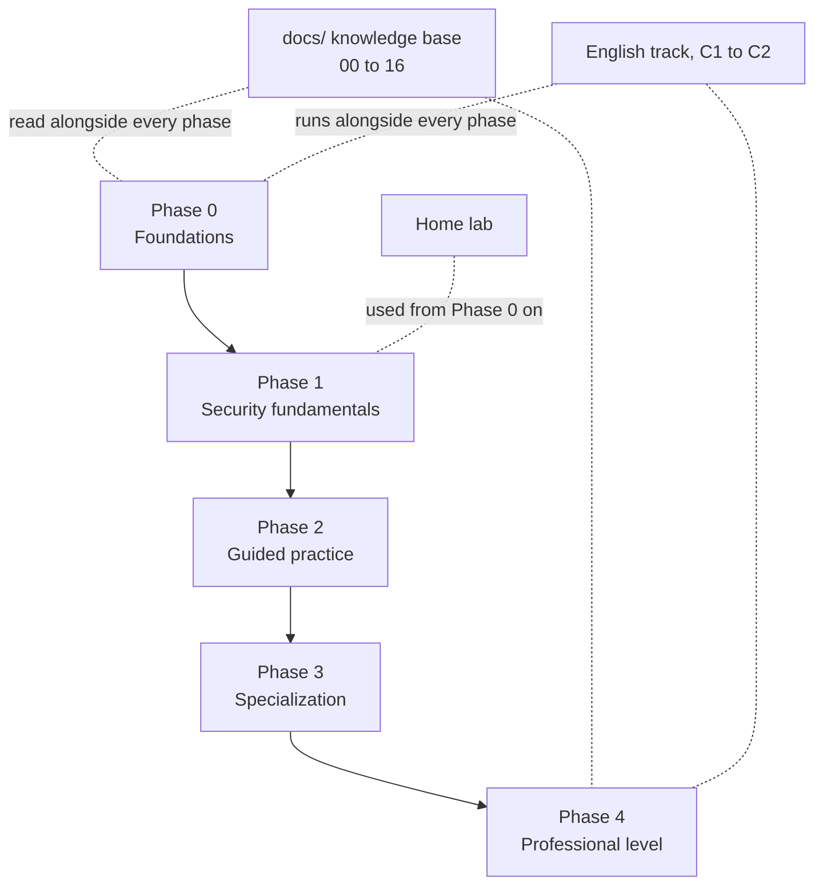

# Cibersecurity Prime

### A verified cybersecurity knowledge base and a week-by-week roadmap, built to run alongside a degree and double as a public portfolio

**Author:** Santiago Lugo Gómez, Cybersecurity Engineering student at the Escuela Colombiana de Ingeniería Julio Garavito, Bogotá, Colombia.

[Start here](docs/00-start-here.md) · [Roadmap](roadmap/README.md) · [Knowledge base](docs/) · [Cheat sheet](docs/cheatsheet.md) · [Glossary](docs/14-glossary.md)

> [!IMPORTANT]
> This repository is two things at once. **[`roadmap/`](roadmap/README.md)** is a week-by-week curriculum, from a Linux terminal to professional certifications, built to fit alongside a full engineering course load. **[`docs/`](docs/00-start-here.md)** is a reference knowledge base covering the field end to end, from first principles to AI application security, Active Directory attacks, cloud IAM and Colombian regulation, with every claim marked by how well-established it is and traced to a source. The two are written to point at each other: the roadmap assigns a week's work; `docs/` is where the full explanation, evidence and depth live. Everything here is free-first, dated, and meant to be re-verified rather than trusted blindly as time passes.

## Quick route

1. **Read [`docs/00-start-here.md`](docs/00-start-here.md).** It is the one-hour setup and the map of this whole repository; nothing else here makes sense without it.
2. **Start [Phase 0 of the roadmap](roadmap/phase-0-foundations/README.md).** Do not skip it; every later phase assumes it, regardless of what you already know.
3. **Build the [home lab](homelab/README.md)** early. Almost everything practical from Phase 1 onward runs there.
4. **Pick your [study load mode](docs/11-learning-and-career/03-study-load-modes.md) honestly, for this week**, and run the four weekly sessions described in [the study system](docs/11-learning-and-career/02-the-study-system.md).
5. **Read the matching `docs/` page behind every week the roadmap assigns.** The roadmap tells you what to do; `docs/` explains why it works and gives you the depth an interview will actually probe.
6. **Write up everything** with the [templates](templates/README.md) and the [writeup template](writeups/README.md). An exercise that is not written up did not happen, for portfolio purposes.
7. **Stay legal and ethical, always.** Read [Legal limits and ethics](docs/01-foundations/05-legal-and-ethics.md) before touching any system you do not own, and run the [OSINT self-audit](docs/11-learning-and-career/06-portfolio-and-writing.md#before-you-publish-an-osint-self-audit) before publishing anything.

## The roadmap, by phase

| Phase | Focus | Duration | Outcome |
|---|---|---|---|
| [Phase 0](roadmap/phase-0-foundations/README.md) | Foundations: Git, Linux, Bash, networking, Python, operating systems, Windows and the home lab | 18 weeks | You work in a terminal, read a packet capture, script, and use Git daily |
| [Phase 1](roadmap/phase-1-security-fundamentals/README.md) | Security fundamentals: principles, cryptography, identity, the OWASP Top 10, network defense, frameworks | 16 weeks | You reason about how systems fail and which control stops each failure |
| [Phase 2](roadmap/phase-2-guided-practice/README.md) | Guided practice: CTFs, wargames, web and network labs, machines, Active Directory, blue team | 20 weeks | You solve machines and challenges and write them up professionally |
| [Phase 3](roadmap/phase-3-specialization/README.md) | Specialization: offensive, defensive, web, malware, cloud, GRC, each sampled then deep-dived | 24 weeks | You have sampled every track and built a capstone in the one you chose |
| [Phase 4](roadmap/phase-4-professional/README.md) | Professional level: certifications, portfolio projects, bug bounty, community, the job search | 12-24 months | You have the evidence employers actually hire on |

Every week in Phases 0 to 2, and every week of a Phase 3 deep dive, runs the same four fixed sessions (read, guided practice, deep practice, English) with check-yourself questions and a concrete deliverable. The format is in [roadmap/README.md](roadmap/README.md); how to run it well is in [the study system](docs/11-learning-and-career/02-the-study-system.md), which is itself built on the evidence in [Learning science](docs/11-learning-and-career/01-learning-science.md).

## The knowledge base

`docs/` is organized in the order most people should read it, numbered 00 through 16. Each page carries a one-line summary, evidence markers on its claims, a hands-on practice section, and a checklist; see [`docs/00-start-here.md`](docs/00-start-here.md) for the full topic-by-topic index.

| # | Section | Covers |
|---|---|---|
| 00 | [Start here](docs/00-start-here.md) | The map of this repository and the one-hour setup |
| 01 | [Foundations](docs/01-foundations/01-what-security-is.md) | What security is, principles, threat modeling, adversaries, Colombian law and ethics |
| 02 | [Systems](docs/02-systems/01-linux-for-security.md) | Linux, Windows internals, Active Directory, memory and exploit mitigations |
| 03 | [Networking](docs/03-networking/01-models-and-addressing.md) | Addressing, TCP/UDP, DNS/HTTP, network defense architecture, traffic analysis |
| 04 | [Cryptography and identity](docs/04-cryptography-and-identity/01-cryptography-foundations.md) | Crypto foundations, PKI, TLS, passwords/MFA, OAuth/sessions, Kerberos/NTLM |
| 05 | [Application security](docs/05-application-security/01-browser-security-model-and-headers.md) | Browser security, the OWASP Top 10:2025, injection/XSS, SSRF, APIs, supply chain, LLM security |
| 06 | [Offensive security](docs/06-offensive-security/01-penetration-testing-methodology.md) | Pentest methodology, recon, exploitation, privilege escalation, AD attacks, red teaming |
| 07 | [Defensive security](docs/07-defensive-security/01-logging-and-telemetry.md) | Logging, detection engineering, SOC/SIEM, incident response, forensics, threat hunting, hardening |
| 08 | [Cloud and infrastructure](docs/08-cloud-and-infrastructure/01-cloud-security-fundamentals.md) | Shared responsibility, cloud IAM attack paths, containers/Kubernetes/IaC |
| 09 | [Malware and reverse engineering](docs/09-malware-and-reverse-engineering/01-malware-landscape.md) | The malware landscape, a safe analysis lab, static/dynamic analysis, reverse engineering |
| 10 | [Governance, risk and compliance](docs/10-governance-risk-and-compliance/01-risk-management.md) | Risk management, frameworks (NIST CSF, ISO 27001...), privacy, the Colombian regulatory landscape |
| 11 | [Learning and career](docs/11-learning-and-career/01-learning-science.md) | Learning science, the study system, study load modes, certifications, portfolio, community |
| 12 | [Measuring progress](docs/12-measuring-progress/01-how-to-measure-progress.md) | How to know you are actually learning, and troubleshooting when something is not working |
| &mdash; | [Myths](docs/13-myths.md) · [Glossary](docs/14-glossary.md) · [References](docs/15-references.md) · [Resources](docs/16-resources.md) · [Cheat sheet](docs/cheatsheet.md) | Common misconceptions corrected, about 180 defined terms, every citation grouped, free learning resources, and a dense quick-reference page |

## Repository map

| Path | What it holds |
|---|---|
| [`docs/`](docs/00-start-here.md) | The reference knowledge base described above |
| [`roadmap/`](roadmap/README.md) | The five phases as week-by-week modules; [`progress.md`](roadmap/progress.md) tracks completion |
| [`homelab/`](homelab/README.md) | Home lab build guide, network diagram, and isolation/snapshot helper scripts |
| [`writeups/`](writeups/README.md) | A writeup template, a complete worked example, and your own published writeups |
| [`templates/`](templates/README.md) | Reusable structures: weekly notes, threat models, detection rules, postmortems, risk registers, pentest reports |
| [`tools/`](tools/README.md) | An offline HTML calculator toolkit and a generated study/lab tracker spreadsheet |
| [`english/`](english/README.md) | Glossary, reading method, report writing (with common Spanish-speaker mistakes), speaking and listening practice |

## How to read the evidence markers

Every non-obvious factual claim in `docs/` carries one of four markers, so you always know how much weight a sentence can bear:

| Marker | Meaning | Example |
|---|---|---|
| **●●●** | Specified or established: a named standard, RFC, law, or a settled, reproducible fact | "AES-GCM is an authenticated encryption mode (NIST SP 800-38D)." |
| **●●○** | Strong consensus among practitioners or vendors, but not a formal standard, or resting on one strong study | "MFA reduces account compromise by over 99% in Microsoft's analysis." |
| **●○○** | Contested, actively evolving, or likely to change soon | "DBSC's rollout to non-Windows platforms was not confirmed at the time of writing." |
| **◇** | A practical recommendation or judgment call this knowledge base makes, not a measured fact | "Prefer Argon2id over PBKDF2 where you control the implementation." |

Where a specific number, date or regulatory detail was genuinely unsettled while this was written (a bill still in the Colombian Congress, a vendor's rollout timeline), the text says so explicitly and points you to the primary source to check yourself, rather than quietly presenting a guess as settled. Every citation behind every marker is collected in [References](docs/15-references.md).

## Ten principles behind this repository

1. **Free first.** Every phase and every topic can be learned with free resources; paid options are listed separately, dated, and never required.
2. **Skill before certificate.** A certification comes after the hands-on practice that justifies it, never before.
3. **Primary sources beat summaries.** Where an RFC, a standard or a vendor's own documentation exists, this knowledge base points to it instead of a blog describing it.
4. **Evidence over assertion.** Every non-obvious claim is marked by how well-established it is and traced to a reference, so you can verify instead of trusting.
5. **Hands-on over theory.** Every concept page ends in practice; reading without doing produces exactly the shallow, overconfident learning [Learning science](docs/11-learning-and-career/01-learning-science.md) warns against.
6. **Write everything down.** If it is not written up, it did not happen, for portfolio purposes or for your own later recall.
7. **Consistency over intensity.** Four steady hours a week for a year outperforms occasional marathons; see [Study load modes](docs/11-learning-and-career/03-study-load-modes.md).
8. **Defense and offense need each other.** Neither is taught here as superior; the strongest practitioners understand both.
9. **English is not optional.** Most of this field's hiring, documentation and community runs in English; this knowledge base is written in it on purpose.
10. **Authorized targets only, always.** Every offensive technique here assumes your own lab or an explicitly authorized target. See the warning below.

> [!WARNING]
> Several pages in this knowledge base describe offensive techniques, malware behavior, and dual-use tools in enough detail to be genuinely useful for attack **or** defense. They are written for the second purpose: authorized security testing, defensive research, and education, consistent with [Legal limits and ethics](docs/01-foundations/05-legal-and-ethics.md). Running anything described here against a system you do not own and are not explicitly, contractually authorized to test is a crime under Colombian law (Ley 1273 de 2009, article 269A and others) and likely under the law of wherever the target sits. "I did not cause damage" and "I was only testing" are not defenses to the offense itself. When in doubt, you are not authorized.

## A note on currency

This repository was researched and written between October and November 2026. Where a fact was likely to change (prices, certification codes, tool versions, regulatory bills, event dates), it is dated in place and marked with the evidence legend above. The field moves fast: treat every external detail as "true when checked," re-verify it on the primary source before you spend money or time on it, and see [Troubleshooting](docs/12-measuring-progress/02-troubleshooting.md) if something here no longer matches reality.

