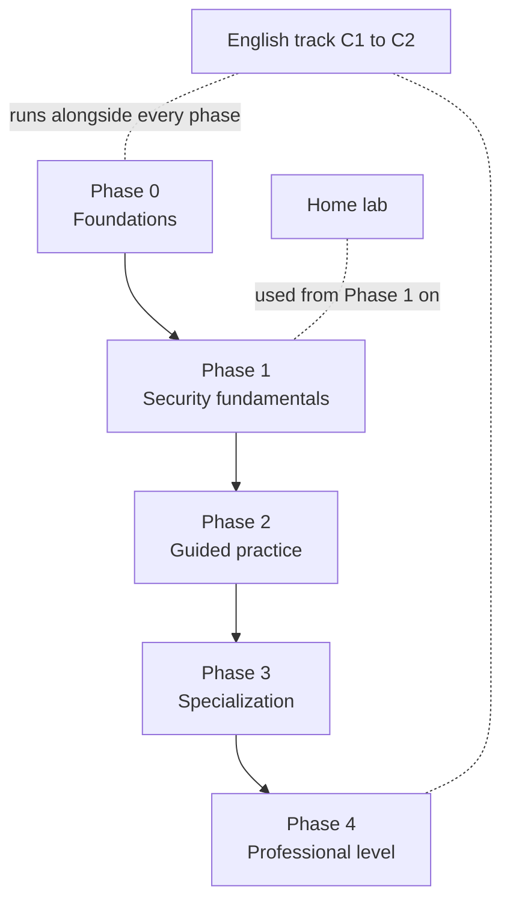

# Cybersecurity Learning Roadmap

A personal, structured path from first-semester fundamentals to professional-level cybersecurity skill, built to run alongside a Cybersecurity Engineering degree and to double as a public portfolio.

**Author:** Santiago Lugo Gómez, Cybersecurity Engineering student at the Escuela Colombiana de Ingeniería Julio Garavito, Bogotá, Colombia.

## What this is

Five phases, from the Linux command line to certifications and bug bounty, each with concrete objectives, prioritized resources (free first), required hands-on practice, a clear mastery checklist and an estimated duration. Around it: a home lab guide, a writeup system, Colombian legal and ethical limits, the regional community, a sustainable weekly plan, and a dedicated track for professional and technical English from C1 to C2.

Every resource, price and link was verified in October 2026. Prices and versions change, so each one is dated and should be reconfirmed before you rely on it.

## How to use this repository

1. **Start at [Phase 0](roadmap/phase-0-foundations/README.md).** Do not skip it; every later phase assumes it.
2. **Work one phase at a time**, following the plan and doing the required practice. Each phase ends with a "you've mastered this when" checklist. Do not advance until you can tick the boxes honestly.
3. **Fit it to your week** with the [weekly plan](weekly-plan.md): a light, sustainable pace during the semester and an intensive pace during breaks.
4. **Reinforce your courses.** [degree-connections.md](degree-connections.md) shows how Linear Algebra, Data Structures, Calculus and networking show up in security, with exercises that cover both at once.
5. **Build the [home lab](homelab/README.md)** early; most practice and all projects run there.
6. **Document everything** with the [writeup template](writeups/TEMPLATE.md). Writeups are how you learn and what employers see.
7. **Run the English track** ([english/](english/README.md)) in parallel from the start.
8. **Track progress** in [progress.md](progress.md) and commit it, so your Git history shows the work.
9. **Stay legal and ethical.** Read [legal-and-ethics.md](legal-and-ethics.md) before touching any system you do not own.

## Roadmap by phase

| Phase | Focus | Duration | Outcome |
|---|---|---|---|
| [Phase 0](roadmap/phase-0-foundations/README.md) | Foundations: Linux, networking, Python, Git, operating systems | ~14 weeks | You can work in a terminal, read a capture, script, and use Git daily |
| [Phase 1](roadmap/phase-1-security-fundamentals/README.md) | Security fundamentals: CIA, cryptography, auth, OWASP Top 10:2025, ATT&CK, NIST CSF 2.0 | ~12 weeks | You can reason about how systems fail and which control stops each failure |
| [Phase 2](roadmap/phase-2-guided-practice/README.md) | Guided practice: CTFs, wargames, web and network labs | ~16 weeks | You can solve easy machines and challenges and write them up professionally |
| [Phase 3](roadmap/phase-3-specialization/README.md) | Specialization: offensive, defensive, web, malware, cloud, GRC | ~20 weeks | You have sampled every track and chosen one, with a deep-dive project |
| [Phase 4](roadmap/phase-4-professional/README.md) | Professional level: certifications, projects, bug bounty, community | 12-24 months | You have evidence employers hire on: certs, projects, findings, visibility |

## Repository map

| Path | What it holds |
|---|---|
| [roadmap/](roadmap/) | The five phases, one folder each; Phase 0 includes runnable exercises |
| [degree-connections.md](degree-connections.md) | How your courses map to security, with exercises |
| [homelab/](homelab/README.md) | Home lab build guide, network diagram and helper scripts |
| [writeups/](writeups/) | Writeup template, a complete worked example, and your own writeups |
| [english/](english/README.md) | Glossary, reading method, report writing, speaking and listening |
| [legal-and-ethics.md](legal-and-ethics.md) | Colombian law (Ley 1273, Ley 1581), authorized practice, disclosure |
| [community.md](community.md) | Conferences, groups and communities in Colombia, Latin America and online |
| [weekly-plan.md](weekly-plan.md) | Sustainable semester plan and intensive break plan |
| [progress.md](progress.md) | Per-phase progress checklists and logs |

## Guiding principles

- **Free first.** Every phase can be completed with free resources. Paid options are listed separately, dated, and never required.
- **Skill before certificate.** Certifications come after the practice that justifies them.
- **Hands-on over theory.** Reading is for enabling practice, not replacing it.
- **Document everything.** If it is not written up, it did not happen.
- **Legal and ethical, always.** Practice only where you are authorized.

## A note on currency

This repository was researched and written in October 2026. Where a fact was likely to change (prices, certification versions, tool releases, event dates), it is dated in place. The field moves fast: treat every external detail as "true when checked" and reconfirm it on the official source before you spend money or time on it.
