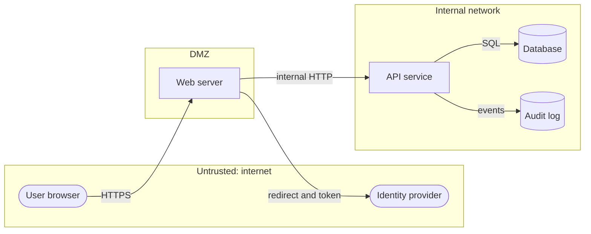

# Threat modeling

> [!TIP]
> **In short:** threat modeling is a structured way to find what can go wrong with a system *before* it does. Draw the system with its trust boundaries, walk each element with **STRIDE**, decide what to do about each threat, and check that you did enough. Four questions drive the whole process, and a useful first model takes one to two hours. The value is not the diagram; it is the list of decisions you made on purpose.

## The four questions

Adam Shostack condensed the practice into four questions (Shostack, 2014), and the Threat Modeling Manifesto adopted the same shape (Threat Modeling Manifesto, 2020). **●●●**

| # | Question | Output |
|---|---|---|
| 1 | What are we working on? | A model of the system: data-flow diagram, assets, entry points, trust boundaries |
| 2 | What can go wrong? | A list of threats, found with STRIDE, attack trees or ATT&CK |
| 3 | What are we going to do about it? | A decision per threat: mitigate, eliminate, transfer or accept |
| 4 | Did we do a good enough job? | Review, tests and a plan to revisit when the design changes |

Run the loop at the smallest scale that makes sense: one feature, one API, one new integration. A model of "the whole company" is never finished and never used.

## Step 1: model the system

The standard representation is the **data-flow diagram (DFD)**. It has only five symbols.

| Element | Meaning | Example |
|---|---|---|
| **External entity** | Someone or something outside your control that interacts with the system | Browser user, payment provider, partner API |
| **Process** | Code that transforms or routes data | Web server, API service, background worker |
| **Data store** | Where data rests | Database, object storage, log file, cache |
| **Data flow** | Data moving between elements | HTTPS request, SQL query, message on a queue |
| **Trust boundary** | A line where the level of trust changes | Internet to DMZ, application to database, tenant A to tenant B |

Trust boundaries are the most valuable part of the diagram. Most serious threats occur where data crosses one, because that is where one party's assumptions meet another's input.

A minimal web application looks like this:



Also write down the **assets** next to the diagram (customer records, session tokens, the signing key) and the **entry points** (every place an outsider can send data in). If you cannot list the entry points, you cannot protect them.

## Step 2: find what can go wrong

### STRIDE

STRIDE is a mnemonic for six threat categories, created at Microsoft in the late 1990s (Kohnfelder and Garg, 1999). Each category violates a security property.

| Letter | Threat | Property violated | Example | Typical mitigation |
|---|---|---|---|---|
| **S** | Spoofing | Authenticity | Logging in with a stolen token; forged sender address | Strong authentication, signatures, certificate validation |
| **T** | Tampering | Integrity | Modifying a price in a request; altering a log | Integrity checks, server-side validation, write controls |
| **R** | Repudiation | Accountability | "I never approved that transfer" | Audit logs, signed actions, trusted timestamps |
| **I** | Information disclosure | Confidentiality | Verbose errors; open storage bucket; unencrypted traffic | Encryption, access control, error handling |
| **D** | Denial of service | Availability | Request flooding; expensive query on demand | Rate limiting, quotas, capacity, caching |
| **E** | Elevation of privilege | Authorization | User becomes admin by editing a parameter | Authorization checks, least privilege, input validation |

**STRIDE per element.** Not every threat applies to every symbol. Apply the categories as follows:

| Element | S | T | R | I | D | E |
|---|---|---|---|---|---|---|
| External entity | x | | x | | | |
| Process | x | x | x | x | x | x |
| Data store | | x | x* | x | x | |
| Data flow | | x | | x | x | |

\* Repudiation applies to data stores that hold logs.

Walk the diagram element by element, asking each applicable question out loud. For the web application above, the data flow from the browser to the web server raises tampering ("can the request be changed in transit or by the client?"), information disclosure ("is it encrypted, and what appears in URLs and logs?") and denial of service ("what is the cost of one request?").

### Attack trees

An attack tree puts the attacker's goal at the root and breaks it into sub-goals combined with AND and OR (Schneier, 1999). **●●○** Attach a cost or difficulty to each leaf, and the cheapest path from leaf to root shows where the attacker will actually go.

```
Goal: read another user's invoices
|-- OR: obtain their credentials
|   |-- phish the user
|   |-- reuse a password from another breach
|-- OR: bypass authorization
|   |-- change the invoice ID in the request (IDOR)
|   |-- find an admin endpoint without a role check
|-- OR: read the database directly
    |-- AND: reach the database network AND obtain a valid credential
```

Trees are good for a single high-value goal; STRIDE is better for broad coverage. They complement each other.

### Other lenses

- **ATT&CK-driven.** For an existing environment, walk the tactics of MITRE ATT&CK and ask which techniques apply and whether you would detect them (see [Adversaries and attack frameworks](04-adversaries-and-attack-frameworks.md)).
- **LINDDUN** is the privacy counterpart of STRIDE: linking, identifying, non-repudiation, detecting, data disclosure, unawareness, non-compliance (Deng et al., 2011). Use it when personal data is central.
- **PASTA** is a risk-centric, seven-stage process that starts from business objectives. It is heavier than STRIDE and suits larger programs.
- **DREAD** (damage, reproducibility, exploitability, affected users, discoverability) is an older scoring scheme. It produces inconsistent scores and is no longer recommended; rate threats with a plain high, medium or low and a one-line reason.

## Step 3: decide what to do

Every threat needs an explicit decision.

| Response | Meaning | Example |
|---|---|---|
| **Mitigate** | Reduce likelihood or impact with a control | Add rate limiting and MFA to the login |
| **Eliminate** | Remove the feature or data that creates the threat | Stop storing card numbers; use the provider's tokens |
| **Transfer** | Move the risk to a party better placed to bear it | Use a payment processor; buy cyber insurance |
| **Accept** | Consciously live with it, with an owner and a review date | Low-impact threat on an internal tool |

"We will think about it later" is not a response. Write the decision, the owner and the date.

## A worked example: password reset

Feature: a user who forgot their password enters their email address and receives a link to set a new one.

| Threat | STRIDE | Why it matters | Mitigation |
|---|---|---|---|
| Attacker requests a reset for a victim's address and intercepts the email | S | Account takeover | Short-lived, single-use link; notify the owner; do not auto-login after reset |
| Reset token is guessable or reused | S, E | Takeover at scale | Token from a cryptographically secure random generator, at least 128 bits, stored hashed, single-use, expiring in minutes |
| Different responses for known and unknown emails | I | Lets attackers enumerate accounts | Same message and similar response time in both cases |
| Token leaks through the `Referer` header or access logs | I | Lets a third party use the link | Send a `Referrer-Policy` header; do not log full URLs with tokens; exchange the token for a session on first use |
| Attacker floods an address with reset emails | D | Harassment and cost | Rate limit per account and per source |
| Old sessions stay valid after the password changes | E | Attacker keeps access | Revoke all sessions and tokens on reset |
| No record of who requested the reset | R | No evidence in an investigation | Log request, delivery and use with source address |

This took ten minutes and produced seven concrete requirements, which is the usual ratio. The same exercise on the password reset flow of a real site is a good first project (see [Module 1.1](../../roadmap/phase-1-security-fundamentals/01-principles-threat-modeling.md)).

## Step 4: check your work

- **Review.** Have someone who did not draw the diagram read it. They will find the unstated assumption.
- **Test.** Turn each mitigation into a test case or a detection. A mitigation without a test is a hope.
- **Track.** Put the actions in the same backlog as other work. A threat model that lives in a slide deck dies there.
- **Revisit.** Update the model when the architecture, data or exposure changes. Tie it to design reviews so it happens by default.

## Common mistakes

| Mistake | Why it hurts | Fix |
|---|---|---|
| Starting after the system is built | Fixes become expensive redesigns | Model at design time, even roughly |
| Drawing everything | The model is never finished | One feature or one flow at a time |
| Skipping trust boundaries | Misses the places where threats concentrate | Draw them first, then the elements |
| Security team does it alone | They do not know the system's real behavior | Include the developers and operators who run it |
| Listing threats without decisions | Nothing changes | Every threat gets mitigate, eliminate, transfer or accept |
| Treating it as a one-time document | It goes stale | Revisit at each significant change |

## Tools

You do not need special software to start. A whiteboard, or a diagram in draw.io or Mermaid, is enough. When you want structure and a record, **OWASP Threat Dragon** is a free, open-source tool for DFD-based models, and **OWASP pytm** lets you define a model in Python so it can live in version control. The OWASP *Threat Modeling Cheat Sheet* is a good short reference.

## What to do with this

- [ ] Draw a data-flow diagram of a small application you know, with trust boundaries.
- [ ] Apply STRIDE per element and list at least ten threats.
- [ ] For your three most serious threats, write the response, owner and review date.
- [ ] Turn two mitigations into concrete tests you can run in your lab.
- [ ] Do the full exercise in [Module 1.1](../../roadmap/phase-1-security-fundamentals/01-principles-threat-modeling.md).

## Key references

Deng et al. (2011) · Kohnfelder and Garg (1999) · NIST SP 800-30 Rev. 1 · OWASP Threat Modeling Cheat Sheet · Schneier (1999) · Shostack (2014) · Threat Modeling Manifesto (2020). Full list in [References](../15-references.md).

<!-- navigation -->
[← Security principles](02-security-principles.md) · [Index](../00-start-here.md) · [Adversaries and attack frameworks →](04-adversaries-and-attack-frameworks.md)
