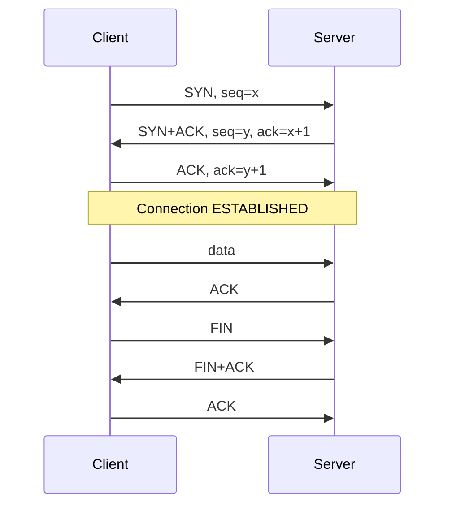

# TCP, UDP, ICMP and routing

> [!TIP]
> **In short:** the transport layer turns "deliver this packet" into "talk to this service". **TCP** gives you a reliable, ordered connection after a three-way handshake; **UDP** just sends datagrams and leaves the rest to the application. Ports identify services, and a scanner learns which are open by how a host answers. Spoofable UDP is the engine of amplification DDoS; unauthenticated TCP state is why encryption matters. If you can read a handshake and a port-scan response in a capture, you understand most of what network tools do.

## Ports and sockets

A **port** is a 16-bit number that identifies a service on a host. A connection is identified by five values, the **5-tuple**: source IP, source port, destination IP, destination port and protocol. A server listens on a known port; a client uses a temporary (ephemeral) source port.

| Range | Name | Use |
|---|---|---|
| 0 to 1023 | Well-known | Standard services; on Unix binding them needs privilege |
| 1024 to 49151 | Registered | Applications and databases |
| 49152 to 65535 | Dynamic / ephemeral (IANA) | Client source ports (Linux defaults to 32768 to 60999) |

### Ports worth knowing

The point is not to memorize a list; it is to recognize in a scan what deserves attention.

| Port | Service | Note for defenders and testers |
|---|---|---|
| 21 | FTP | Cleartext; often anonymous or weak |
| 22 | SSH | Brute force target; keep key-only |
| 23 | Telnet | Cleartext remote shell; should not exist |
| 25, 465, 587 | SMTP, submission | Mail relay; spoofing and open-relay checks |
| 53 | DNS (UDP and TCP) | Zone transfers, amplification, tunneling |
| 67 / 68 | DHCP | Rogue server risk |
| 80, 443, 8080, 8443 | HTTP, HTTPS, alternates | The web attack surface |
| 88 | Kerberos | Marks a domain controller |
| 110, 143, 993, 995 | POP3, IMAP and their TLS variants | Mail access |
| 123 | NTP | Amplification; time matters for Kerberos |
| 135, 139, 445 | RPC, NetBIOS, SMB | Windows file sharing and remote management; lateral movement and ransomware spread |
| 161 | SNMP | Default community strings leak configuration |
| 389, 636, 3268 | LDAP, LDAPS, global catalog | Directory access |
| 1433, 1521, 3306, 5432 | SQL Server, Oracle, MySQL, PostgreSQL | Databases should not face the internet |
| 3389 | RDP | Heavily brute-forced; never expose directly |
| 5900 | VNC | Often weakly authenticated |
| 5985 / 5986 | WinRM | Windows remote management |
| 6379, 9200, 27017 | Redis, Elasticsearch, MongoDB | A long history of exposed, unauthenticated instances |

## TCP

**TCP** provides a reliable, ordered byte stream between two endpoints. It does so with a connection setup, sequence numbers, acknowledgements and retransmission.

### Header fields that matter

| Field | Purpose |
|---|---|
| Source and destination port | Identify the service endpoints |
| **Sequence number** | Position of this segment's first byte in the stream |
| **Acknowledgement number** | The next byte the sender expects to receive |
| **Flags** | `SYN` (synchronize), `ACK` (acknowledge), `FIN` (finish), `RST` (reset), `PSH` (push), `URG` (urgent) |
| Window | How much data the receiver can accept |
| Options | Maximum segment size, window scaling, selective ACK, timestamps (also useful for OS fingerprinting) |

### The three-way handshake



Each side chooses a random **initial sequence number**. If they were predictable, an attacker who could not see the traffic could still forge packets that the receiver would accept; this was demonstrated in the 1980s and is the reason modern stacks randomize them (Bellovin, 1989; RFC 6528). **●●●** Connections end with a four-step FIN exchange or are aborted instantly by a segment with `RST`.

### Connection states

`ss -tan` (Linux) and `netstat -ano` (Windows) show these states.

| State | Meaning | What it tells you |
|---|---|---|
| `LISTEN` | Waiting for connections | A service is exposed |
| `SYN-SENT`, `SYN-RECV` | Handshake in progress | Many `SYN-RECV` indicates a SYN flood |
| `ESTABLISHED` | Open connection | Who is talking to whom |
| `FIN-WAIT`, `CLOSE-WAIT`, `LAST-ACK` | Teardown | A pile of `CLOSE-WAIT` often means an application is leaking sockets |
| `TIME-WAIT` | Waiting to make sure the last ACK was received | Normal on busy clients and proxies |

### Attacks on TCP

| Attack | Mechanism | Defense |
|---|---|---|
| **SYN flood** | Send many SYNs, never complete the handshake, exhaust the server's half-open connection table | SYN cookies (the server encodes state in the sequence number instead of storing it), larger backlogs, rate limits, upstream scrubbing |
| **RST injection / connection reset** | Forge a RST with a valid-looking sequence number to kill a connection | Randomized sequence numbers; encryption does not stop resets but limits what else can be done |
| **Session hijacking** | Take over an established connection by injecting data | TLS, which authenticates and protects the stream; random sequence numbers |
| **Port scanning** | Probe ports to map services | Not an attack by itself, but a precursor; firewalls and rate limits |
| **Slow attacks** (Slowloris) | Open many connections and send data very slowly to hold server resources | Connection timeouts, reverse proxies, limits per source |

## UDP

**UDP** adds only ports and a checksum to IP: an 8-byte header and nothing else. There is no handshake, no retransmission and no ordering. That makes it fast and simple, and it is what DNS, DHCP, NTP, SNMP, syslog, VoIP and the QUIC protocol (HTTP/3) use. Applications built on UDP must do their own reliability and, usually, their own security.

### Why UDP is the DDoS workhorse

Because there is no handshake, a sender can put **any source address** in a UDP datagram. An attacker sends a small request to many open servers with the victim's address as the source, and the servers send their (much larger) responses to the victim. This is a **reflection and amplification** attack. The *amplification factor* is the ratio of response size to request size.

| Protocol | Approximate amplification | Note |
|---|---|---|
| DNS (open resolvers, large records) | about 30 to 50 times | Mitigate with response rate limiting, closing open resolvers |
| NTP (`monlist` command) | up to about 550 times | Led to disabling `monlist` (US-CERT, 2014) |
| SSDP, CLDAP, SNMP | tens of times | Devices exposed by default |
| Memcached over UDP | tens of thousands of times | Used in the record 1.35 Tbps attack on GitHub in February 2018 |

**●●○** (figures vary by measurement). The defenses are mostly operational: do not expose these services to the internet, disable UDP where it is not needed, and let networks apply **ingress filtering** so that spoofed packets are dropped at their source (BCP 38, RFC 2827; see also RFC 3704). Large attacks are absorbed by upstream providers and CDNs with scrubbing capacity.

## ICMP

**ICMP** carries control and error messages for IP. It is not a transport protocol and has no ports; it uses types and codes.

| Type | Meaning | Use |
|---|---|---|
| 8 / 0 | Echo request / reply | `ping` |
| 3 | Destination unreachable (code 3 = port unreachable, code 4 = fragmentation needed) | Tells a sender why delivery failed; used in UDP scanning and path MTU discovery |
| 11 | Time exceeded | Basis of `traceroute`: probes are sent with increasing TTL and each router that discards one answers |
| 5 | Redirect | Suggests a better route; hosts should ignore it, since it can be abused to reroute traffic |

Do not block ICMP wholesale. Path MTU discovery depends on "fragmentation needed" messages, and blocking them causes mysterious stalls on large transfers. Filter by type instead. ICMP can also be abused as a covert channel (data hidden in echo payloads), which is why unusual ICMP volume and payload sizes are worth monitoring.

## Fragmentation and MTU

Ethernet carries up to 1,500 bytes of IP payload (the MTU), so TCP's maximum segment size is typically 1,460 bytes. Larger packets are either fragmented or, with the Don't Fragment flag set, dropped with an ICMP message. Fragmentation has a long history of security issues, from the 1990s "teardrop" and "ping of death" bugs to firewall and IDS evasion by splitting a payload across fragments, so modern devices reassemble before inspecting.

## Routing

A host sends packets for its own subnet directly and everything else to its default gateway. A router forwards a packet using the **longest matching prefix** in its routing table, and decrements the TTL (IPv4) or hop limit (IPv6). Internal routing uses protocols such as OSPF. The internet joins thousands of autonomous systems with **BGP**, which is built on trust: a network can announce that it is the path to a prefix and neighbors usually believe it.

| Incident | What happened |
|---|---|
| **Pakistan Telecom and YouTube, 2008** | An ISP announced a more specific prefix to block YouTube domestically; it leaked to the internet and diverted much of YouTube's traffic for hours |
| **MyEtherWallet, 2018** | Attackers announced the prefixes of an Amazon DNS service and answered with forged DNS records for a cryptocurrency site |

The main mitigation is **RPKI route origin validation**: prefix owners publish signed records stating which AS may originate their prefixes, and networks drop announcements that do not match (RFC 6480, RFC 6811). **●●●** Adoption has grown but is not universal.

## Seeing it on your own machine

```bash
ss -tan                    # TCP sockets and states
ss -uan                    # UDP sockets
sudo tcpdump -i eth0 -nn 'tcp[tcpflags] & tcp-syn != 0'   # SYNs only
traceroute -n 203.0.113.10
```

```powershell
Get-NetTCPConnection -State Established | Group-Object RemoteAddress | Sort Count -Descending
Test-NetConnection 203.0.113.10 -Port 443
```

### How a port scanner reads the answers

| Probe | Response | Port state |
|---|---|---|
| TCP SYN | SYN+ACK | **Open** |
| TCP SYN | RST | **Closed** |
| TCP SYN | Nothing, or ICMP "administratively prohibited" | **Filtered** (a firewall is dropping it) |
| UDP datagram | Application reply | Open |
| UDP datagram | ICMP port unreachable | Closed |
| UDP datagram | Nothing | Open or filtered (ambiguous, so UDP scans are slow) |

Detecting scanning is the reverse: a single source touching many ports or hosts, a burst of SYNs with no completed handshakes, or a large number of RSTs. See [Traffic analysis and scanning](05-traffic-analysis-and-scanning.md).

## Denial of service in three families

| Family | Example | Resource exhausted | Typical response |
|---|---|---|---|
| **Volumetric** | UDP floods, amplification | Bandwidth | Upstream scrubbing, anycast CDNs |
| **Protocol** | SYN flood | State tables, CPU on devices | SYN cookies, firewall limits |
| **Application** | HTTP request floods, expensive queries | Application threads, database | Rate limiting, caching, WAF, bot management |

In October 2016, the Mirai botnet of compromised cameras and routers flooded the DNS provider Dyn and made many popular sites unreachable. It did not need a new exploit: the devices had default credentials (see [Security principles](../01-foundations/02-security-principles.md)). **●●●**

## What to do with this

- [ ] Draw a TCP handshake and teardown from memory, with flags and sequence numbers.
- [ ] Capture one connection to a local web server in Wireshark and identify every phase.
- [ ] Run a SYN scan and a connect scan of your lab host and compare them in a capture.
- [ ] Explain, in two sentences each, why UDP enables amplification and why TLS prevents hijacking.
- [ ] Write a Python TCP client and server with the `socket` module, as in [Module 0.4, week 7](../../roadmap/phase-0-foundations/04-networking.md).

## Key references

Bellovin (1989) · RFC 768 · RFC 792 · RFC 2827 · RFC 3704 · RFC 6480 · RFC 6528 · RFC 6811 · RFC 9293 · US-CERT TA14-017A. Full list in [References](../15-references.md).

<!-- navigation -->
[← Network models and addressing](01-models-and-addressing.md) · [Index](../00-start-here.md) · [DNS, HTTP and the web stack →](03-dns-http-and-the-web-stack.md)
