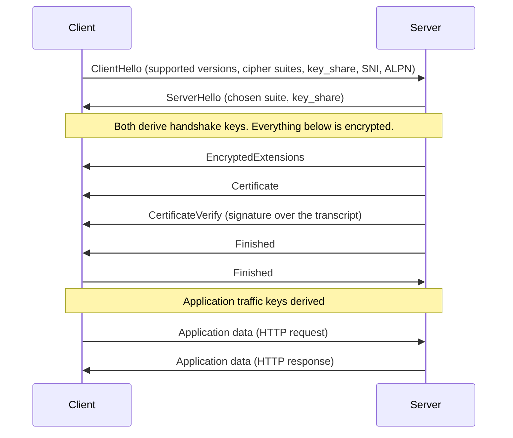

# TLS in depth

> [!TIP]
> **In short:** TLS is the protocol that makes HTTPS, secure email, many APIs and VPNs work. It gives you an **encrypted, integrity-protected channel** to a server you have **authenticated** by its certificate. **TLS 1.3** (RFC 8446) is the version to run: one round trip, mandatory forward secrecy, only authenticated encryption, and most of the handshake encrypted. Disable TLS 1.0 and 1.1, follow a maintained configuration profile, test it, and understand the history of attacks, because each removed feature in TLS 1.3 corresponds to a break.

## What TLS does and does not do

| TLS provides | TLS does not provide |
|---|---|
| **Confidentiality** of the data in transit | Protection of the endpoints: malware on the client or an injection bug on the server is untouched |
| **Integrity**: tampering is detected | Hiding **metadata**: IP addresses, packet sizes, timing, and (without ECH) the server name are visible |
| **Authentication** of the server, and optionally of the client | Trust in the *organization*: a valid certificate shows that a CA validated a name, not that the site is honest. Phishing sites have valid certificates |

**Practical implication:** the padlock means "the connection to this name is encrypted". It does not mean "this site is safe".

## Versions

| Version | Year | Status |
|---|---|---|
| SSL 2.0, SSL 3.0 | 1995, 1996 | Broken; do not enable (POODLE broke SSL 3.0 in 2014) |
| TLS 1.0 | 1999 | Deprecated (RFC 8996, 2021) |
| TLS 1.1 | 2006 | Deprecated (RFC 8996, 2021) |
| **TLS 1.2** (RFC 5246) | 2008 | Still widely used; safe if configured with ECDHE and AEAD suites |
| **TLS 1.3** (RFC 8446) | 2018 | The current version; use it wherever possible |

DTLS is TLS for datagrams (UDP), and QUIC (the transport under HTTP/3) integrates TLS 1.3. **●●●**

## The TLS 1.3 handshake

TLS 1.3 completes in one round trip.



1. **ClientHello.** The client lists the versions, cipher suites and key-exchange groups it supports and, to save a round trip, sends its **key share** (an ephemeral public key) for the group it expects the server to choose. It also sends the server name (SNI) and the application protocols it speaks (ALPN, for example `h2`).
2. **ServerHello.** The server picks the parameters and sends its own ephemeral key share. At this point both sides can compute the same shared secret.
3. **Key derivation.** The shared secret goes through **HKDF** to produce separate keys for the handshake and, later, for application data. After this point everything is encrypted.
4. **Server authentication.** The server sends its certificate chain and a **CertificateVerify**: a signature over the entire handshake transcript with the key in the certificate. This proves it possesses the private key and binds the authentication to this handshake.
5. **Finished.** Each side sends a MAC over the transcript, confirming that nothing was altered, including the negotiation (this is what blocks downgrade attacks).
6. **Application data** flows under keys that depend on the whole handshake.

Compare the older TLS 1.2 flow, which took two round trips, sent the certificate in clear text, and allowed key exchange methods without forward secrecy. The best companion to this page is *The Illustrated TLS 1.3 Connection*, which shows every byte of a real handshake ([resources](../16-resources.md)).

### What TLS 1.3 removed

| Removed | Why |
|---|---|
| RSA key transport (the client encrypts the secret to the server's certificate key) | No forward secrecy: later theft of the key decrypts recorded traffic |
| Static Diffie-Hellman | Same problem |
| CBC mode, RC4, 3DES | Padding-oracle and bias attacks; weak block size |
| SHA-1 and MD5 in signatures | Collisions |
| Compression | CRIME-style side channels |
| Renegotiation | A long history of vulnerabilities |
| Custom or weak Diffie-Hellman groups | Logjam |

What is left is small: five cipher suites, all AEAD. **●●●**

| TLS 1.3 cipher suite | Notes |
|---|---|
| `TLS_AES_128_GCM_SHA256` | Mandatory to implement |
| `TLS_AES_256_GCM_SHA384` | Common |
| `TLS_CHACHA20_POLY1305_SHA256` | Fast without AES hardware |
| `TLS_AES_128_CCM_SHA256`, `TLS_AES_128_CCM_8_SHA256` | Rare; constrained devices |

Key exchange groups include `x25519`, `secp256r1`, `secp384r1` and, as deployed since 2024, the hybrid **X25519MLKEM768** for post-quantum protection (see [Public-key cryptography and PKI](02-public-key-cryptography-and-pki.md)).

### Forward secrecy

If every session uses a fresh ephemeral key pair, the long-term certificate key is used only for authentication, not for deriving secrets. An attacker who records traffic today and steals the server's private key next year cannot decrypt the recordings. TLS 1.3 requires this; in TLS 1.2 you get it only by choosing `ECDHE` suites. **●●●**

### Resumption and 0-RTT

After a handshake, the server can issue a **session ticket** so the client can resume later without a full handshake. TLS 1.3 also allows **0-RTT early data**: the client sends application data in its first flight when resuming. This is fast but **replayable**: an attacker who records the first flight can send it again. Allow 0-RTT only for idempotent requests (reads), or not at all, and rotate ticket keys. **●●●**

### The server name: SNI and ECH

The **Server Name Indication** tells the server which site the client wants, so one IP address can host many sites. It is sent in the clear in the ClientHello, so a network observer sees the hostnames you visit even though the content is encrypted. **Encrypted Client Hello (ECH)**, standardized as RFC 9849 in March 2026, encrypts the inner ClientHello with a key the site publishes in DNS (HTTPS resource records, RFC 9460). Deployment is growing, mainly through large CDNs. **●●○**

For defenders, ECH removes one of the most useful passive signals (the destination name). That moves detection toward endpoint, DNS-resolver and identity data.

## Attacks that shaped the protocol

Each of these explains a design choice. Know the one-line cause of each.

| Attack (year) | Target | Cause | Fixed or avoided by |
|---|---|---|---|
| **BEAST** (2011) | TLS 1.0 CBC | Predictable IV | TLS 1.1+, AEAD |
| **CRIME / BREACH** (2012, 2013) | Compression | Compressed length leaks secrets mixed with attacker-controlled text | Disable TLS compression; mitigate HTTP-level compression of secrets |
| **Lucky13** (2013) | CBC MAC-then-encrypt | Timing differences in padding checks | AEAD |
| **POODLE** (2014) | SSL 3.0 | Padding not covered by the MAC | Disable SSL 3.0; downgrade protection |
| **Heartbleed** (2014) | OpenSSL | Missing bounds check in the heartbeat extension (an implementation bug, not a protocol flaw) | Patching; re-issue keys |
| **FREAK** (2015) | Export-grade RSA | Servers accepted deliberately weak "export" cipher suites | Remove export suites |
| **Logjam** (2015) | Weak DH groups | Servers used 512-bit or shared 1024-bit groups | Strong groups (2048+), ECDHE |
| **DROWN** (2016) | SSLv2 | A server supporting SSLv2 exposed other TLS keys on the same key | Disable SSLv2 everywhere |
| **Sweet32** (2016) | 64-bit block ciphers | Birthday collisions after about 2^32 blocks | Drop 3DES |
| **ROBOT** (2017) | RSA key exchange | Bleichenbacher-style padding oracle in implementations | Remove RSA key exchange (done in 1.3) |
| **Raccoon** (2020) | DH in TLS 1.2 | Timing leak in handling of the shared secret | TLS 1.3, ephemeral keys |

The lesson that repeats: **optional legacy features create downgrade paths**, and attackers use whichever weak option is still enabled.

## Configuring TLS properly

Use a maintained profile rather than composing cipher lists yourself. Mozilla's *Server Side TLS* guidelines and its configuration generator publish three profiles. **●●○**

| Profile | Protocols | When |
|---|---|---|
| **Modern** | TLS 1.3 only | You control all clients |
| **Intermediate** | TLS 1.2 and 1.3, ECDHE with AEAD suites | **The default recommendation** |
| **Old** | TLS 1.0 to 1.3 | Only for legacy clients you must support |

A checklist for a web server:

- Enable TLS 1.3 and TLS 1.2 only; disable older versions and compression.
- Use ECDHE key exchange and AEAD ciphers (AES-GCM, ChaCha20-Poly1305).
- Use RSA keys of 2048 bits or more, or ECDSA P-256.
- Send **HSTS** (`Strict-Transport-Security`) once everything works over HTTPS, and consider preload.
- Serve the full certificate chain; automate renewal (ACME).
- Rotate session ticket keys regularly; consider disabling 0-RTT.
- Redirect HTTP to HTTPS and avoid mixed content.

### Testing

```bash
# What does the server negotiate?
openssl s_client -connect example.com:443 -servername example.com -tls1_3 </dev/null
openssl s_client -connect example.com:443 -servername example.com -tls1_2 </dev/null

# Which versions and ciphers are enabled? (lab or authorized targets)
nmap --script ssl-enum-ciphers -p 443 example.com
testssl.sh example.com
sslyze example.com
```

Public scanners such as the Qualys SSL Labs server test are convenient for sites you own or are permitted to test. Treat the output as a to-do list: remove weak protocols, fix the chain, enable HSTS.

## Watching TLS

You cannot read encrypted content, but you can learn a lot.

| Observable | What it tells you |
|---|---|
| Server name (SNI, if not ECH) | Where the client is going |
| Certificate (in TLS 1.2 or on the endpoint) | Issuer, validity, SANs; self-signed or very new certificates deserve suspicion |
| Protocol version and ciphers | Outdated clients or downgrade attempts |
| **JA3 / JA4 fingerprints** | Hashes of the ClientHello fields identify the client software (a browser, a scripting library, a known malware family) without decrypting anything |
| Volume and timing | Beaconing, uploads, and sessions that look automated |

For your own traffic, you can decrypt captures in Wireshark by exporting session keys from the client: set the `SSLKEYLOGFILE` environment variable before starting a browser or curl, then point Wireshark to that file under *TLS preferences, (Pre)-Master-Secret log filename*. This is invaluable for learning and for debugging your applications. **●●●**

### Interception

Organizations sometimes decrypt traffic at a gateway: the device presents certificates signed by an internal CA that is installed on managed endpoints. It gives visibility into malware but creates a high-value target, can weaken security if done badly, and has legal and privacy implications. If you see an unexpected issuer on an unmanaged device, assume interception or an attack.

## TLS in code

Most TLS vulnerabilities in applications are not in the protocol but in how it is called.

| Mistake | Fix |
|---|---|
| Turning off certificate or hostname verification | Keep the defaults; add your CA to the trust store if needed |
| Forcing an old protocol version or custom cipher list | Use the library's secure defaults and updates |
| Accepting any certificate for internal services | Use a private CA and verify against it |
| Storing private keys alongside code or in images | Use a secrets manager or hardware-backed key |
| Not validating client certificates properly in mTLS | Verify chain, expiry and identity mapping |
| Mixing HTTP and HTTPS | HSTS, redirects, and `Secure` cookies |

For service-to-service traffic, **mutual TLS (mTLS)** authenticates both ends with certificates and is the basis of service meshes and zero trust designs. It moves the problem to certificate issuance and rotation, which short-lived, automatically issued certificates solve.

## What to do with this

- [ ] Capture a TLS 1.3 handshake and label every message against *The Illustrated TLS 1.3 Connection*.
- [ ] Set `SSLKEYLOGFILE`, browse a site, and decrypt the capture in Wireshark.
- [ ] Run `testssl.sh` against a server in your lab and fix two findings.
- [ ] Generate a Mozilla "Intermediate" configuration for a web server and apply it.
- [ ] Explain, in one sentence each, the cause of Heartbleed, POODLE and Logjam.
- [ ] Do the TLS 1.3 explainer in [Module 1.2, week 5](../../roadmap/phase-1-security-fundamentals/02-applied-cryptography.md).

## Key references

Althouse et al. (2017) · Mozilla Server Side TLS · Qualys SSL Labs · RFC 5246 · RFC 8446 · RFC 8996 · RFC 9000 · RFC 9460 · RFC 9849. Full list in [References](../15-references.md).

<!-- navigation -->
[← Public-key cryptography and PKI](02-public-key-cryptography-and-pki.md) · [Index](../00-start-here.md) · [Passwords and multi-factor authentication →](04-passwords-and-mfa.md)
