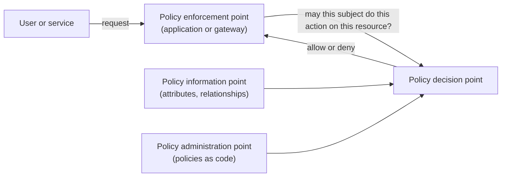
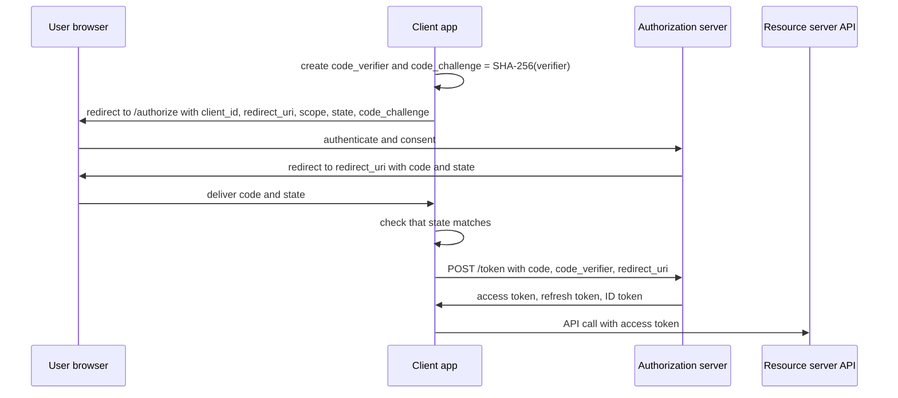

# Authorization, sessions and federation

> [!TIP]
> **In short:** authentication asks *who are you?*; authorization asks *what may you do?*. Most real access-control failures are authorization bugs: the application checks that you are logged in, but not that the object you asked for is yours. A **session** turns one login into thousands of requests, so the session token becomes the thing attackers steal. **Federation** (OAuth 2.0, OpenID Connect, SAML) lets one identity provider vouch for you elsewhere, and each protocol has a short list of well-known mistakes: loose redirect URIs, missing PKCE, unvalidated tokens, and trusting an email address as an identity.

## The three questions

| Question | Name | Failure looks like |
|---|---|---|
| Who are you? | **Authentication** (authn) | Stolen or guessed credentials, bypassed MFA |
| What may you do? | **Authorization** (authz) | Reading another user's data, calling an admin endpoint |
| What did you do? | **Accounting** or audit | No log, or a log nobody can trust |

Authentication happens once per session; authorization must happen on **every request**, for **every object**. Mixing the two up is the root of the most common web vulnerability class: in the OWASP Top 10:2025, Broken Access Control is ranked first (A01). **●●●**

| Term | Meaning |
|---|---|
| **Principal** | Any actor that can be authenticated: a person, a service, a device |
| **Credential** | Proof offered to authenticate: password, key, certificate, token |
| **Session** | Server-side state, or a token, that links later requests to an authenticated principal |
| **Token** | A string that represents authority (access token, refresh token, ID token, session ID) |
| **Claim** | A statement about a subject inside a token (`sub`, `email`, `scope`) |
| **Assertion** | A signed statement from an identity provider (SAML term) |
| **Scope** | A named slice of permission an access token carries (`invoices:read`) |
| **Role / permission** | A named set of permissions / a single allowed action on a resource |

## Access control models

| Model | Who decides | Idea | Strength | Weakness | Seen in |
|---|---|---|---|---|---|
| **DAC** (discretionary) | The resource owner | Owners grant rights to others | Flexible, simple | Owners make mistakes; malware inherits the user's rights | Unix permissions, file shares, "anyone with the link" sharing |
| **MAC** (mandatory) | A central policy | Labels on subjects and objects that users cannot override | Contains mistakes and compromised processes | Rigid, heavy to administer | SELinux, AppArmor, Windows Mandatory Integrity Control, military classification |
| **RBAC** (role-based) | Administrators | Permissions attach to roles; users receive roles | Easy to audit; matches job functions | Role explosion; coarse; weak for per-object rules | Kubernetes RBAC, Azure RBAC, most business applications |
| **ABAC** (attribute-based) | A policy engine | Decision from attributes of subject, resource, action and environment | Fine-grained; context-aware (device, time, location) | Complex policies; hard to answer "who can reach X?" | AWS IAM conditions and tags, Conditional Access, XACML, OPA, Cedar |
| **ReBAC** (relationship-based) | A graph of relationships | "Editors of a folder can edit its documents" | Natural for sharing and hierarchies | Needs a dedicated relationship store | Google Zanzibar (Pang et al., 2019), SpiceDB, OpenFGA |
| **Capabilities** | Possession of an unforgeable reference | Holding the token is the permission | Avoids the confused deputy; natural delegation | Revocation is hard; a leak is a loss | File descriptors, pre-signed URLs, OAuth bearer tokens |

The classic confidentiality model for MAC is **Bell-LaPadula** ("no read up, no write down"); its integrity counterpart is **Biba** ("no read down, no write up"). Modern systems rarely implement them literally, but the ideas explain Windows integrity levels and why a low-integrity process must not be able to modify a high-integrity one. RBAC was formalized in the 1990s (Sandhu et al., 1996) and later standardized (NIST/ANSI INCITS 359), and NIST SP 800-162 defines ABAC. **●●●**

In real applications the models combine: **roles** for coarse capabilities, an **ownership or relationship check** for each object, and **attribute conditions** for context (managed device, business hours, MFA completed).

### Where the decision is made



Separating enforcement from decision lets you change policy without redeploying code, test policies in isolation, and answer audit questions from one place. Open-source policy engines such as **Open Policy Agent** (Rego), AWS **Cedar**, **SpiceDB** and **OpenFGA** implement the decision point. Small applications do not need one, but they need the same discipline.

### Design rules

1. **Enforce on the server, on every request**, at a central choke point (middleware, a policy layer), not scattered across handlers.
2. **Deny by default.** A new endpoint is closed until someone opens it.
3. **Authorize the object, not just the function.** "Alice may call the invoices endpoint" is not "Alice may read invoice 17".
4. **Take identity and role from the server-side session or a verified token**, never from request fields such as `user_id` or `role`.
5. **Scope queries to the caller** (`WHERE owner_id = :current_user`) so a forgotten check fails closed.
6. **Separate duties** that should not combine (the person who creates a payment does not approve it).
7. **Re-authenticate for sensitive actions** (change email, add payee, create API key).
8. **Log denials** and sensitive allows with the principal, action and object.

## How authorization fails

| Failure | What happens | Example | Fix |
|---|---|---|---|
| **IDOR / BOLA** (broken object level authorization) | Changing an identifier returns another user's object | `GET /orders/1043` then `/orders/1044` | Scope the query to the owner; check ownership on every object access |
| **Missing function level authorization** (BFLA) | A normal user calls an admin endpoint because only the UI hides it | Customer token accepted by `POST /admin/users` | Central policy on every route; deny by default |
| **Broken property level authorization** (mass assignment, excessive data exposure) | The API accepts or returns fields the caller should not touch | `{"role":"admin"}` accepted in a profile update; response includes `password_hash` | Allowlist input and output fields (explicit schemas) |
| **Vertical escalation** | A low-privilege user gains higher privileges | Role stored in an editable cookie | Look up roles server-side or in a signed, verified token |
| **Horizontal escalation** | A user reaches a peer's data | Same as IDOR | Same as IDOR |
| **Forced browsing** | Unlinked URLs are unprotected | `/backup.zip`, `/internal/report` | Authenticate and authorize every path |
| **Confused deputy** (Hardy, 1988) | A privileged service is tricked into using its authority for an attacker | SSRF to a metadata service; a service acting on a user-supplied ID with its own broad rights | Pass the caller's identity downstream; least privilege per service |
| **Race condition** (TOCTOU) | The check and the use are separated in time | Two parallel requests spend one coupon twice | Transactions, atomic updates, locks |
| **Tenant leakage** | A missing tenant filter exposes another customer | Query without `tenant_id` | Enforce the tenant in the data layer (row-level security) and test it |
| **Client-side enforcement** | The control exists only in JavaScript or a hidden field | Hidden `isAdmin` input | Never trust the client |
| **Over-broad sharing** | A link grants access to anyone who holds it | Public storage links, "anyone with the link can view" | Expiry, scope, audit of shared links |

The textbook case: in 2019 a title-insurance company exposed hundreds of millions of documents because a document URL contained a sequential number and the server never checked who was asking (Krebs, 2019). **●●●** Nothing sophisticated was involved; incrementing a number was the attack.

### The bug in code

```python
@app.get("/invoices/<int:invoice_id>")
@login_required
def get_invoice(invoice_id):
    return jsonify(db.invoices.get(invoice_id))
```

This checks *who is logged in* but not *whose invoice it is*. The fixed version makes the owner part of the query:

```python
@app.get("/invoices/<int:invoice_id>")
@login_required
def get_invoice(invoice_id):
    invoice = db.invoices.get(id=invoice_id, owner_id=current_user.id)
    if invoice is None:
        abort(404)
    return jsonify(invoice)
```

Returning `404` instead of `403` avoids confirming that the object exists; either is acceptable if applied consistently. Random identifiers (UUIDs) make guessing harder but are **defense in depth, not a fix**: identifiers leak through logs, referrers and shared links.

### Testing authorization

Authorization bugs are invisible to scanners, because a scanner cannot know which user should see what. Test them deliberately:

1. Create two ordinary users and one admin.
2. Perform each action as user A, capture the request, and **replay it with user B's session** and with no session.
3. For every endpoint, record the expected result per role in a matrix and assert it in automated tests.
4. In Burp Suite, the **Autorize** extension automates the replay; in code, write negative tests ("user B gets 404 for user A's invoice").

```bash
curl -s -o /dev/null -w "%{http_code}\n" -H "Authorization: Bearer $TOKEN_ALICE" http://lab.local:8000/invoices/17
curl -s -o /dev/null -w "%{http_code}\n" -H "Authorization: Bearer $TOKEN_BOB"   http://lab.local:8000/invoices/17
```

The second command must not print `200`. The OWASP API Security Top 10 (2023) puts BOLA first, property-level failures third and function-level failures fifth; see [API security](../05-application-security/05-api-security.md). **●●●**

**Practical implication:** the most valuable authorization control is not a framework feature but a habit: every data access passes through code that knows the caller.

## Sessions

HTTP has no memory, so the server must recognize a returning client. There are several designs:

| Design | State lives in | Strengths | Weaknesses |
|---|---|---|---|
| **Server-side session** (random ID in a cookie) | Server store (memory, Redis, database) | Instant revocation; nothing sensitive on the client | Needs a shared store when scaled out |
| **Signed client-side session** (signed or encrypted cookie) | The client | No lookup | Cannot be revoked before expiry without extra state |
| **Self-contained token** (JWT) | The client | Stateless verification across services | Revocation is hard; easy to misuse |
| **Opaque bearer token or API key** | Server-side lookup | Revocable, simple | Whoever holds it can use it |
| **Sender-constrained token** (mTLS, DPoP) | Token bound to a key | A stolen token is useless without the key | More moving parts |

For a browser application with its own login, a **server-side session in an HttpOnly cookie** remains the simplest secure default. **◇**

### Lifecycle rules

| Event | Rule |
|---|---|
| **Creation** | Generate the ID with a cryptographically secure generator. OWASP asks for at least 64 bits of entropy, using a generator of at least 128 bits; the ID carries no meaning |
| **Login and any privilege change** | Issue a **new** session ID and discard the old one (prevents fixation) |
| **Idle timeout** | Set by risk: OWASP gives 2 to 5 minutes for high-value applications and 15 to 30 for low-risk ones |
| **Absolute timeout** | Force re-login after a fixed period (hours), regardless of activity |
| **Logout** | Invalidate **server-side**, clear the cookie, revoke refresh tokens |
| **Password or MFA change** | Invalidate the user's other sessions |
| **Sensitive actions** | Require recent re-authentication (step-up) |
| **Visibility** | Let users see and revoke their active sessions |
| **Transport** | HTTPS only, with HSTS |

### Cookie attributes

```
Set-Cookie: __Host-session=3f9c1a...; Path=/; Secure; HttpOnly; SameSite=Lax; Max-Age=3600
```

| Attribute | Effect | Recommended |
|---|---|---|
| `Secure` | Sent only over HTTPS | Always |
| `HttpOnly` | Not readable by JavaScript | Always for session cookies. It blunts cookie theft through XSS, but script can still *use* the session by sending requests |
| `SameSite` | Whether the cookie travels on cross-site requests: `Strict`, `Lax` or `None` | `Lax` as a baseline, `Strict` for high-value apps, `None` (with `Secure`) only when cross-site use is required. Chromium treats a missing attribute as `Lax`, but set it explicitly |
| `Domain` | Which hosts receive the cookie | Omit it, so the cookie is host-only and not shared with subdomains |
| `Max-Age` / `Expires` | Lifetime | Short; a long-lived "remember me" should be a separate, rotating, revocable token |
| `__Host-` prefix | Browser enforces `Secure`, `Path=/` and no `Domain` | Use for session cookies; defeats cookie tossing from sibling subdomains |

### Session attacks

| Attack | Mechanism | Defense |
|---|---|---|
| **Fixation** | The attacker plants a known session ID in the victim's browser before login and uses it afterwards | Regenerate the ID at login; do not accept IDs from the URL |
| **Hijacking via XSS** | Script reads the cookie or acts as the user | `HttpOnly`, CSP, and fix the XSS |
| **Sniffing** | Cookie sent over plain HTTP | `Secure`, HSTS, TLS everywhere |
| **Theft from the endpoint** | An infostealer exports the browser's cookies and replays them, bypassing the password and MFA | Short lifetimes, risk-based re-authentication, endpoint protection, **device-bound sessions** |
| **Prediction** | Weak ID generator | Secure random generator, enough entropy |
| **Cookie tossing** | A hostile subdomain sets cookies for the parent domain | `__Host-` prefix, subdomain hygiene |
| **Token in the URL** | The token leaks through logs, history and the `Referer` header | Send tokens in cookies or headers, never in query strings |

Cookie theft after login is now a primary route around MFA. Chrome has begun shipping **Device Bound Session Credentials** (DBSC), which tie a session to a key held in the device's secure hardware so that a copied cookie stops working elsewhere; Google announced the Windows rollout in April 2026. **●○○** Adoption by sites is still early, so treat it as direction rather than a control you can rely on today.

## Cross-site request forgery

**CSRF** exploits the fact that the browser attaches cookies automatically. A malicious page makes the victim's browser send a state-changing request to a site where the victim is logged in:

```html
<form action="https://bank.example/transfer" method="POST">
  <input name="to" value="attacker-account">
  <input name="amount" value="1000">
</form>
<script>document.forms[0].submit()</script>
```

The bank sees a valid session cookie and a well-formed request. The attacker never reads the response; the damage is the action itself (change an email address, transfer funds, add an admin).

| Defense | How it works | Notes |
|---|---|---|
| **`SameSite` cookies** | The browser withholds the cookie on cross-site requests | First line of defense. `Lax` still sends cookies on top-level `GET` navigations, so **never change state on `GET`**. *Same-site* is broader than *same-origin*: sibling subdomains count as the same site |
| **Synchronizer token** | The server issues an unpredictable token tied to the session, embedded in forms or sent in a header, and checks it on every state-changing request | The classic defense; frameworks implement it |
| **Signed double-submit cookie** | Token in a cookie and in the request, bound to the session by an HMAC | The naive unsigned version can be bypassed by planting a cookie |
| **Origin / Referer check** | Reject state-changing requests whose `Origin` is not on an allowlist | Reliable in current browsers |
| **Fetch Metadata** | Reject requests where `Sec-Fetch-Site` is `cross-site` for state-changing endpoints | A simple server-side filter |
| **Custom header** | APIs require a header or a JSON content type that a cross-site form cannot send | Depends on CORS preflight; weaker than tokens |
| **Re-authentication or confirmation** | Ask again for sensitive operations | Also helps against other attacks |

An API that authenticates with an `Authorization` header set by JavaScript is not exposed to CSRF, because the browser does not attach that header by itself; its risk moves to token theft through XSS. **XSS defeats CSRF protection**, because script running in your origin can read the token. See [Browser security model](../05-application-security/01-browser-security-model-and-headers.md) for the same-origin policy, CORS and CSP.

## Tokens and JWT

A **JSON Web Token** (RFC 7519) has three Base64URL parts separated by dots: header, payload and signature. The payload is **encoded, not encrypted**: anyone holding the token can read it.

```json
{"alg": "RS256", "typ": "JWT", "kid": "2026-11"}
{"iss": "https://id.example.com", "sub": "9821", "aud": "api.example.com", "exp": 1793667600, "scope": "invoices:read"}
```

| Claim | Meaning | Check it |
|---|---|---|
| `iss` | Issuer | Must equal the issuer you trust |
| `sub` | Subject: the stable user identifier | Use it, with `iss`, as the user key |
| `aud` | Audience: who the token is for | Must include **your** service |
| `exp`, `nbf` | Expiry and not-before (Unix time) | Reject outside the window, allowing small clock skew |
| `iat`, `jti` | Issued-at and a unique token ID | Useful for replay detection and revocation lists |

A signed JWT is a **JWS** (RFC 7515); an encrypted one is a **JWE** (RFC 7516). Common signature algorithms: `HS256` (HMAC with a shared secret), `RS256` (RSA signature), `ES256` (ECDSA over P-256) and `EdDSA`.

### Validating a token

1. **Allowlist the algorithms** your service accepts and bind each to a key. Never take the algorithm solely from the token header, and never accept `none`.
2. Fetch verification keys from the **issuer's JWKS endpoint that you configured**, selecting by `kid`. Ignore keys, URLs or certificates embedded in the token (`jwk`, `jku`, `x5u`).
3. Verify the signature, then check `iss`, `aud`, `exp` and `nbf`.
4. Use explicit token typing so an ID token cannot be replayed as an access token (access tokens in JWT form should use the `at+jwt` type, RFC 9068).
5. Use a maintained library with strict options, as below, and do not hand-roll parsing.

```python
import jwt

claims = jwt.decode(
    token,
    key=public_key,
    algorithms=["RS256"],
    audience="api.example.com",
    issuer="https://id.example.com",
    options={"require": ["exp", "iss", "aud", "sub"]},
)
```

### JWT attacks

| Attack | Mechanism | Defense |
|---|---|---|
| **`alg: none`** | A verifier accepts an unsigned token | Algorithm allowlist; current libraries reject it |
| **Algorithm confusion** | The attacker signs with HS256 using the server's *public* RSA key as the HMAC secret, and a verifier that trusts the header uses that key | Pin the algorithm per key; keep key types separate |
| **Weak HMAC secret** | A short secret is cracked offline (Hashcat has a JWT mode) | Random secrets of at least 256 bits, or asymmetric signatures |
| **Header key injection** | `jwk`, `jku`, `x5u` point at an attacker's key; `kid` is abused for path traversal or injection | Ignore embedded keys; fixed JWKS; sanitize `kid` |
| **Missing claim checks** | A token meant for another service, or an expired one, is accepted | Validate `iss`, `aud`, `exp` |
| **Theft and replay** | A bearer token is copied and reused until it expires | Short lifetime, TLS, sender-constrained tokens |
| **No revocation** | Logout does not invalidate a self-contained token | Short-lived access tokens, revocable refresh tokens, a deny list for emergencies |
| **Payload exposure** | Sensitive data readable by anyone | Keep secrets out; use JWE if needed |

These issues were catalogued in a widely read 2015 analysis of JWT libraries (McLean, 2015), and the IETF later published best practices in **RFC 8725**. **●●●**

**Opaque tokens or JWTs?** Use opaque tokens with introspection (RFC 7662) when you need instant revocation and have few resource servers. Use JWT access tokens (RFC 9068) when many services must validate locally, and keep them short-lived. Where the browser holds a token, `localStorage` is readable by any script; the safer pattern for a single-page application is a **backend for frontend** (BFF) that holds the tokens and gives the browser only an HttpOnly session cookie, a pattern the IETF's best current practice for browser-based apps discusses (RFC 10017, 2026). **●●○**

## OAuth 2.0 and OpenID Connect

**OAuth 2.0** (RFC 6749) solves *delegated access*: letting an application act on your behalf at another service without receiving your password. **OpenID Connect** (OIDC) adds an identity layer on top, so an application can learn *who signed in*.

| Role | Meaning |
|---|---|
| **Resource owner** | The user |
| **Client** | The application asking for access |
| **Authorization server** | Authenticates the user and issues tokens (the identity provider) |
| **Resource server** | The API that accepts access tokens |

| Grant | Use for | Status |
|---|---|---|
| **Authorization code + PKCE** | Web apps, mobile and desktop apps, single-page apps | Recommended for **all** clients (RFC 9700) |
| **Client credentials** | Service-to-service, no user | Fine; protect the credential, prefer private-key or mTLS client authentication |
| **Device authorization** (RFC 8628) | TVs, command-line tools, devices without a browser | Acceptable; see device-code phishing below |
| **Refresh token** | Getting new access tokens | Rotate on use or sender-constrain, especially for public clients |
| **Implicit** | Tokens returned in the browser redirect | **Do not use**; leaks tokens and is dropped from OAuth 2.1 |
| **Resource owner password** | The client collects the username and password | **Do not use**; defeats the purpose of OAuth and MFA |

**OAuth 2.1** is an IETF draft (draft-ietf-oauth-v2-1, still an Internet-Draft in late 2026) that folds these recommendations into one document; the practical rules are already in **RFC 9700**, the OAuth 2.0 Security Best Current Practice (January 2025). **●●●**

### Authorization code with PKCE



| Parameter | Purpose |
|---|---|
| `redirect_uri` | Where the code is sent; the server must compare it **exactly** against pre-registered values |
| `state` | Unpredictable value bound to the user's session; blocks login CSRF and code injection |
| `code_challenge` / `code_verifier` | **PKCE** (RFC 7636): the client proves it is the one that started the flow, so a stolen code is useless. Use method `S256` |
| `scope` | The permissions requested; ask for the minimum |
| `nonce` (OIDC) | Ties the ID token to this request and blocks replay |

### OpenID Connect

OIDC defines the **ID token**, a JWT meant for the *client*, never for an API. Clients learn who signed in by validating it.

| Claim | Meaning |
|---|---|
| `iss`, `sub` | Issuer and a stable, never-reassigned user identifier. **Identify users by the pair `iss` + `sub`** |
| `aud` | Must equal the client's own `client_id` |
| `exp`, `iat` | Validity window |
| `nonce` | Must match the value the client sent |
| `auth_time`, `acr`, `amr` | When and how the user authenticated (useful to require MFA) |
| `email`, `email_verified` | Profile data; **mutable and not an identifier** |

Providers publish a discovery document at `/.well-known/openid-configuration` that lists endpoints and the JWKS location.

**Two classic mistakes:** using an *access token* as proof of login (it says the client may call an API, not who the user is), and using the **email address as the user key**. In 2023, the "nOAuth" finding showed that apps which keyed accounts on the `email` claim from Microsoft Entra ID could be taken over by an attacker who set a matching, unverified email in their own tenant (Descope, 2023). **●●●**

### Where OAuth deployments break

| Weakness | Consequence | Defense |
|---|---|---|
| **Loose `redirect_uri` matching** (prefix or wildcard) | Code or token sent to an attacker-controlled URL, often via an open redirect | Exact string matching of registered URIs |
| **Missing `state`** | Login CSRF: the victim is signed in to the attacker's account | Bind `state` to the session and verify it |
| **No PKCE** | An intercepted or injected authorization code can be redeemed | PKCE for every client |
| **Implicit flow** | Tokens in URL fragments, history and referrers | Use code + PKCE |
| **Mix-up attacks** (several providers) | The client sends a code to the wrong authorization server | Per-provider redirect URIs and the `iss` response parameter (RFC 9207) |
| **ID token not validated** | Forged or replayed logins | Check signature, `iss`, `aud`, `exp`, `nonce` |
| **Email used as identity** | Account takeover (nOAuth) | Key on `iss` + `sub` |
| **Over-broad scopes and consent phishing** | A malicious app obtains mailbox or file access with the user's own click, with no password stolen | Admin-controlled consent, scope review, alerts on new grants |
| **Device-code phishing** | The attacker starts a device flow and persuades the victim to enter the code on the genuine sign-in page | Block or restrict the device code flow where unused; phishing-resistant MFA |
| **Long-lived bearer refresh tokens** | A stolen token gives lasting access | Rotation, sender-constraint, short absolute lifetime, revocation |
| **Secrets in public clients** | A "client secret" in a mobile app or SPA is not secret | No secret for public clients; PKCE |

Device-code phishing is not theoretical: Microsoft reported a nation-state-linked campaign using it against Microsoft 365 tenants in 2025 (Microsoft Threat Intelligence, 2025). **●●●**

### Sender-constrained tokens and newer extensions

| Mechanism | Standard | What it does |
|---|---|---|
| **DPoP** | RFC 9449 (2023) | Binds tokens to a client-held key; each request carries a signed proof, so a stolen token alone is useless |
| **mTLS-bound tokens** | RFC 8705 | Binds tokens to the client certificate |
| **Pushed authorization requests** | RFC 9126 | Sends request parameters directly to the server, not through the browser |
| **JWT-secured requests** | RFC 9101 | Signs the authorization request |
| **GNAP** | RFC 9635 (2024) | A newer, non-backward-compatible authorization protocol |

## SAML

**SAML 2.0** (OASIS, 2005) is the older, XML-based single sign-on standard that still dominates enterprise and business-to-business logins. The **identity provider** (IdP) signs an **assertion** about the user, and the **service provider** (SP) accepts it. Flows are either SP-initiated (the application redirects to the IdP) or IdP-initiated (the user starts from a portal; harder to protect against replay).

| Weakness | Mechanism | Defense |
|---|---|---|
| **XML signature wrapping** | The signature covers one element, but the application reads another the attacker inserted | Use a maintained library; process only the element whose signature you verified |
| **Parser differentials** | Inconsistent handling of XML (for example, comments inside the user name, found in several libraries in 2018) lets an attacker alter the identity | Update libraries; strict canonicalization |
| **XXE** | External entities enabled in the XML parser | Disable DTDs and external entities |
| **Unsigned or unchecked assertions** | The SP does not require or verify the signature | Require signatures; reject unsigned |
| **Missing conditions** | No check of `Audience`, `Recipient`, `NotOnOrAfter` or `InResponseTo` | Validate every condition; one-time-use assertion IDs |
| **Golden SAML** | An attacker who steals the IdP's token-signing key forges assertions for any user and bypasses MFA | Protect signing keys (HSM), monitor federation and certificate changes |

Golden SAML was named by researchers in 2017 and is part of the post-compromise tradecraft documented in the 2020 SolarWinds intrusion. **●●●** The key point is architectural: whoever holds the signing key is every user.

## Choosing a mechanism

| Situation | Use |
|---|---|
| Users sign in to **your** web application | OIDC authorization code + PKCE with a managed identity provider; server-side session after login |
| Single-page application | BFF pattern, or code + PKCE with strict token handling |
| Mobile or desktop app | Code + PKCE through the system browser (RFC 8252), never an embedded web view |
| Service-to-service in the cloud | Workload identity or short-lived tokens issued by the platform; client credentials with private-key authentication; mTLS |
| Third-party apps calling your API on behalf of users | OAuth 2.0 with narrow scopes and consent screens |
| Enterprise customers who require it | SAML or OIDC federation, plus automated user provisioning |
| Command-line tool or device with no browser | Device authorization grant, with restrictions |

**Deprovisioning** is the part teams forget: when a person leaves, the identity provider account, active sessions, refresh tokens, API keys and OAuth grants must all die. Automate provisioning with SCIM (RFC 7644) where available, and test that a disabled user really loses access within minutes.

## Detection

| Signal | Source | Meaning |
|---|---|---|
| New MFA method or recovery change shortly after sign-in from a new device | Identity provider logs | Account takeover |
| Access token used from a different address or network than the one that obtained it | API gateway, identity provider | Token theft and replay |
| New application consent with broad scopes (mail, files, offline access) | Cloud audit logs | Consent phishing |
| Device-code sign-ins when your organization does not use that flow | Sign-in logs | Device-code phishing |
| Change to a SAML signing certificate or federation settings | IdP and AD FS admin logs | Golden SAML or federation backdoor |
| One session requesting many sequential identifiers; bursts of `403` and `404` | Application logs, WAF | IDOR enumeration |
| JWTs with unexpected `alg`, `kid`, `iss` or `aud` | API gateway | Forgery attempts |
| Authorization codes issued but never redeemed, token endpoint errors | Identity provider | Interception attempts or misconfiguration |

## Review checklist for developers

- [ ] Every endpoint has a documented authorization rule; the default is deny.
- [ ] Every object access is scoped to the caller or checked against a policy.
- [ ] Input and output fields are allowlisted; no mass assignment.
- [ ] Session IDs are random, regenerated at login, expired and invalidated server-side.
- [ ] Session cookies are `__Host-`, `Secure`, `HttpOnly` and `SameSite`.
- [ ] State-changing requests are protected against CSRF and never use `GET`.
- [ ] JWT validation uses an algorithm allowlist and checks `iss`, `aud` and `exp`.
- [ ] OAuth clients use code + PKCE, exact redirect URIs and `state`; users are keyed on `iss` + `sub`.
- [ ] Tokens never appear in URLs or logs; refresh tokens rotate or are sender-constrained.
- [ ] Departing users lose every session and token quickly.

## Practice

1. Build a small API with two users and an `invoices` table. Write the vulnerable endpoint, read another user's invoice with the second account, then fix it with a scoped query and add a test that fails if the bug returns.
2. Decode a JWT by hand (`base64 -d` on each part, adding padding) and then with a library. Change a claim and show that a correct verifier rejects the token.
3. Run an identity provider such as Keycloak in a container, register a client, and complete the code + PKCE flow step by step with `curl`, reading each parameter.
4. Complete the free PortSwigger Web Security Academy topics on [access control](https://portswigger.net/web-security/access-control), [authentication](https://portswigger.net/web-security/authentication), [JWT attacks](https://portswigger.net/web-security/jwt), [OAuth](https://portswigger.net/web-security/oauth) and [CSRF](https://portswigger.net/web-security/csrf).

These map to [Module 1.3](../../roadmap/phase-1-security-fundamentals/03-identity-and-access.md) and [Module 1.4](../../roadmap/phase-1-security-fundamentals/04-web-security-owasp.md) of the roadmap.

## What to do with this

- [ ] Write the authorization matrix (roles by endpoints) for a project you own and test every cell with two accounts.
- [ ] Audit one of your applications for the cookie attributes above using your browser's developer tools.
- [ ] Explain, from memory, why PKCE stops a stolen authorization code and why `state` is a different protection.
- [ ] List the OAuth grants and consents on your personal Google, Microsoft and GitHub accounts and revoke the ones you do not use.
- [ ] Draft a detection note for "access token used from a new network", as in the roadmap.

## Key references

Hardy (1988) · Krebs (2019) · McLean (2015) · NIST SP 800-162 · OASIS SAML 2.0 · OpenID Connect Core 1.0 · OWASP Authorization Cheat Sheet · OWASP CSRF Prevention Cheat Sheet · OWASP Session Management Cheat Sheet · Pang et al. (2019) · RFC 6749 · RFC 7519 · RFC 7636 · RFC 8725 · RFC 9449 · RFC 9700 · RFC 10017 · Sandhu et al. (1996). Full list in [References](../15-references.md).

<!-- navigation -->
[← Passwords and multi-factor authentication](04-passwords-and-mfa.md) · [Index](../00-start-here.md) · [Kerberos, NTLM and enterprise identity →](06-kerberos-ntlm-and-enterprise-identity.md)
