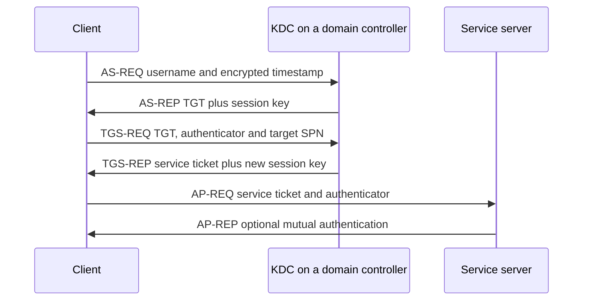
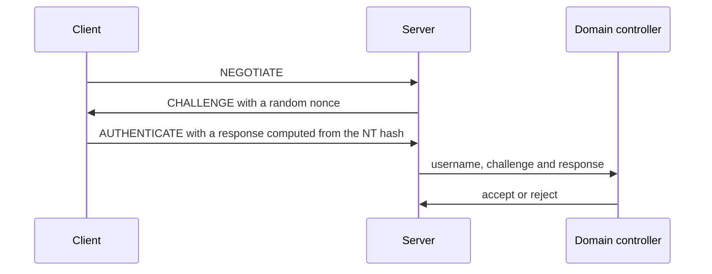

# Kerberos, NTLM and enterprise identity

> [!TIP]
> **In short:** inside a Windows domain, authentication is **Kerberos** when it can be and **NTLM** as a legacy fallback. Kerberos replaces passwords on the wire with time-limited **tickets** issued by the domain controller; NTLM answers a challenge with a value derived from the password hash and gives the client no proof of who the server is. Nearly every classic Active Directory attack abuses one of three facts: a secret derived from a password is enough to authenticate (**pass-the-hash**), tickets can be requested for any service and cracked offline (**roasting**), and a stolen key lets an attacker mint credentials (**forged tickets**). Microsoft is retiring RC4 and NTLM, but you will meet both in real networks for years. Learn the mechanics, the attacks and the events that expose them.

## Which protocol does Windows use?

Windows applications call the **Negotiate** package (SPNEGO), which tries Kerberos first and falls back to NTLM. Kerberos needs three things: the client can reach a domain controller (the KDC), the target has a **service principal name** (SPN), and the client addresses the target by that name. When any of them is missing, NTLM takes over.

| Why NTLM is used | Typical cause |
|---|---|
| Target addressed by **IP address** | Scripts, mapped drives, misconfigured shortcuts (no SPN can match an IP) |
| No SPN registered, or a duplicate SPN | Service account misconfiguration |
| Client cannot reach a domain controller | VPN, segmented networks, remote workers |
| Local accounts, workgroup machines, cross-forest without trust | Standalone servers, appliances, printers, NAS devices |
| Applications that hard-code NTLM | Legacy software |

This explains a common hardening discovery: you cannot simply switch NTLM off. You first **audit** who uses it and why, fix the causes (use host names, register SPNs, remove legacy apps), and then restrict it.

## Kerberos

Kerberos (RFC 4120, from MIT's Project Athena in the 1980s) is a ticket system built on a trusted third party. In Active Directory every domain controller runs the **Key Distribution Center** (KDC), made of an **Authentication Service** (AS) and a **Ticket Granting Service** (TGS).

| Term | Meaning |
|---|---|
| **Principal** | A user, computer or service identity (`alice@CORP.EXAMPLE.COM`) |
| **Long-term key** | A key derived from the principal's password; known to the principal and the KDC |
| **`krbtgt`** | The domain account whose key protects every TGT; the most valuable secret in the domain |
| **TGT** (ticket-granting ticket) | Proof of authentication, encrypted with the `krbtgt` key and presented to get service tickets |
| **Service ticket** (ST, "TGS ticket") | A ticket for one service, encrypted with that **service account's** key |
| **SPN** | Name that identifies a service instance (`HTTP/web01.corp.example.com`), mapped to the account that runs it |
| **Authenticator** | A fresh timestamp encrypted with a session key; prevents replaying a captured ticket |
| **PAC** | Microsoft's *privilege attribute certificate*, carried inside the ticket: the user's SID and group SIDs, signed by the KDC |
| **Pre-authentication** | The client proves knowledge of its key (encrypted timestamp) before the KDC answers |

### The exchange



| Message | Carries | Protected with | Why it matters |
|---|---|---|---|
| **AS-REQ** | Username, pre-authentication timestamp | Timestamp encrypted with the **user's key** | Proves the password without sending it. If pre-authentication is disabled, the KDC answers anyone |
| **AS-REP** | The **TGT** and a session key | TGT: `krbtgt` key. Session key copy: **user's key** | The user-key portion can be cracked offline when obtained without pre-authentication |
| **TGS-REQ** | TGT, authenticator, target SPN | Authenticator with the TGT session key | The KDC does not check whether the user is *allowed* to use the service |
| **TGS-REP** | The **service ticket** | Ticket: **service account's key** | Any domain user can request a ticket for any SPN and attack the service account's password offline |
| **AP-REQ** | Service ticket, authenticator | Authenticator with the service session key | The service decrypts the ticket with its **own** key and never talks to the KDC |
| **AP-REP** | Server timestamp | Session key | Optional mutual authentication: the server proves it also knew the key |

The service reads the user's SID and groups from the **PAC** and builds the access token from them. Because the PAC is trusted, forging a ticket with an arbitrary PAC grants arbitrary privileges.

### Defaults worth knowing

| Parameter | Active Directory default | Consequence |
|---|---|---|
| **Clock skew** | 5 minutes | Time synchronization is a hard dependency; a drifting clock breaks logons and is a classic troubleshooting cause |
| **TGT lifetime** | 10 hours | A stolen TGT is useful until it expires or is renewed |
| **Renewal window** | 7 days | Tickets can be renewed within this limit |
| **Service ticket lifetime** | 10 hours | |
| **Port** | 88 (TCP and UDP) | Visible in captures; filter `kerberos` in Wireshark |
| **Encryption types** | AES256 (etype 18), AES128 (17), **RC4-HMAC (23)** | RC4 uses the NT hash directly as the key; AES keys are salted and slow to derive |

**●●●** (Microsoft Kerberos policy documentation; RFC 4120, RFC 3962.)

AES keys are derived from the password with PBKDF2 (4,096 iterations by default) and a salt built from the realm and user name (RFC 3962). The RC4-HMAC key is simply the **NT hash**, which is unsalted MD4. That makes RC4 tickets thousands of times cheaper to crack and lets someone who holds only the NT hash obtain Kerberos tickets (*overpass-the-hash*).

### Delegation

Delegation lets a service act on behalf of a user toward another service, such as a web front end querying a database as the user. It is a frequent source of privilege escalation.

| Type | How it works | Risk | Defense |
|---|---|---|---|
| **Unconstrained** | The service receives each connecting user's **TGT** and can use it anywhere | Anyone controlling that host can collect TGTs of every user who connects, including administrators or, with coercion, domain controllers | Avoid entirely; only domain controllers should hold it |
| **Constrained** (`msDS-AllowedToDelegateTo`) | The service may obtain tickets, as the user, only for listed services (S4U2Proxy); with *protocol transition* (S4U2Self) it can do so without the user having authenticated by Kerberos | A compromised service can impersonate any user toward the listed services | Minimal lists; mark privileged accounts **sensitive and cannot be delegated** or put them in **Protected Users** |
| **Resource-based constrained** (`msDS-AllowedToActOnBehalfOfOtherIdentity`) | The *target* resource lists which accounts may delegate to it | Anyone who can write that attribute, or who can create machine accounts (default `MachineAccountQuota` is 10), may take over the target | Set `MachineAccountQuota` to 0; restrict write access; monitor attribute changes |

### What goes wrong

| Attack | What the attacker has | What they do | Defense | ATT&CK |
|---|---|---|---|---|
| **Kerberoasting** (Medin, 2014) | Any domain account | Request service tickets for accounts with SPNs, then crack the account password offline | Long random passwords (25+ characters), **gMSA**, AES-only, alert on ticket-request patterns | T1558.003 |
| **AS-REP roasting** | Names of accounts with pre-authentication off | Request AS-REPs without proving anything and crack offline | Keep pre-authentication on; audit the `DONT_REQ_PREAUTH` flag | T1558.004 |
| **Pass-the-ticket** | A stolen TGT or service ticket (from memory, or from a Linux credential cache file) | Inject and reuse it until it expires | Credential Guard, short lifetimes, endpoint protection, tiering | T1550.003 |
| **Overpass-the-hash / pass-the-key** | An NT hash or AES key | Use it to request a legitimate TGT | Protect LSASS, Credential Guard, remove RC4, Protected Users | T1550.002 |
| **Golden ticket** | The **`krbtgt` key** | Forge a TGT for any user and any group, lasting as long as the key is unchanged | Protect domain controllers; rotate `krbtgt` twice on a schedule and after incidents | T1558.001 |
| **Silver ticket** | One **service account's key** | Forge service tickets for that service without contacting the KDC, so the DC logs nothing | Long, rotating service passwords (gMSA); PAC validation; monitor the service host | T1558.002 |
| **Diamond and sapphire tickets** | The `krbtgt` key | Modify a real TGT, or embed a legitimately obtained PAC, to look normal to detections | Same as golden, plus anomaly detection on ticket content | T1558 |
| **Delegation abuse** | Control of a delegating host or a writable attribute | Impersonate users, often administrators | See the delegation table | T1550, T1558 |
| **Forged or stolen certificates** | A certificate template or CA flaw | Authenticate as another principal through certificate-based Kerberos (PKINIT) | Harden AD Certificate Services; see [Active Directory](../02-systems/03-active-directory.md) | T1649 |

A *golden ticket* is the reason a domain compromise must be treated as total: the attacker has not just a password, but the means to create every credential in the domain. The usual remedy after such an incident is to rotate `krbtgt` twice (the previous key remains valid for one cycle) and to rebuild trust from clean systems. **●●●**

**Practical implication:** most of the attack table is defended by the same four measures: strong, machine-managed service-account passwords; AES instead of RC4; no unconstrained delegation; and protecting the domain controllers and `krbtgt`.

## NTLM

NTLM is a family of challenge-response protocols embedded in SMB, HTTP, LDAP, RPC and others. It has no port of its own.

The **NT hash** is `MD4(UTF-16LE(password))`: unsalted and fast to compute. Anyone who holds it can authenticate as the user, with no need to recover the password. This is *pass-the-hash*.



| Version | Status | Notes |
|---|---|---|
| **LM** | Obsolete | Uppercased, split and DES-based; disable storage |
| **NTLMv1** | Broken | DES-based response; can be converted into the NT hash with precomputed tables when the attacker chooses the challenge |
| **NTLMv2** | Weak but current | HMAC-MD5 over the server challenge, a client challenge, a timestamp and target information |

The captured challenge and response (often called a "Net-NTLMv2 hash") **cannot** be passed like an NT hash, but it can be **cracked offline** or **relayed**.

### Relay and coercion

NTLM does not bind the authentication to the server the client meant to reach. An attacker positioned between a victim and a target can forward the exchange and be authenticated as the victim.

| Step | Technique |
|---|---|
| **Get a victim to authenticate** | Name-resolution poisoning (LLMNR, NBT-NS, mDNS replies) or **coercion**: calling a remote procedure so that a machine, even a domain controller, authenticates to an attacker-chosen host (the EFSRPC, print spooler and DFS coercion families) |
| **Forward it** | To SMB, LDAP, or an HTTP service such as the AD Certificate Services web enrollment |
| **Result** | Code execution, creation of machine accounts, modification of delegation attributes or issuance of a certificate for the victim |

| Mitigation | Stops |
|---|---|
| **Require SMB signing** | Relay to SMB |
| **Require LDAP signing and LDAP channel binding** | Relay to LDAP and LDAPS |
| **Extended Protection for Authentication** on IIS, AD CS enrollment and other HTTP services | Relay to web services |
| Disable **LLMNR, NBT-NS and mDNS** by policy | Name-poisoning capture |
| Patch coercion vectors, disable unused services such as the print spooler on servers | Coercion |
| **Restrict NTLM**, then block it | The whole class |

MITRE ATT&CK lists these under T1557.001 (LLMNR/NBT-NS poisoning and SMB relay). **●●●**

### The retirement of NTLM and RC4

Microsoft has deprecated NTLM and is removing it in stages. As of late 2026, the verified state is:

| Change | State |
|---|---|
| **NTLMv1** | The protocol is **removed** from Windows 11 24H2 and Windows Server 2025; a related change to block NTLMv1-derived credentials for single sign-on moves to enforcement in October 2026. Some NTLMv1-derived cryptography remains in domain-joined MS-CHAPv2 scenarios |
| **NTLM auditing** | Enhanced auditing is available in Windows Server 2025 and Windows 11 24H2 |
| **IAKerb and Local KDC** | Kerberos extensions that let more scenarios (no direct line to a domain controller, local accounts) use Kerberos instead of falling back to NTLM |
| **Network NTLM off by default** | The announced end state; NTLM remains in the operating system and can be re-enabled by policy. Dates for this step are not settled |
| **Kerberos RC4** | Updates from January 2026 added audit events (Kdcsvc 201 to 209) for tickets that depend on RC4; the default for accounts **without explicit encryption settings** moved to AES during 2026, with later phases making this permanent. Accounts with explicit `msDS-SupportedEncryptionTypes` values are still honored |
| **SMB signing** | Required by default for outbound connections on Windows 11 24H2 and Windows Server 2025 (inbound behavior varies by edition; check current documentation) |
| **LDAP signing and channel binding** | New Active Directory deployments on Windows Server 2025 require LDAP signing by default; channel binding defaults to "when supported". Upgraded domains keep their existing settings |

**●●○** These dates come from vendor announcements and have moved before. Verify against Microsoft's current documentation before you plan a change window, and test on non-production domain controllers first.

## Kerberos outside Windows

| Item | What to know |
|---|---|
| **MIT Kerberos and Heimdal** | The open-source implementations; commands `kinit`, `klist`, `kdestroy` |
| **Keytab files** | Store a service's long-term key on disk (`/etc/krb5.keytab`). Anyone who reads one can impersonate the service: protect with file permissions |
| **Credential caches** | Tickets live in files (often `/tmp/krb5cc_<uid>`) or in the kernel keyring. A root user or a process running as the user can copy them: Linux pass-the-ticket |
| **SSSD / realmd** | Join Linux hosts to Active Directory; bring Kerberos and group lookups to Linux |
| **Web and database access** | Kerberos SSO through SPNEGO in browsers and `GSSAPI` in many servers (PostgreSQL, SSH, Hadoop) |

## Enterprise identity beyond the domain

Organizations rarely run Active Directory alone. Cloud identity providers are connected to it, and the connection creates attack paths in both directions.

| Component | What it does | What to watch |
|---|---|---|
| **Password hash sync** (Microsoft Entra Connect / Cloud Sync) | Copies a derived form of password hashes to the cloud so users sign in there | The sync account is highly privileged on the directory; treat it and its server as tier 0 |
| **Pass-through authentication** | Validates cloud sign-ins against the on-premises directory through an agent | The agent sees credentials; protect and monitor it |
| **Federation** (AD FS and similar) | The cloud trusts SAML or WS-Federation tokens signed on premises | The **token-signing key** is the crown jewel (Golden SAML, T1606.002) |
| **Seamless SSO** | Kerberos-based single sign-on for domain-joined devices through a special computer account (`AZUREADSSOACC`) | Rotate that account's key; protect it like `krbtgt` |
| **Primary Refresh Token (PRT)** | A device-bound token that gives SSO on joined devices, including MFA state | Theft from a compromised device can reuse MFA claims; enforce device compliance and token protection |
| **Conditional Access / policy engine** | Evaluates user, device, location and risk per sign-in | Gaps in policy scope are the bypass; test with a break-glass-safe account |

The common theme is **tier 0**: every system that can mint credentials for the whole directory (domain controllers, the `krbtgt` account, AD CS, the sync server, the federation server, identity-provider administrators) must be protected, administered and monitored as one unit, separately from ordinary servers and workstations. A tiered or *enterprise access* model, privileged access workstations and separate administrator accounts are the structural defense. See [Cloud IAM and attack paths](../08-cloud-and-infrastructure/02-cloud-iam-and-attack-paths.md) for the cloud side.

## Detection

| Event or source | Meaning | Look for |
|---|---|---|
| **4768** | TGT requested | `PreAuthType` 0 (AS-REP roasting); requests for users that should not log on; `TicketEncryptionType` 0x17 |
| **4769** | Service ticket requested | Encryption type **0x17 (RC4)** for service accounts; one user requesting tickets for many SPNs in a short window (Kerberoasting); requests with no earlier 4768 for the account (possible forged TGT) |
| **4771** | Pre-authentication failed | Failure code 0x18 (bad password) for many accounts: password spraying over Kerberos |
| **4776** | DC validated credentials with NTLM | Which workstations and accounts still use NTLM; bursts of failures |
| **4624** | Successful logon | `AuthenticationPackageName`, `LogonProcessName: NtLmSsp`, `LmPackageName` (NTLM V1 or V2); logon type 3 from unexpected hosts; logon type 9 followed by remote access |
| **4648** | Logon with explicit credentials | Lateral movement and `runas` patterns |
| **4672** | Special privileges assigned | Administrative logons on unusual hosts |
| **4662, 5136** | Directory object access and modification | Replication rights used by a non-DC account (DCSync, T1003.006); changes to delegation attributes |
| **NTLM Operational log** (events such as 8001 to 8004) | NTLM use, when auditing policies are enabled | Inventory of NTLM clients and servers |
| **KDC events 201 to 209** | RC4 dependence (2026 updates) | Service accounts and applications that need AES fixes |
| **Network** | Port 88 traffic from workstations to non-DCs; SMB or LDAP relays | Unusual KDC-like traffic, authentication to unexpected hosts |

A baseline query in PowerShell to list service ticket requests that used RC4. Run it on a domain controller with *Audit Kerberos Service Ticket Operations* enabled:

```powershell
Get-WinEvent -FilterHashtable @{ LogName = 'Security'; Id = 4769 } -MaxEvents 500 |
    ForEach-Object {
        $data = ([xml]$_.ToXml()).Event.EventData.Data
        [pscustomobject]@{
            Time    = $_.TimeCreated
            User    = ($data | Where-Object Name -eq 'TargetUserName').'#text'
            Service = ($data | Where-Object Name -eq 'ServiceName').'#text'
            EType   = ($data | Where-Object Name -eq 'TicketEncryptionType').'#text'
            Client  = ($data | Where-Object Name -eq 'IpAddress').'#text'
        }
    } | Where-Object EType -eq '0x17'
```

Expect noise from legacy applications. Triage by service: which accounts truly need RC4, and why? Each answer is a remediation ticket. Rules for the other events are covered in [Detection engineering](../07-defensive-security/02-detection-engineering.md).

## Hardening, in priority order

1. **Audit NTLM** and fix its causes; then restrict, starting with NTLMv1 and outbound NTLM from servers.
2. **Require SMB signing**, LDAP signing and channel binding, and Extended Protection on web services (especially AD CS enrollment).
3. **Disable LLMNR, NBT-NS and mDNS** by policy.
4. **Move service accounts to gMSA** or give them long random passwords; set AES-only encryption types; remove accounts with `DONT_REQ_PREAUTH`.
5. **Remove unconstrained delegation** outside domain controllers; mark privileged accounts sensitive or place them in Protected Users.
6. **Adopt tiering**: separate administrator accounts, privileged access workstations, no administrator logons on lower tiers.
7. **Rotate `krbtgt`** twice on a schedule and after any domain-level incident; protect and monitor domain controllers.
8. **Enable Credential Guard, LSA protection and Windows LAPS** on endpoints and servers.
9. **Monitor** the events above and test the detections.

The broader checklist, with the misconfigurations that expose these protocols, is in [Active Directory](../02-systems/03-active-directory.md).

## Practice

1. In your Windows lab, run `klist` after logging on, open a share by **name** and then by **IP address**, and compare the tickets and the logon events (Kerberos versus NTLM) in the Security log.
2. Capture a logon in Wireshark with the display filter `kerberos`. Identify AS-REQ, AS-REP, TGS-REQ and TGS-REP, and read the encryption type in each.
3. Turn on NTLM auditing in the lab and list every client that still uses NTLM, with the reason.
4. In the lab only, create a service account with an SPN and a weak password. Using the technique from [Module 2.3](../../roadmap/phase-2-guided-practice/03-machines-and-ad.md), obtain its service ticket and observe how cracking effort differs between RC4 (Hashcat mode 13100) and AES256 (mode 19700). Then change the account to a gMSA and AES-only and confirm the attack fails and your 4769 query flags the attempt.
5. Read the first sections of RFC 4120 and redraw the exchange from memory.

## What to do with this

- [ ] Explain, without notes, what each of the six Kerberos messages is encrypted with and why that lets Kerberoasting work.
- [ ] Produce a table of which of your lab services are reached by Kerberos and which fall back to NTLM, with the reason.
- [ ] Write the detection note for Kerberoasting (event 4769, RC4, volume per user) and for DCSync (event 4662 from a non-DC).
- [ ] Draw your lab's tier 0 and list what protects each asset.
- [ ] Record the current state of RC4 and NTLM in your lab domain and what would break if you enforced AES and blocked NTLM.

## Key references

Medin (2014) · Microsoft MS-KILE · Microsoft MS-NLMP · Microsoft NTLM and Kerberos hardening notices · MITRE ATT&CK · RFC 3962 · RFC 4120. Full list in [References](../15-references.md).

<!-- navigation -->
[← Authorization, sessions and federation](05-authorization-sessions-and-federation.md) · [Index](../00-start-here.md) · [The browser security model and security headers →](../05-application-security/01-browser-security-model-and-headers.md)
