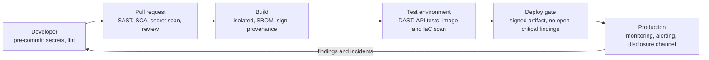

# Secure development and the software supply chain

> [!TIP]
> **In short:** secure software is the result of a **process**, not a final scan. Put security into requirements, design, code review, automated testing and release, and make the secure path the easy path. Today most of the code you ship is not yours: it is dependencies, build tools, container images and CI actions. Attackers know this, so the **supply chain** is now a primary target. The practical defenses are boring and effective: know what you use, pin and verify it, build in a locked-down pipeline, sign what you produce, keep secrets out of code, and be ready to patch quickly.

## The secure development lifecycle

| Phase | Security activities | Output |
|---|---|---|
| **Requirements** | Classify data; choose an ASVS level; write security requirements and abuse cases | Testable requirements |
| **Design** | Threat model; choose proven patterns (authentication, authorization, logging); review third-party components | Threat model, design decisions |
| **Implementation** | Secure coding standards; peer review; secrets handling; pre-commit checks | Reviewed code |
| **Verification** | SAST, SCA, secret scanning, DAST, API tests, fuzzing, targeted manual testing | Findings with owners and deadlines |
| **Release** | Signed artifacts, provenance, SBOM, approval gates | Trustworthy release |
| **Operations** | Monitoring, patching, vulnerability intake, incident response, feedback to design | Lower risk each cycle |

Frameworks help you organize these activities:

| Framework | What it is | Use it for |
|---|---|---|
| **NIST SSDF** (SP 800-218, version 1.1 from 2022; a draft revision, 1.2, was released for comment in December 2025) | Practices in four groups: Prepare the Organization, Protect the Software, Produce Well-Secured Software, Respond to Vulnerabilities | A neutral baseline, and the basis of US government supplier attestations |
| **OWASP ASVS** (version 5.0) | Verifiable application security requirements at three levels | Requirements and test plans |
| **OWASP SAMM** | Maturity model with practices per business function | Planning an improvement program |
| **BSIMM** | Descriptive study of what real organizations do | Benchmarking |
| **Microsoft SDL** | One company's published lifecycle | A concrete example to borrow from |

**●●●** (NIST, OWASP.)

**"Shift left" done well** means finding problems when they are cheapest to fix, not pushing all security work onto developers. Give them a **paved road**: secure templates, vetted libraries, one-click pipelines with checks included, and a **security champion** in each team who connects them to the security specialists.

## Secure coding: the recurring mistakes

| Language | Classic pitfalls | Safer practice |
|---|---|---|
| **Python** | `pickle.loads` and `yaml.load` on untrusted data, `eval`, `subprocess(..., shell=True)`, `random` for tokens, `assert` for security checks, weak temp files | `json`, `yaml.safe_load`, argument lists, `secrets`, explicit checks, `tempfile` |
| **JavaScript / TypeScript** | `innerHTML`, `eval`, prototype pollution, unsafe regular expressions (ReDoS), trusting `JSON.parse` shapes, `npm` install scripts | Output encoding, schema validation, `Object.create(null)` or `Map`, linear-time patterns, `--ignore-scripts` for untrusted installs |
| **Java** | Native deserialization, XXE, expression-language injection, logging of untrusted data | Serialization filters, hardened parsers, parameterized calls |
| **C and C++** | Buffer overflows, use-after-free, integer overflow, format strings | Memory-safe languages for new code; bounds-checked containers; sanitizers and fuzzing |
| **Go** | Ignoring returned errors, `text/template` for HTML, goroutine races | `html/template`, `errcheck`, the race detector |
| **PHP** | `include` with user input, `unserialize`, loose comparison (`==`) | Fixed includes, JSON, strict comparison |
| **SQL** | Dynamic SQL in stored procedures | Parameters; see [Injection and XSS](03-injection-and-xss.md) |

**Memory safety.** A large share of severe vulnerabilities in C and C++ code are memory-safety bugs (see [Memory and exploit mitigations](../02-systems/04-memory-and-exploit-mitigations.md)). Government agencies in several countries have urged vendors to publish roadmaps toward memory-safe languages such as Rust, Go, Java, C# and Swift for new code (CISA et al., 2023). **●●●**

## Code review for security

Reviewing for security is a different pass from reviewing for style. A reliable method is to **trace trust boundaries**:

1. List the **entry points** the change touches (routes, message handlers, file readers, scheduled jobs).
2. For each, follow the data to its **sinks** (database, shell, file system, template, outbound request, log).
3. At each step ask: is the data validated, encoded or parameterized for this sink?
4. Check **authentication and authorization** on every new route, object access and function.
5. Look for **secrets**, keys and tokens, and for sensitive data in logs and errors.
6. Check **error paths**: do they fail closed and avoid leaking detail?
7. Check **cryptography usage**: library defaults, key sources, modes, comparison of secrets in constant time.
8. Check **dependencies** added or upgraded.

| Practice | Why |
|---|---|
| Small pull requests | Large diffs are skimmed, not reviewed |
| `CODEOWNERS` for security-sensitive paths | The right people see authentication, crypto and permission changes |
| Two-person rule for sensitive changes | One compromised account cannot ship a backdoor alone |
| A short checklist in the pull request template | Memory aid, not bureaucracy |

## Testing types

| Type | What it does | Finds | Misses | Example tools |
|---|---|---|---|---|
| **SAST** (static analysis) | Analyzes source without running it | Injection patterns, hard-coded secrets, dangerous APIs | Logic and authorization flaws; many false positives | Semgrep, CodeQL, Bandit, SonarQube |
| **SCA** (software composition analysis) | Matches dependencies against vulnerability databases | Known vulnerable libraries, licenses | Unknown flaws, malicious packages without an advisory | Dependabot, OSV-Scanner, `pip-audit`, `npm audit`, Trivy, Grype |
| **Secret scanning** | Looks for credentials in code and history | Keys, tokens, passwords | Secrets in unusual formats | Gitleaks, TruffleHog, GitHub secret scanning with push protection |
| **DAST** (dynamic) | Attacks a running application like a user would | Misconfiguration, some injection and XSS | Anything behind logic or authorization, unreachable code | OWASP ZAP, Burp Suite |
| **IAST** | Instruments the app during tests | Precise findings with stack traces | Needs coverage from tests | Commercial agents |
| **IaC and container scanning** | Checks Terraform, Kubernetes manifests, images | Misconfigurations, vulnerable base images | Runtime behavior | Checkov, Trivy, Hadolint |
| **Fuzzing** | Feeds random or mutated input | Crashes, memory bugs, parser flaws | Logic flaws | AFL++, libFuzzer, Atheris, Schemathesis for APIs |
| **Manual penetration test** | Skilled human, objectives-driven | Chained and logic flaws | Breadth, if time-boxed | Burp Suite, custom scripts |
| **Bug bounty / VDP** | External researchers | Unexpected real-world issues | Depends on scope and rewards | Platforms such as HackerOne and Bugcrowd |

Automation provides breadth and speed; humans provide depth. Neither replaces the other. **●●●**

### A pipeline that runs the checks



Local commands you can run today:

```bash
pip-audit -r requirements.txt
semgrep scan --config auto
```

**Triage matters more than tool count.** An unowned backlog of 3,000 findings protects nobody. Decide what blocks a release (critical, exploitable, internet-facing), who owns each finding, and the fix deadline per severity. Tune rules to remove noise and suppress false positives with a documented reason.

## The software supply chain

Your software depends on code you did not write, tools that build it, and services that deliver it. Each link is an attack surface.

| Attack | How it works | Example |
|---|---|---|
| **Typosquatting** | Malicious package with a name close to a popular one | Look-alike names on npm and PyPI |
| **Dependency confusion** | A public package with the same name as an internal one and a higher version number is installed instead | Birsan (2021) used it to run code inside large technology companies and was paid bounties |
| **Account takeover of a maintainer** | Phished or reused credentials publish a malicious release | Many npm and PyPI incidents |
| **Malicious maintainer / social engineering** | A contributor gains trust over months, then inserts a backdoor | xz utils, 2024 (CVE-2024-3094) |
| **Protestware and sabotage** | A maintainer deliberately breaks or poisons their own package | `colors` and `faker` in 2022 |
| **Compromised build or CI** | The attacker modifies the build, so signed official artifacts are malicious | SolarWinds (2020); Codecov (2021); tj-actions/changed-files (2025) |
| **Self-propagating package worms** | A malicious package steals publishing tokens and infects the owner's other packages | The 2025 "Shai-Hulud" npm campaigns |
| **Compromised update channel** | The vendor's update mechanism is hijacked | CCleaner (2017) |
| **Poisoned images and extensions** | Malicious container images, IDE extensions, GitHub Actions | Public registries and marketplaces |
| **Hallucinated packages** | Code assistants suggest package names that do not exist, and attackers register them | Reported by Spracklen et al. (2025) |

**●●●** (CISA and vendor advisories; the cases above are documented in public reports.)

### Defenses for what you consume

| Control | How |
|---|---|
| **Know what you ship** | Maintain a **software bill of materials** (SBOM) in CycloneDX or SPDX format; generate it in the build with a tool such as Syft or Trivy |
| **Pin and verify** | Lockfiles with hashes (`pip install --require-hashes`, `npm ci`, `go.sum`, `Cargo.lock`) so the build uses exactly what you reviewed |
| **Avoid install-time code** | `npm ci --ignore-scripts` for untrusted installs; review packages that run scripts at install |
| **Wait a little** | Most malicious versions are discovered within days; delay adopting brand-new releases unless they fix a vulnerability |
| **Reduce** | Fewer dependencies mean fewer suppliers; prefer the standard library for small tasks; remove unused packages |
| **Vet** | Maintainer history, activity, OpenSSF Scorecard results, provenance attestations (download counts alone are a weak signal) |
| **Scan and prioritize** | SCA on every pull request and on a schedule; prioritize by exploitability (EPSS, the CISA KEV list) and exposure; see [Vulnerability and exposure management](../07-defensive-security/07-vulnerability-and-exposure-management.md) |
| **Control resolution** | Use an internal registry or proxy, scoped namespaces (`@yourorg/...`), reserve your internal names on public registries, and avoid pip's `--extra-index-url` mixing of indexes |
| **Update continuously** | Automated pull requests (Dependabot, Renovate) with good tests make small, frequent updates routine |

### Defenses for what you produce

| Control | How |
|---|---|
| **Protect the source** | Branch protection, required reviews, MFA or passkeys for every maintainer, least privilege for repository access |
| **Harden the build** | Ephemeral, isolated runners; no long-lived cloud keys (use OIDC federation to obtain short-lived credentials); minimal token permissions; **pin third-party actions to a full commit SHA**; never run untrusted pull-request code with privileged secrets |
| **Provenance** | Produce signed attestations of how and where an artifact was built. The **SLSA** framework defines levels (a provenance record exists, then a hosted build platform generates it, then a hardened and isolated platform does) |
| **Sign artifacts** | Sigstore (cosign) for images and files; npm provenance; PyPI trusted publishing; GitHub artifact attestations |
| **Verify at deploy** | Admission controls that accept only signed images from your pipeline |
| **Publish an SBOM and a disclosure policy** | `SECURITY.md`, a `security.txt` file (RFC 9116), a way to report vulnerabilities, advisories for fixed issues |

A least-privilege starting point for a GitHub Actions workflow:

```yaml
permissions:
  contents: read

jobs:
  test:
    runs-on: ubuntu-latest
    steps:
      - uses: actions/checkout@<full-commit-sha>
      - run: pip install --require-hashes -r requirements.txt
      - run: pytest
```

Regulation is moving in the same direction. The US Executive Order 14028 (2021) led to supplier attestations against the SSDF, and the EU Cyber Resilience Act, in force since December 2024 with obligations phasing in through 2027, requires manufacturers of products with digital elements to handle vulnerabilities and document their components. **●●○**

## Secrets management

A **secret** is anything that grants access: passwords, API keys, tokens, private keys, database URLs. They are the most commonly leaked asset in repositories.

| Rule | Detail |
|---|---|
| **Never in source control** | Not in code, config files, notebooks, container images or CI logs; keep `.env` files in `.gitignore` |
| **Central store** | A secrets manager (HashiCorp Vault, cloud secret managers) injects them at run time |
| **Prefer no static secret** | Workload identity and OIDC federation issue short-lived credentials automatically |
| **Least privilege and separation** | One secret per purpose, per environment, with narrow scope |
| **Rotate** | On a schedule and on any suspicion; design systems so that rotation is routine |
| **Detect** | Pre-commit scanning, repository scanning, and provider push protection |

When a secret leaks, the order matters:

1. **Revoke or rotate it immediately.** Removing it from the repository is not enough: copies and caches exist, and automated scanners find exposed keys within minutes.
2. **Check what it accessed** in the provider's audit logs, from the time of exposure.
3. Treat any use you did not make as an incident (see [Incident response](../07-defensive-security/04-incident-response.md)).
4. Remove it from history and fix the process that allowed it.

## Practice

1. Add `pip-audit` and Semgrep to one of your projects, fix or triage every finding, and write the policy for what blocks a merge.
2. Generate an SBOM for the project (Syft or Trivy), read it, and find the transitive dependency you did not know you had.
3. Enable GitHub secret scanning and push protection on a repository, then try to commit a fake token and observe the block.
4. Write a Semgrep rule for a bug pattern you found in a previous exercise.
5. Reproduce a dependency confusion scenario **locally** with a private package index and a higher-versioned package on a second index, then fix the configuration.
6. Sign a container image with Sigstore's cosign in a lab registry and verify the signature.

These support [Module 1.6](../../roadmap/phase-1-security-fundamentals/06-frameworks-and-governance.md) and the [web track](../../roadmap/phase-3-specialization/track-web.md) of the roadmap.

## What to do with this

- [ ] Write a one-page secure development policy for your own projects, with the checks that block a release.
- [ ] Pin and hash-lock dependencies in every project you maintain.
- [ ] Generate SBOMs and keep them with your releases.
- [ ] Audit your CI workflows for broad permissions, unpinned actions and long-lived secrets.
- [ ] Rotate every secret you have ever pasted into a chat, ticket or notebook.

## Key references

Birsan (2021) · CISA et al. (2023) · CycloneDX and SPDX specifications · NIST SP 800-218 · OpenSSF Scorecard · OWASP ASVS 5.0 · OWASP SAMM · Sigstore documentation · SLSA · Spracklen et al. (2025). Full list in [References](../15-references.md).
