# Penetration testing methodology

> [!TIP]
> **In short:** a penetration test is **authorized, scoped, time-boxed attacking whose product is a report that helps the client fix things**. The technical work is perhaps half of it. The rest is what makes it professional and legal: written authorization, a clear scope and rules of engagement, careful handling of production systems and data, disciplined notes, and a report that a technical reader can reproduce and an executive can act on. Learn the phases, the paperwork and the reporting habits early, because they separate a tester from someone who merely knows tools.

> [!CAUTION]
> Everything in this section applies only to systems you own or are explicitly authorized in writing to test. "I was only checking" is not a defense under Ley 1273 de 2009. See [Legal limits and ethics](../01-foundations/05-legal-and-ethics.md).

## Kinds of engagements

| Type | Question it answers | Scope | Stealth | Typical length | Output |
|---|---|---|---|---|---|
| **Vulnerability assessment** | What known weaknesses exist? | Broad | None | Days | Prioritized list of findings |
| **Penetration test** | Can these weaknesses be exploited, and how far does that get an attacker? | Defined systems | Low; the defenders are often informed | 1 to 4 weeks | Report with evidence of exploitation |
| **Assumed-breach test** | What can an attacker do from an inside foothold? | Internal network, identity | Medium | 1 to 3 weeks | Attack paths and fixes |
| **Red team** | Can a realistic adversary reach our most important assets without being stopped, and would we notice? | Goal-based, whole organization | High | Weeks to months | Narrative, detection and response gaps |
| **Purple team** | How well do our detections work against these specific techniques? | Selected techniques | None; testers and defenders work together | Days | Better detections and a coverage record |
| **Bug bounty / VDP** | What can many independent researchers find? | A published program scope | n/a | Continuous | Individual vulnerability reports |
| **Social engineering assessment** | Do people follow procedures under pressure? | Staff, processes | Varies | Days | Metrics and training needs |

**●●●** The terms are used loosely in the industry, so agree on definitions in writing before you start.

## Standards and frameworks

| Source | What it gives you |
|---|---|
| **PTES** (Penetration Testing Execution Standard) | A seven-phase community standard from pre-engagement to reporting |
| **NIST SP 800-115** (2008) | The US government's technical guide to security testing: planning, discovery, attack, reporting; still the current edition |
| **OSSTMM** | A metrics-oriented methodology from ISECOM |
| **OWASP Web Security Testing Guide** | Step-by-step tests for web applications |
| **OWASP MASVS and MASTG** | Requirements and testing guide for mobile apps |
| **MITRE ATT&CK** | A shared language for techniques; used to plan, label and report |
| **CREST** | UK-based body that accredits testing companies and certifies testers |
| **PCI DSS 4.0.1, requirement 11.4** | Penetration testing at least every 12 months and after significant changes, for environments that handle payment cards |
| **TIBER-EU and DORA threat-led penetration testing** | Intelligence-led red teaming for significant financial entities in the EU, under Delegated Regulation 2025/1190; the TIBER-EU framework was updated in 2025 to align with it |

## Phases

```mermaid
flowchart LR
    A["1. Pre-engagement<br/>scope, rules, authorization"] --> B["2. Intelligence gathering<br/>passive and active recon"]
    B --> C["3. Threat modeling<br/>what matters, how it could fail"]
    C --> D["4. Vulnerability analysis<br/>find and validate weaknesses"]
    D --> E["5. Exploitation<br/>prove impact, minimally"]
    E --> F["6. Post-exploitation<br/>reach, persistence, objectives"]
    F --> G["7. Reporting<br/>findings, risk, remediation"]
    G --> H["Retest<br/>verify the fixes"]
```



| Phase | Activities | Deliverables |
|---|---|---|
| **1. Pre-engagement** | Scoping call, contract and statement of work, rules of engagement, authorization letter, emergency contacts, data-handling terms | Signed documents; target list; test windows |
| **2. Intelligence gathering** | OSINT, DNS and certificate enumeration, port scanning, service identification (see [Reconnaissance and enumeration](02-reconnaissance-and-enumeration.md)) | Asset inventory and attack-surface map |
| **3. Threat modeling** | Identify crown jewels, likely adversaries and plausible attack paths | Prioritized test plan |
| **4. Vulnerability analysis** | Run scanners, review configurations, test manually, confirm findings and remove false positives | Validated list of weaknesses |
| **5. Exploitation** | Demonstrate impact with the least action that proves it | Evidence: screenshots, logs, proof files |
| **6. Post-exploitation** | Privilege escalation, lateral movement, access to target data, only as far as agreed | Attack paths; objective reached or not |
| **7. Reporting** | Write findings, rate risk, recommend fixes, brief the client | Report, executive summary, presentation |
| **Retest** | Verify that fixes work | Closure letter or updated report |

In practice, phases overlap and loop: a credential found in phase 6 sends you back to phase 2 for a new part of the network.

## Pre-engagement: the paperwork that protects you

| Document | What it contains |
|---|---|
| **Contract / statement of work** | Parties, objectives, price, dates, liability, confidentiality, how findings are handled |
| **Scope** | Exact assets (IP ranges, domains, applications, accounts), what is in, what is explicitly out, and third-party systems that need their owners' consent (cloud providers, hosting, SaaS; check each provider's penetration testing policy) |
| **Rules of engagement** | Allowed techniques; forbidden techniques (denial of service, social engineering, physical access unless listed); test windows; source IP addresses; handling of credentials and personal data; how to stop |
| **Authorization letter** | Signed by someone with authority over the systems, naming testers and dates, which you can show if anyone challenges your activity |
| **Contacts** | Technical contact, emergency contact reachable during the test, and the person who can say "stop" |
| **Data handling** | What you may copy, how you store it, how long, and how you destroy it |

A useful scoping checklist:

- [ ] What are the objectives, and what would a successful test show?
- [ ] What systems are in scope, and who owns each one? Which are production?
- [ ] Which techniques are allowed (exploitation, password attacks, social engineering, physical)?
- [ ] When may testing happen? Are there freeze periods?
- [ ] Will the monitoring team know? (Informed tests are cheaper; blind tests measure detection.)
- [ ] Which data is regulated (personal data, payment data, health data)?
- [ ] Who is called if something breaks, or if a real attacker is found?

**Practical implication:** if the scope is vague, ask. A test that wanders into a system the client does not own, such as a shared hosting provider or a partner's API, creates legal exposure for you.

## Safe practice on real systems

| Rule | Why |
|---|---|
| **Prove, do not pillage** | Demonstrate access with a harmless marker, a screenshot or a record count, not by downloading the database |
| **Prefer the lowest-impact method** that proves the finding | Production systems have users |
| **No denial of service** unless the rules explicitly allow it | Availability is part of the client's security |
| **Stop and tell the client at once** for critical exposure, signs of an existing intruder, or illegal content | Their risk is immediate |
| **Keep evidence minimal and protected** | Evidence often contains real credentials or personal data |
| **Record what you changed** and undo it | Accounts, files, tools and settings you add are the client's risk if left behind |
| **Stay inside the scope even when you can reach more** | A reachable system is not an authorized one |

## Notes, evidence and workflow

Keep notes while you work, not afterward. Good notes are the raw material of the report and your defense if anything is questioned.

```bash
mkdir -p engagement-acme-2026-11/{00-admin,01-recon,02-findings,03-notes,04-report,evidence}
script -a -f engagement-acme-2026-11/03-notes/terminal-$(date +%F).log
```

| What to record | Why |
|---|---|
| Date, time, source IP and target for each action | Lets the client correlate with their logs and prove what you did |
| Command, output and your interpretation | Reproducibility |
| Failed attempts | Shows coverage; saves repeating work |
| Screenshots with timestamps for each finding | Evidence; redact secrets in the report copy |
| A running list of "things to retest or ask" | Nothing falls through |

Store everything on an encrypted disk, use a clean virtual machine per engagement, and delete data at the end according to the contract. The same notes, rewritten, become your public [writeups](../../writeups/README.md) once the target is a lab or the client allows it.

## Methods by target

| Target | Typical approach | Key reference |
|---|---|---|
| **External network** | Enumerate exposed services, test authentication and patch level, look for exposed admin interfaces and leaked credentials | [Reconnaissance and enumeration](02-reconnaissance-and-enumeration.md) |
| **Internal network and Active Directory** | Start with a user-level foothold; enumerate, escalate, move laterally | [Active Directory attacks](05-active-directory-attacks.md) |
| **Web application and API** | Map the application, test authentication, authorization, input handling and business logic | [OWASP Top 10:2025](../05-application-security/02-owasp-top-10-2025.md), [API security](../05-application-security/05-api-security.md) |
| **Mobile application** | Static and dynamic analysis of the app, storage, transport and backend API | OWASP MASTG |
| **Wireless** | Assess encryption, authentication and rogue-access-point exposure | Wi-Fi Alliance and vendor guidance |
| **Cloud** | Review identity and permissions, storage, network exposure and logging, within provider rules | [Cloud IAM and attack paths](../08-cloud-and-infrastructure/02-cloud-iam-and-attack-paths.md) |
| **Social engineering** | Phishing, phone, physical; only with explicit sign-off from leadership and legal | Rules of engagement |
| **Industrial / OT** | Passive and read-only first; safety of people and processes comes before findings | Specialist standards (IEC 62443) |

## Reporting

The report is the product. Clients pay for what they can understand and act on.

### Structure

| Section | Content | Reader |
|---|---|---|
| **Executive summary** | Overall result in plain language, the most important risks, a short list of recommended actions | Management |
| **Scope and approach** | What was tested, when, from where, with what limits and what method | Everyone; also establishes limits of the test |
| **Findings summary** | A table of all findings with severity, affected asset and status | Technical leads |
| **Detailed findings** | One entry per finding (below) | Engineers |
| **Attack narrative** | For assumed-breach and red team work: the path from foothold to objective | Defenders, management |
| **Positive observations** | Controls that worked | Morale and accuracy |
| **Appendices** | Tool outputs, hosts, methodology details | Reference |

### Anatomy of a finding

| Field | Example |
|---|---|
| **Title** | Reflected cross-site scripting in the search page |
| **Severity** | Medium. Record the CVSS v4.0 score and vector from the FIRST calculator, then adjust for business context and explain why |
| **Affected asset** | `https://shop.example.com/search` parameter `q` |
| **Description** | The value of `q` is inserted into the page without output encoding |
| **Evidence** | Request and response excerpt, plus a screenshot showing the injected element executing in a test account |
| **Impact** | A victim who opens a crafted link has attacker script running in the shop's origin and can be made to perform actions as that user |
| **Reproduction steps** | Numbered, so another tester gets the same result |
| **Recommendation** | Encode output for the HTML context; add a Content Security Policy; add a test; reference the OWASP XSS Prevention Cheat Sheet |
| **References** | CWE-79, OWASP Top 10:2025 A05 |

### Rating risk

Scores such as **CVSS v4.0** describe technical severity. Risk also depends on exposure, the value of the asset and existing controls, so say how you adjusted a rating and why. Add **EPSS** and the **CISA KEV** catalog when ranking known vulnerabilities (see [Vulnerabilities and exploitation](03-vulnerabilities-and-exploitation.md)). A medium finding on the internet-facing payment system may outrank a high one on an isolated test server.

### Common mistakes

| Mistake | Better |
|---|---|
| Pasting scanner output as findings | Validate, explain and prioritize each one |
| Describing a flaw without impact | State what an attacker gains in the client's terms |
| "Apply patches" as the whole recommendation | Say which patch, which setting, which owner, and how to verify |
| Severity inflation | Rate honestly; a report that cries wolf is ignored |
| Missing reproduction steps | Write them so a junior engineer can follow |
| Unredacted secrets and personal data in the report | Redact; share sensitive evidence through a secure channel |
| Jargon for the executive audience | Two audiences, two levels of language |

Good report writing is also an English skill: short sentences, active voice, one idea per paragraph, consistent terms. Practice it in the [English track](../../english/writing-reports.md), and compare real examples in public collections such as the [public pentesting reports](https://github.com/juliocesarfort/public-pentesting-reports) repository.

## Retest and closure

After the client fixes issues, retest each finding and record the result: fixed, partially fixed, accepted risk, or not fixed. Issue a short closure statement. Many clients need it for audits.

## Practice

1. Take one lab machine from a training platform and run it as an engagement: write a one-page scope and rules of engagement first, keep notes in the folder structure above, and produce a three-finding report with an executive summary.
2. Rewrite one of your earlier writeups as a formal finding using the table above.
3. Read one report from the public collection and list what it does well and what you would change.
4. Role-play a scoping call with a friend: write the list of questions before you start.
5. Map each finding of your report to ATT&CK techniques and CWE identifiers.

These support [Module 2.1](../../roadmap/phase-2-guided-practice/01-ctf-foundations.md), [Module 2.3](../../roadmap/phase-2-guided-practice/03-machines-and-ad.md) and the [offensive track](../../roadmap/phase-3-specialization/track-offensive.md) of the roadmap. A report template is in [templates](../../templates/README.md).

## What to do with this

- [ ] Draft your own rules-of-engagement and authorization-letter templates.
- [ ] Explain the difference between a penetration test, a red team and a purple team in two sentences each.
- [ ] Create the engagement folder structure and use it on your next lab.
- [ ] Write one complete finding for each of three vulnerability classes.
- [ ] Learn the PCI DSS and DORA testing requirements well enough to explain who needs what.

## Key references

MITRE ATT&CK · NIST SP 800-115 · OSSTMM · OWASP Mobile Application Security (MASVS and MASTG) · OWASP Web Security Testing Guide · PCI DSS 4.0.1 · PTES. Full list in [References](../15-references.md).

<!-- navigation -->
[← LLM and AI application security](../05-application-security/07-llm-and-ai-application-security.md) · [Index](../00-start-here.md) · [Reconnaissance and enumeration →](02-reconnaissance-and-enumeration.md)
