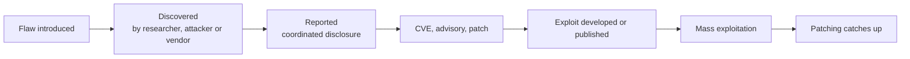

# Vulnerabilities and exploitation

> [!TIP]
> **In short:** a **vulnerability** is a weakness; an **exploit** is the technique that uses it; the **payload** is what runs afterwards. To work with them professionally you need three skills: **identifying and rating** vulnerabilities (CVE, CWE, CVSS v4.0, EPSS and the CISA KEV catalog), **understanding why an exploit works** before you run it, and **choosing the lowest-impact way to prove the finding**. Exploitation is rarely the first or best tool: misconfigurations and valid credentials usually get you further with less risk. For the defender the same knowledge translates into patch priority, virtual patching and detection of exploit behavior.

> [!CAUTION]
> Run exploits only against systems you are authorized to test, ideally your own isolated lab. Public exploit code is often unreviewed, can crash targets and is sometimes itself malicious. Never run code you have not read.

## Vocabulary

| Term | Meaning |
|---|---|
| **Vulnerability** | A weakness in design, code or configuration that can be abused to violate a security property |
| **Exploit** | Code or technique that takes advantage of a vulnerability |
| **Payload** | The action the exploit delivers (run a command, open a session, drop a file) |
| **PoC** (proof of concept) | A minimal demonstration that a flaw is real, often not safe for production use |
| **Weaponized exploit** | A reliable, packaged exploit ready for operational use |
| **0-day** | Exploited (or known to the attacker) before the vendor has a fix |
| **N-day** | A vulnerability with a published fix; exploitation continues because patching lags |
| **RCE / LPE / DoS / info leak** | Remote code execution / local privilege escalation / denial of service / disclosure of memory or data |
| **Zero-click / one-click** | Exploitation needing no user action / a single user action |

## Identifiers and scores

| Source | What it is |
|---|---|
| **CVE** | A unique ID (`CVE-2021-44228`) for a specific vulnerability, assigned by CVE Numbering Authorities such as vendors and national CERTs. The program's funding and governance have been in the news, so check [cve.org](https://www.cve.org/) for its current state |
| **NVD** | The US National Vulnerability Database enriches CVEs with scores and affected-product data. Its analysis backlog since 2024 means enrichment may be missing for recent entries; vendor and CNA advisories are primary |
| **CWE** | The *type* of weakness (CWE-79 cross-site scripting, CWE-787 out-of-bounds write); used to learn patterns and to label findings |
| **CAPEC** | Common attack patterns |
| **CPE / purl / SBOM** | Ways to say which product and version is affected |
| **CVSS v4.0** | A severity score from FIRST (2023). **Base** metrics describe the flaw: attack vector, complexity, attack requirements, privileges, user interaction, and impact on the vulnerable and subsequent systems. **Threat** adds exploit maturity; **Environmental** adjusts for your context; **Supplemental** adds safety, automatability, recovery and more. Scores are written CVSS-B, CVSS-BT, CVSS-BE or CVSS-BTE. Bands: 0.1 to 3.9 low, 4.0 to 6.9 medium, 7.0 to 8.9 high, 9.0 to 10.0 critical |
| **EPSS** | The Exploit Prediction Scoring System: the probability that a CVE will be exploited in the wild in the next 30 days (version 4 released in 2025) |
| **CISA KEV** | The Known Exploited Vulnerabilities catalog: CVEs with evidence of real exploitation, with remediation due dates for US federal agencies |
| **SSVC** | A decision-tree method (outcomes Track, Track*, Attend, Act) that combines exploitation status, automatability, impact and mission context |

**●●●** (FIRST, CISA, MITRE.)

**Rating is not prioritizing.** CVSS says how bad a flaw could be. Whether you should fix it *first* depends on whether it is exploited (KEV, EPSS), whether the asset is exposed, and what the asset is worth. A critical CVSS score on an unreachable internal host can wait; a medium on an internet-facing server that appears in KEV cannot. See [Vulnerability and exposure management](../07-defensive-security/07-vulnerability-and-exposure-management.md).

## The lifecycle

The order varies: an attacker may find a flaw first and exploit it as a 0-day for months, or a patch may be reverse-engineered (**patch diffing**) within hours of release to build an N-day exploit. The time between disclosure and exploitation has been shrinking, which is why exposed systems need patching in days, not quarters. **●●○**

## Case studies

| Case | CVE | Class | Why it mattered | Lesson |
|---|---|---|---|---|
| **Heartbleed** (2014) | CVE-2014-0160 | Out-of-bounds read in OpenSSL's heartbeat | Leaked server memory, including keys and passwords, from a huge share of the internet | Critical libraries need funding and review; memory safety |
| **Shellshock** (2014) | CVE-2014-6271 | Command injection through Bash environment variables | Web servers using CGI executed attacker commands | Old, ubiquitous components hide old bugs |
| **EternalBlue** (2017) | CVE-2017-0144 (MS17-010) | Memory corruption in SMBv1 | Powered the WannaCry and NotPetya outbreaks | Patch quickly; disable legacy protocols; segment networks |
| **BlueKeep** (2019) | CVE-2019-0708 | Pre-authentication RDP flaw | Wormable; huge exposed population | Do not expose RDP to the internet |
| **Zerologon** (2020) | CVE-2020-1472 | Cryptographic flaw in Netlogon | Unauthenticated takeover of a domain controller | Identity infrastructure is tier 0 |
| **PrintNightmare** (2021) | CVE-2021-34527 | Print Spooler code execution and privilege escalation | Reachable on every Windows server | Disable unneeded services |
| **Log4Shell** (2021) | CVE-2021-44228 | Injection through logged strings (JNDI lookups) | A logging library gave remote code execution almost everywhere | Know your dependencies; SBOMs |
| **ProxyLogon** (2021) | CVE-2021-26855 and related | Chain of flaws in Exchange | Mass compromise of mail servers | Internet-facing servers are targets; patch and monitor |
| **Citrix Bleed** (2023) | CVE-2023-4966 | Session token leak in NetScaler | Session hijacking that bypassed MFA | Edge appliances are high-value; session tokens are credentials |
| **MOVEit Transfer** (2023) | CVE-2023-34362 | SQL injection leading to a web shell | A ransomware group stole data from many organizations at once | Third-party file transfer tools concentrate risk |
| **regreSSHion** (2024) | CVE-2024-6387 | Race condition in OpenSSH's server | Unauthenticated remote code execution on some Linux systems | Even hardened code regresses |
| **xz backdoor** (2024) | CVE-2024-3094 | Malicious code planted by a trusted maintainer | Nearly reached sshd on major distributions | Supply chain trust; see [Secure development](../05-application-security/06-secure-development-and-supply-chain.md) |

Read the advisory and one technical write-up for each. Your goal is to be able to explain the **root cause**, **the condition that made it exploitable** and **what would have stopped it**.

## How exploitation works

| Part | Meaning |
|---|---|
| **Trigger** | The input or condition that reaches the vulnerable code |
| **Primitive** | What the bug gives the attacker: an arbitrary read, an arbitrary write, control of the instruction pointer, a command-injection point |
| **Bypassing mitigations** | Defeating DEP/NX, ASLR, stack canaries, CFG and similar (see [Memory and exploit mitigations](../02-systems/04-memory-and-exploit-mitigations.md)) |
| **Payload** | The code or command that runs once control is gained |
| **Delivery** | The network request, file or message that carries the exploit |

Logic bugs, authentication bypasses and injection flaws skip the memory-corruption steps: the "primitive" is already a command or a query. These are usually more reliable and less likely to crash the target.

### Shells, conceptually

| Kind | How it works | Why defenders care |
|---|---|---|
| **Reverse shell** | The compromised host connects **out** to the attacker and receives commands | Works through firewalls that block inbound connections; detected by egress filtering and by unusual outbound connections from servers |
| **Bind shell** | The compromised host listens on a port | Needs an inbound path; easy to spot with a firewall and port monitoring |
| **Web shell** | A script placed on a web server that runs commands sent over HTTP | Persists as a file on disk; detected with file integrity monitoring and by a web server process spawning a shell |

The point for a defender is the **behavior**, regardless of the tool: a web server process starting `sh` or `cmd`, a server making a new outbound connection, a new listening port, a new file in a web directory.

### Using Metasploit in a lab

The Metasploit Framework is a library of reviewed exploit and auxiliary modules with a common interface, useful for learning and for repeatable testing.

| Step | Command |
|---|---|
| Start | `msfconsole` |
| Find a module | `search type:exploit name:vsftpd` |
| Select and read | `use exploit/unix/ftp/vsftpd_234_backdoor`, then `info` |
| Configure | `show options`, `set RHOSTS 10.10.20.50` |
| Verify safely | `check` (when the module supports it) |
| Run | `run` |

Always understand what the module does before you run it. The vsftpd 2.3.4 backdoor (CVE-2011-2523), found on Metasploitable 2, is a good first study: it is not a coding mistake but malicious code inserted into the distributed source in 2011, an early supply chain compromise. Practice exploiting it, then read how it was discovered.

### Handling public exploit code

1. Find it in reputable places: the vendor advisory, Exploit-DB (the `searchsploit` tool searches a local copy), Metasploit, or researchers you can identify.
2. **Read every line.** Fake PoCs that infect the person running them have been published for popular CVEs.
3. Run it in an isolated VM, never on your daily machine.
4. Match the target version exactly; most failures and crashes come from wrong assumptions.
5. Take a VM snapshot first. Memory-corruption exploits crash services.
6. Prefer a non-destructive proof (a harmless command or a marker file) and keep the output as evidence.

## Learning exploit development

A path that builds understanding rather than copy-and-run skills:

| Step | Resource | Purpose |
|---|---|---|
| 1. Memory and the stack | [Memory and exploit mitigations](../02-systems/04-memory-and-exploit-mitigations.md); Aleph One (1996), *Smashing the Stack for Fun and Profit*; Erickson (2008) | Understand why overflows work |
| 2. Classic stack overflow | A vulnerable 32-bit program you compile yourself with protections disabled, in a lab | Control the instruction pointer |
| 3. Mitigation bypasses and ROP | ROP Emporium, pwn.college | Return-oriented programming |
| 4. Heap and modern targets | Nightmare, OpenSecurityTraining2 | Heap layouts, use-after-free |
| 5. Tooling | `gdb` with pwndbg or GEF, pwntools, Ghidra | Debugging, scripting, reversing |

See also [Reverse engineering basics](../09-malware-and-reverse-engineering/05-reverse-engineering-basics.md).

## Vulnerability research

Researchers find new bugs with a loop of **target, tool, triage**.

| Method | How |
|---|---|
| **Code review** | Read source or decompiled code, following untrusted input to dangerous operations |
| **Fuzzing** | Feed mutated inputs to a program and watch for crashes. Coverage-guided fuzzers (AFL++, libFuzzer, honggfuzz) learn which inputs reach new code |
| **Static analysis** | Query code for patterns (CodeQL, Semgrep) |
| **Patch diffing** | Compare vulnerable and fixed binaries (BinDiff, Diaphora) to learn what the patch changed |
| **Protocol and API analysis** | Test implementations against malformed messages and unexpected sequences |

A fuzzing workflow: build the target with sanitizers (AddressSanitizer, UndefinedBehaviorSanitizer); write a small harness that feeds data into the function you care about; start from a seed corpus; run; **triage** crashes (deduplicate, minimize, find root cause, judge exploitability); report.

### Coordinated vulnerability disclosure

| Step | Practice |
|---|---|
| **Find the channel** | Look for `security.txt` (RFC 9116), a security policy page, a bug bounty or vulnerability disclosure program; otherwise a CERT |
| **Stay within the rules** | Test only what the policy allows; never access, copy or keep other people's data |
| **Report clearly** | Affected product and version, impact, minimal steps to reproduce, suggested fix |
| **Agree on timing** | A common norm is about 90 days to fix before publication, adjusted for severity and effort |
| **Request a CVE** | Through the vendor's CNA or a CNA of last resort |
| **Publish responsibly** | After the fix or the deadline, with enough detail to help defenders |

The CERT Coordination Center's *Guide to Coordinated Vulnerability Disclosure* is the standard reference. In Colombia there is no general safe harbor for researchers, so rely on an explicit program policy or written permission (see [Legal limits and ethics](../01-foundations/05-legal-and-ethics.md)). **●●●**

## The defender's view

| Layer | Controls |
|---|---|
| **Reduce exposure** | Do not expose management interfaces; segment networks; remove unused services |
| **Patch by priority** | KEV and EPSS first, then exposure and asset value; track time to patch |
| **Virtual patching** | A WAF or IPS rule that blocks a known exploit while the patch is scheduled (a stopgap) |
| **Exploit mitigations** | Keep operating-system protections and EDR exploit-protection features on |
| **Detection** | IDS signatures for exploit attempts; **process lineage** alerts (web server spawns a shell); unexpected outbound connections from servers; crash and fault events for services (Windows Error Reporting, application crash logs); new files in web roots |
| **Threat intelligence** | Subscribe to KEV and vendor advisories; watch for exploitation of products you run |
| **Response readiness** | Know how to isolate a server and rotate credentials quickly |

## Practice

1. In your lab, take Metasploitable 2: list its services, research the CVEs for three of them (CVSS, EPSS, KEV status) and rank them in two ways, by CVSS only and by exploitation likelihood and exposure. Explain the differences.
2. Exploit the vsftpd 2.3.4 backdoor with Metasploit and then by hand with `nc`, from a clean snapshot, and write both up.
3. Choose four cases from the table above. For each, write five lines: class, root cause, who was affected, what would have stopped it, how you would detect exploitation.
4. Compile a small C program with an obvious stack overflow in your lab, crash it, find the offset with a debugger, and document what each mitigation (canary, NX, ASLR) changes when you re-enable it.
5. Write a tiny C parser with a seeded bug, fuzz it with AFL++ or libFuzzer under AddressSanitizer, and triage the crash.
6. Draft a disclosure report for a made-up vulnerability using the steps above.

These support [Module 2.3](../../roadmap/phase-2-guided-practice/03-machines-and-ad.md) and the [offensive track](../../roadmap/phase-3-specialization/track-offensive.md) of the roadmap.

## What to do with this

- [ ] Explain the difference between CVE, CWE, CVSS, EPSS and KEV in one sentence each.
- [ ] Write your own rule for prioritizing a vulnerability list.
- [ ] Explain why a reverse shell is easier to detect with egress controls than a bind shell with ingress controls.
- [ ] Read one advisory and one technical analysis a week and keep a log in your notes.
- [ ] Set up a feed (CISA KEV, vendor advisories) and read it for a month.

## Key references

Aleph One (1996) · CERT/CC Guide to Coordinated Vulnerability Disclosure · CISA KEV · CVE Program · Erickson (2008) · FIRST CVSS v4.0 · FIRST EPSS · MITRE CWE · RFC 9116. Full list in [References](../15-references.md).
