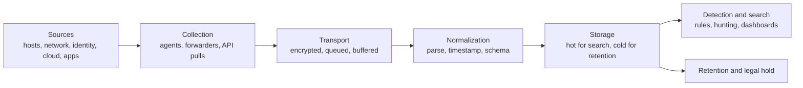

# Logging and telemetry

> [!TIP]
> **In short:** you cannot detect, investigate or prove what you do not record. Logging and telemetry are the raw material every later defensive activity depends on: detection rules, incident response, forensics, threat hunting, and compliance evidence all read from the same pipeline. The discipline is to log the **right events**, with the **right fields**, from the **right sources**, ship them somewhere an attacker who gains local access cannot delete them, keep them **long enough**, and only then build alerts on top. Most real investigations are not slowed down by a lack of tools; they are slowed down by a gap in logging nobody noticed until the day it mattered.

## Why this comes before detection

Detection engineering, incident response and forensics are all described in the pages that follow this one, and every one of them assumes the data already exists. A detection rule that references a field your logs do not capture is not a rule, it is a wish. Building the pipeline first, and testing that it actually captures what you think it does, is what makes the rest of this section possible. OWASP's logging guidance and NIST's incident-handling guide both treat logging as a prerequisite control, not a detection technique in itself. **●●●**

## What to log

| Category | Examples | Why it matters |
|---|---|---|
| **Authentication** | Logon success and failure, MFA events, password and credential changes, session creation and termination | The starting point of almost every intrusion and the clearest signal of account abuse |
| **Authorization** | Access denied, privilege or role changes, group membership changes | Shows both attempted and successful escalation |
| **Process and command execution** | Process creation with full command line and parent process, script block logging, scheduled task and service creation | The core of endpoint detection; see [Detection engineering](02-detection-engineering.md) |
| **Network** | Connection metadata (flow logs), DNS queries, proxy and firewall logs, VPN connections | Shows reach and movement even when content is encrypted |
| **Data access** | Reads and writes to sensitive files, databases and object storage; bulk downloads | Detects exfiltration and insider misuse |
| **Configuration and administrative changes** | Group policy, firewall rules, identity provider settings, cloud IAM policy changes, security tool changes (an EDR agent stopped or uninstalled) | Attackers modify defenses; so do mistakes |
| **Application events** | Input validation failures, errors, business-logic events (a large transfer, many failed lookups) | Catches what infrastructure logs cannot see |
| **Email and web gateway** | Delivered and blocked messages, clicked links, downloaded files | Covers the most common initial access vector |

**●●●** (NIST SP 800-92 and its draft Revision 1; OWASP Logging Cheat Sheet.)

### What belongs in one event

A useful log line answers five questions. If any is missing, the event is weaker evidence than it looks.

| Question | Field |
|---|---|
| **Who** | User, account, service identity, source process |
| **What** | Action taken, object acted on, outcome (success, failure, denied) |
| **When** | Timestamp, in UTC, with enough precision to order events across systems |
| **Where** | Host, source and destination address, application, cloud region |
| **How** | The command, request or API call that produced it |

```json
{
  "timestamp": "2026-11-03T14:22:07Z",
  "event": "authentication.failure",
  "user": "jrodriguez",
  "source_ip": "203.0.113.45",
  "host": "vpn-gw-01",
  "method": "password",
  "reason": "invalid_credentials",
  "attempt_count": 7
}
```

Structured, consistent fields (a schema) are what let a single detection rule or query work across many log sources instead of one regular expression per source. The **Open Cybersecurity Schema Framework** (OCSF) is an open, vendor-neutral effort to give security events a common shape across tools; adopting a consistent schema, whether OCSF or your own, pays off the first time you have to correlate a firewall log with an EDR alert during an incident. **●●○**

## Sources, by platform

| Platform | What to enable | Notes |
|---|---|---|
| **Windows** | Security log auditing (logon, object access, privilege use), **PowerShell Script Block Logging** and Module Logging, process creation with command line (Event 4688, with command-line auditing enabled via policy), **Sysmon** for process, network, file and registry telemetry beyond the built-in log | Sysmon ships with Windows 11 as an optional, built-in capability; a tuned configuration (SwiftOnSecurity's or sysmon-modular) controls the volume. See [Windows internals](../02-systems/02-windows-internals-for-security.md) |
| **Linux** | `auditd` rules for identity files, privilege use and sensitive paths; shell history with user attribution; `journald` or syslog for service logs | Rules for `sudoers`, `passwd` and `shadow` are given in [Privilege escalation](../06-offensive-security/04-privilege-escalation.md) |
| **Network devices** | Firewall allow and deny logs, NetFlow or IPFIX, DNS query logs, DHCP leases | DNS logs are disproportionately useful: most malicious activity resolves a name first |
| **Identity providers** | Sign-in logs, risk signals, conditional access decisions, administrative actions, consent grants | Often the fastest signal of account compromise; see [Authorization, sessions and federation](../04-cryptography-and-identity/05-authorization-sessions-and-federation.md) |
| **Cloud platforms** | Control-plane audit logs (who called which API), object storage access logs, load balancer and WAF logs | Control-plane logs are the cloud equivalent of Windows Security logs; see [Cloud security fundamentals](../08-cloud-and-infrastructure/01-cloud-security-fundamentals.md) |
| **Endpoint detection and response** | Process, network, file and memory telemetry, with vendor-specific detections layered on top | Often the richest single source; see [Detection engineering](02-detection-engineering.md) |
| **Applications** | Authentication, authorization and business events as in the table above | The only layer that can see application-level abuse |

## Building the pipeline



| Stage | Key decisions |
|---|---|
| **Collection** | Agent-based (an EDR or log-forwarder agent on every host) versus agentless (API pulls from cloud and SaaS platforms); both are usually needed |
| **Transport** | Encrypt in transit; buffer so a brief network loss does not drop events; use a message queue for volume spikes |
| **Normalization** | Parse into structured fields, apply one timestamp standard (UTC, ISO 8601), map to a shared schema |
| **Storage** | A "hot" tier for fast search over recent data, a cheaper "cold" tier for longer retention; index what you will actually search |
| **Access** | Role-based access to logs; logs often contain the same sensitive data as the systems they describe |

### Centralize, and protect the center

**Ship logs off the host that generated them, continuously, not on request.** An attacker with local administrative or root access can edit or delete local logs (ATT&CK T1070, Indicator Removal), so a log that only exists on the compromised host is not reliable evidence. A central collector that receives a forwarded copy the moment an event occurs removes that single point of failure.

| Principle | Why |
|---|---|
| **Write-once or append-only storage** for the central copy | Prevents quiet tampering after the fact |
| **The logging infrastructure is itself a tier 0 asset** | Whoever controls it can blind every detection or rewrite the record |
| **Monitor the pipeline itself** | A host that stops sending logs is itself a signal worth alerting on |
| **Time synchronization** (NTP) across every source | Without it, correlating events across systems during an investigation is close to guesswork |

## Retention

| Driver | Typical guidance |
|---|---|
| **Investigation needs** | Many intrusions are discovered weeks or months after initial access (industry breach reports consistently show dwell time measured in weeks), so logs that expire in days cannot answer "how did they get in?" |
| **Regulatory and contractual requirements** | PCI DSS requires at least 12 months of log retention with 3 months immediately available; sector regulators and contracts may set their own minimums; see [Frameworks and standards](../10-governance-risk-and-compliance/02-frameworks-and-standards.md) |
| **Cost** | High-volume sources (network flow, DNS) usually need tiered retention: full detail for weeks, summarized or sampled for longer |
| **Legal hold** | Once an incident or a legal matter is known, retention rules can be overridden to preserve relevant logs regardless of the normal schedule |

Decide retention **per source**, not as one blanket number: authentication logs are small and worth keeping longer; full packet capture is large and usually kept for days.

## Privacy and legal handling of logs

Logs routinely contain personal data: usernames, IP addresses, email addresses, sometimes more. In Colombia this brings them inside **Ley 1581 de 2012**: collect only what the stated purpose needs, secure it, and do not keep it indefinitely without a reason tied to that purpose. See [Privacy and data protection](../10-governance-risk-and-compliance/04-privacy-and-data-protection.md). Two practical consequences:

- **Never log secrets.** Passwords, full tokens, session cookies and card numbers must never reach a log line; mask or omit them at the source, because a leaked log then becomes a credential leak (this is OWASP Top 10:2025's A09 concern in reverse: logging too much sensitive data is itself a failure).
- **Control who can read logs.** The same data that helps an investigator helps an attacker who reaches the logging platform; apply least privilege and log access to the logs themselves.

## Quality checks

A pipeline that looks complete can still have silent gaps. Verify it:

| Check | How |
|---|---|
| **Coverage test** | Perform a known, harmless action (a failed login, a specific command) and confirm the expected event arrives, end to end, within the expected delay |
| **Clock check** | Compare timestamps across two sources for the same real-world event |
| **Volume baseline** | Know the normal daily volume per source, so a source going quiet is noticed quickly |
| **Field completeness** | Spot-check that the "who, what, when, where, how" fields are actually populated, not blank or placeholder values |
| **Parser regression** | A vendor update that changes a log format can silently break your parsing; test after upgrades |

**Practical implication:** the question "are we logging X?" is less useful than "if X happened right now, would it show up, correctly parsed, in our search tool, within an acceptable delay?" Only the second one is testable, and testing it is the job.

## Practice

1. In your lab, enable PowerShell Script Block Logging (or `auditd` rules on Linux) and Sysmon with a public baseline configuration. Run a handful of ordinary and suspicious-looking actions and confirm each produces the event you expect, with the fields you need.
2. Ship your lab's logs to a central collector (a free tier of a SIEM, or even a simple log shipper into a local Elasticsearch or similar stack) and verify the coverage test above end to end.
3. Write down your own retention policy for three log sources in your lab, with the reasoning for each duration.
4. Delete a local log file on a test VM after simulating a harmless "attack," and show that the centrally shipped copy survived. Explain why this matters for evidence integrity.
5. Pick one log source and list every field it is missing that the "who, what, when, where, how" framework calls for, then fix the configuration.

These support [Module 1.5](../../roadmap/phase-1-security-fundamentals/05-network-defense-monitoring.md) of the roadmap and are the foundation for [Detection engineering](02-detection-engineering.md).

## What to do with this

- [ ] List, for your own lab or home network, every log source you currently have and every one you are missing from the source table above.
- [ ] Run the coverage test on your three most important log sources.
- [ ] Write the retention policy for each source you control.
- [ ] Explain why local logs alone are not reliable evidence, citing the relevant ATT&CK technique.
- [ ] Find and remove one place where a secret could end up in a log, in any project you maintain.

## Key references

MITRE ATT&CK · NIST SP 800-92 and draft Revision 1 · OCSF (Open Cybersecurity Schema Framework) · OWASP Logging Cheat Sheet · PCI DSS 4.0.1. Full list in [References](../15-references.md).

<!-- navigation -->
[← Red teaming and adversary emulation](../06-offensive-security/06-red-teaming-and-adversary-emulation.md) · [Index](../00-start-here.md) · [Detection engineering →](02-detection-engineering.md)
