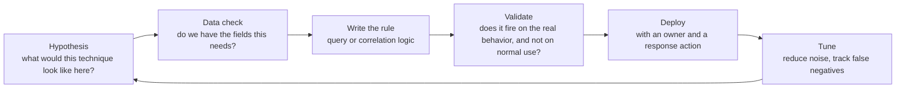

# Detection engineering

> [!TIP]
> **In short:** detection engineering treats alerting as software: you write a **hypothesis** about attacker behavior, express it as a **testable rule** against real telemetry, **validate** that it fires on the behavior and does not drown the team in noise, deploy it, and **maintain** it as the environment and adversary techniques change. The organizing structure for almost everyone doing this work is **MITRE ATT&CK**: it gives detections a shared name, lets you track coverage, and keeps the question concrete: "for this specific technique, what would it look like in our own logs, and do we see it?"

## From log to detection

[Logging and telemetry](01-logging-and-telemetry.md) gets the data in. Detection engineering turns data into an actionable signal. The difference between a data source and a detection is a tested, maintained rule that someone will act on.



A detection without a response action documented is half-built: someone needs to know what to do when it fires, or it will be silenced within a month.

## Detection strategies, from brittle to robust

| Strategy | Example | Robustness | Maintenance cost |
|---|---|---|---|
| **Atomic indicators** | A known-bad IP address, file hash or domain | Low: trivial for an adversary to change | Low per item, but requires constant feed updates |
| **Specific tool signatures** | A string or pattern unique to one attack tool's default configuration | Low to medium: defeated by renaming, recompiling or switching tools | Medium |
| **Behavioral patterns** | "A process other than a browser or update tool spawns a command interpreter and makes an outbound connection" | Higher: survives many tool changes because it targets the *behavior*, not the artifact | Higher to build, lower to maintain |
| **Analytics and anomaly detection** | Statistical baselining of login times, data volumes or peer groups | Variable: strong for catching the unknown, prone to noisy baselines | High: needs tuning and a feedback loop |

The Pyramid of Pain (already introduced in [Adversaries and attack frameworks](../01-foundations/04-adversaries-and-attack-frameworks.md)) explains the trade-off directly: indicators are cheap to write but cheap for the attacker to invalidate; behaviors are expensive to build but expensive for the attacker to avoid, because avoiding them usually means changing how the technique works at all. **Favor behavioral detections wherever the data supports them, and use atomic indicators as a cheap supplement, not the strategy.** **●●●**

## Writing a detection from an ATT&CK technique

A repeatable method:

1. **Pick a technique** (for example T1053.005, Scheduled Task). Read its ATT&CK page: what does it look like, what tools implement it, what data sources does MITRE itself suggest?
2. **State the behavior in your own environment's terms.** "A scheduled task is created or modified by a process other than the expected administration tools, or outside a change window."
3. **Identify the exact event and fields** that would show this (Windows Event 4698 for scheduled task creation, the task's command line, the creating process and account).
4. **Write the query or rule.**
5. **Test against known-good activity** (does your own IT team's legitimate task creation fire it?) **and against a safe reproduction of the technique** (an Atomic Red Team test for the same technique, as introduced in [Red teaming and adversary emulation](../06-offensive-security/06-red-teaming-and-adversary-emulation.md)).
6. **Tune**: add exceptions for known-legitimate sources, or narrow the logic, until the signal-to-noise ratio is something a human can sustain.
7. **Document**: the technique ID, the logic, the data dependency, the expected false positives, and what to do when it fires.
8. **Track coverage** on an ATT&CK Navigator layer, and revisit when the technique's real-world implementation shifts.

A documentation template per rule, worth keeping consistent across a team:

```markdown
## Scheduled task created by an unexpected process (T1053.005)

**Logic:** Event ID 4698 where the creating process is not in {task scheduler, approved RMM tool, approved deployment tool}.
**Data required:** Windows Security log, 4698 enabled; process creation context.
**Expected false positives:** Software installers that register update tasks; list and exclude known ones.
**Response:** Investigate the task's action and the parent process; if unexplained, isolate the host and escalate per the incident response plan.
**Tested against:** Atomic Red Team T1053.005 test 1, <date>, fired as expected.
```

## Tuning: the real job

Most of the lasting effort in detection engineering is tuning, not writing. A rule that is too broad trains the team to ignore it (**alert fatigue**); a rule that is too narrow misses the technique the moment it is implemented slightly differently.

| Term | Meaning | Cost of getting it wrong |
|---|---|---|
| **True positive** | Fired correctly on real malicious activity | The goal |
| **False positive** | Fired on legitimate activity | Wastes analyst time; too many, and real alerts get ignored |
| **False negative** | Did not fire on real malicious activity | The activity goes unnoticed; usually worse than a false positive |
| **True negative** | Correctly did not fire | Expected background state |

**Practical implication:** a detection engineer's default question when a rule is noisy is not "how do I make it quieter?" but "what distinguishes the legitimate cases from the malicious one, specifically?" The answer is usually a more precise condition, not a blanket suppression, because a blanket suppression tends to reopen the false-negative side.

Track, per rule: how often it fires, what fraction were true positives, and how long it has been since it last fired at all (a rule that never fires might be broken, not quiet).

## Sources of detection logic

You do not have to invent every rule from nothing.

| Source | What it gives you |
|---|---|
| **Sigma rules** | An open, vendor-neutral format for sharing detection logic, with converters to many SIEM query languages |
| **MITRE ATT&CK's data sources and detections fields** | Starting points per technique |
| **Vendor and community detection repositories** | Pre-built rules for specific products (EDR vendors, SIEM vendors) and open collections |
| **Purple team sessions** | The fastest way to validate that a rule written from documentation actually fires against the real technique in your own environment, as described in [Red teaming and adversary emulation](../06-offensive-security/06-red-teaming-and-adversary-emulation.md) |
| **Incident postmortems** | Every real incident should produce at least one new or improved detection; see [Incident response](04-incident-response.md) |
| **Threat intelligence** | Reporting on a specific actor's techniques, translated into detections for the techniques relevant to you; see [Threat intelligence and hunting](06-threat-intelligence-and-hunting.md) |

Adapting a published rule to your own environment, rather than deploying it unmodified, is normal and necessary: field names, process names and what counts as "normal" differ by organization.

## Where detections live

| Layer | Typical detections | Tooling |
|---|---|---|
| **Endpoint** | Process behavior, memory injection patterns, credential access attempts | EDR platforms, Sysmon plus a SIEM |
| **Network** | Beaconing patterns, protocol misuse, known-bad destinations, lateral movement patterns | Zeek, Suricata, NetFlow analytics (see [Traffic analysis and scanning](../03-networking/05-traffic-analysis-and-scanning.md)) |
| **Identity** | Impossible travel, new MFA method registration, privilege escalation, anomalous sign-in patterns | Identity provider risk engines, SIEM correlation |
| **Cloud control plane** | Unusual API calls, new access keys, policy changes, disabled logging | Cloud-native detection services, SIEM ingestion of audit logs |
| **Application** | Business-logic abuse, authentication anomalies | Application logs correlated in a SIEM |

A **SIEM** (security information and event management platform) is usually where cross-source correlation happens: a detection that needs "a login from a new country" **and** "followed within an hour by a large download" **and** "from an account that normally does neither" is a correlation across identity and data-access logs that no single source log can express alone.

## Keeping detections alive

Detections decay. An environment changes (new software, new admin tools), and adversary techniques evolve (a new tool replaces an old one that your signature-based rule depended on). A sustainable program:

| Practice | Why |
|---|---|
| **Periodic re-validation** | Re-run the Atomic Red Team test (or equivalent) that originally validated each rule, on a schedule, to catch silent breakage from environment changes |
| **Ownership per rule** | A rule with no owner gets neither tuned nor retired |
| **A retirement process** | A rule that duplicates a better one, or whose technique is no longer relevant, should be removed, not left to add noise forever |
| **Coverage reviews against current threat reporting** | New techniques reported for relevant threat actors should become new detections on a regular cadence, not only after an incident |

## Practice

1. Pick three ATT&CK techniques relevant to your lab environment (one each from initial access, discovery and privilege escalation). For each, follow the eight-step method above and produce one documented, tested rule.
2. Install a SIEM's free tier or an open-source stack in your lab, ingest Sysmon and Windows Security logs, and reproduce the scheduled-task example above end to end.
3. Take one published Sigma rule, convert it to your SIEM's query language, and test it against both legitimate activity and an Atomic Red Team reproduction of the technique it targets.
4. For one of your detections, deliberately generate the false positive you are most worried about and refine the logic until it stops firing on that case without losing the true positive.
5. Build an ATT&CK Navigator layer showing your lab's current detection coverage, and identify the three gaps you would close next.

These support [Module 1.5](../../roadmap/phase-1-security-fundamentals/05-network-defense-monitoring.md) and the [defensive track](../../roadmap/phase-3-specialization/track-defensive.md) of the roadmap.

## What to do with this

- [ ] Explain the Pyramid of Pain in your own words and say why behavioral detections are worth their extra cost.
- [ ] Write and test one complete detection, documented with the template above.
- [ ] Explain the difference between a false positive and a false negative, and why the second is usually worse.
- [ ] Build and maintain a small, personal library of documented detections for your lab.
- [ ] Describe your own process for retiring a detection that no longer earns its noise.

## Key references

MITRE ATT&CK · OWASP Logging Cheat Sheet · Red Canary resources · Sigma (SigmaHQ) · The Pyramid of Pain (Bianco, 2014). Full list in [References](../15-references.md).
