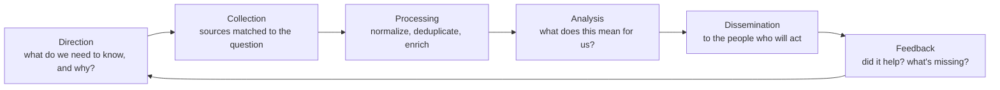

# Threat intelligence and hunting

> [!TIP]
> **In short:** **threat intelligence** is information about adversaries, analyzed enough to change a decision; a feed of indicators nobody acts on is just noise with a subscription fee. **Threat hunting** is the proactive search for intrusions that existing detections have not caught, starting from a hypothesis rather than an alert. The two feed each other: intelligence gives hunters a reason to look somewhere specific, and hunting findings become new intelligence and new detections. Both exist because **detection is never complete**: [Detection engineering](02-detection-engineering.md) builds rules for what you already know to look for, and something always sits outside that.

## Levels of intelligence

| Level | Audience | Question it answers | Example |
|---|---|---|---|
| **Strategic** | Executives, board | What risks should shape our investment and priorities? | "Ransomware targeting our sector has grown 40% year over year" |
| **Operational** | Security management, incident response leads | What campaigns or actors should we prepare for? | "A group known to target Colombian financial institutions is active this quarter" |
| **Tactical** | Detection engineers, SOC | What techniques and tools are being used? | "This actor uses a specific initial-access technique and a specific persistence mechanism" |
| **Technical** | Analysts, automated tools | What specific artifacts can we match against? | A file hash, a domain, an IP address |

Most organizations consume far more technical-level feeds than they can use well, and far less strategic and operational intelligence than would actually change what they do. A mature program invests in the levels that drive decisions, not just the level that is easiest to buy as a feed. **●●○**

## The intelligence cycle

The step most programs skip is **direction**: deciding, explicitly, what questions intelligence work is meant to answer for this organization, before collecting anything. Without it, "threat intelligence" becomes an unread feed of indicators with no connection to a decision anyone makes.

## Sources

| Source | What it offers | Caveat |
|---|---| ---|
| **Open-source intelligence (OSINT)** | Vendor blogs, researcher write-ups, news, vulnerability advisories | Free and broad, but requires your own filtering for relevance |
| **ISACs and sector-sharing groups** | Intelligence specific to an industry, often with trusted peer context | Membership and trust requirements vary by sector and country |
| **National CERTs** | Advisories relevant to a country or region | Coverage and timeliness vary |
| **Commercial threat intelligence platforms** | Curated, enriched, often with analyst support | Cost; still requires your own relevance filtering |
| **Internal sources** | Your own incident history, hunting results, detection telemetry | The most relevant intelligence you have, and the most underused |
| **Information sharing communities** | Peer-shared indicators and context, often under a handling protocol | Quality depends on the community; verify before acting |

## Standards for sharing

| Standard | What it does |
|---|---|
| **STIX** (Structured Threat Information Expression, version 2.1) | A structured format for describing threat information: indicators, actors, campaigns, techniques, and the relationships between them, so intelligence can be shared machine-to-machine instead of as free text |
| **TAXII** (Trusted Automated Exchange of Intelligence Information, version 2.1) | The transport protocol used to exchange STIX content between systems |
| **Traffic Light Protocol (TLP)** | A short-hand for how far a specific piece of shared information may travel (roughly: not shared outside the immediate recipients, shared within an organization and its need-to-know partners, shared within a sector or community, or shared freely). The exact labels and wording have been revised over time (TLP 2.0), so check the current definitions at first.org before using them in a sharing agreement, and always honor the marking you receive even if your own practice differs |

Using a shared, structured format is what makes machine-to-machine sharing (and avoiding a manual rewrite of every incoming report into your own detections) practical at any scale beyond a single analyst reading PDFs.

## From intelligence to action

Intelligence only earns its cost when it changes something. A simple test for any report crossing your desk:

| Question | If yes |
|---|---|
| Does this name a technique relevant to systems we run? | Check detection coverage for that technique; build or improve it |
| Does this name an indicator (domain, hash, address)? | Check historical and current logs for any match; add short-lived detection if warranted |
| Does this name an actor or campaign targeting our sector or region? | Brief relevant stakeholders; consider a focused hunt |
| Does this change our risk picture at a strategic level? | Feed it into risk management and budget conversations, not just the SOC |

An indicator-only response (blocking a hash or an IP address) is the weakest and most perishable action, exactly as the Pyramid of Pain predicts (see [Adversaries and attack frameworks](../01-foundations/04-adversaries-and-attack-frameworks.md)); treat it as a stopgap while you check whether the underlying technique is covered.

## Threat hunting

Hunting starts from the uncomfortable assumption that current detections have already missed something, and asks where to look for it on purpose, rather than waiting for an alert.

### Types of hunts

| Type | Starting point | Example |
|---|---|---|
| **Hypothesis-driven** | A specific, falsifiable guess, usually built from intelligence or an ATT&CK technique | "If an actor used technique T1218 against us, we would see signed binaries executing unusual command lines; let's check" |
| **Baseline or anomaly-driven** | What does normal look like, and what stands out against it? | Unusual process-to-parent relationships across the fleet; rare outbound destinations |
| **Model or analytics-assisted** | Statistical or machine-learning output surfaces candidates for a human to judge | Clustering of similar, rare command lines across many hosts |

### A repeatable loop

1. **Form a hypothesis**, specific enough to be wrong. "Something bad might be happening" is not a hypothesis; "an attacker using technique X would leave artifact Y in data source Z" is.
2. **Check that the data exists** to test it (this is why [Logging and telemetry](01-logging-and-telemetry.md) comes first in this section).
3. **Investigate**: query, pivot, and follow what you find, treating every anomaly as a lead to explain, not a conclusion.
4. **Document findings**, whether or not anything malicious turns up; a hunt that finds nothing still tells you your coverage is likely adequate for that hypothesis, which is useful.
5. **Convert what you learn into a standing detection**, so the next occurrence of the same thing is caught automatically and nobody has to hunt for it by hand again.

This last step is the one that compounds the value of hunting over time: a hunting program that never turns findings into detections is re-doing the same manual work forever.

### Maturity, roughly

| Level | Description |
|---|---|
| **Minimal** | Relies entirely on existing automated detections; no hunting |
| **Procedural** | Follows published hunting procedures from others, with limited customization |
| **Hypothesis-led** | Builds and tests its own hypotheses regularly |
| **Advanced analytics** | Combines hypothesis-driven hunting with statistical and behavioral analytics |
| **Feedback-integrated** | Systematically turns hunt findings into new, automated detections, closing the loop described above |

Treat the climb between these levels as a direction, not a scorecard to game; a team with excellent hypothesis-driven hunting and no feedback loop is not actually more mature than the label suggests.

## Where hunting looks

| Area | Example hunt |
|---|---|
| **Authentication** | Service accounts authenticating interactively; logins at impossible hours for that user's normal pattern |
| **Process execution** | Signed system binaries with unusual parent processes or command-line arguments (living-off-the-land patterns, see [Privilege escalation](../06-offensive-security/04-privilege-escalation.md)) |
| **Network** | Long-lived, low-volume, regular-interval connections to external destinations (beaconing); DNS queries with unusually high entropy |
| **Persistence locations** | New entries in the handful of places malware commonly re-establishes itself after reboot |
| **Data movement** | Unusually large outbound transfers, especially compressed or encrypted archives, especially after hours |

## Practice

1. Pick one ATT&CK technique relevant to your lab, write a specific, falsifiable hunting hypothesis for it, and run the hunting loop end to end: check data availability, query your lab's logs, document the result, and turn it into a detection if it was not already covered.
2. Read one vendor or researcher threat report about an actor relevant to a sector you are interested in. Extract its techniques, map them to ATT&CK, and check your lab's coverage against each one.
3. Build a one-page internal threat intelligence summary (strategic, operational and tactical sections) for a fictional small business, from open sources only.
4. Practice reading and respecting TLP markings: take three fictional pieces of shared information at different TLP levels and write who, specifically, you would and would not share each with.
5. Keep a hunting log for a month of lab work: hypothesis, method, finding, and whether it became a new detection.

These support [Module 2.4](../../roadmap/phase-2-guided-practice/04-blue-team-labs.md) and the [defensive track](../../roadmap/phase-3-specialization/track-defensive.md) of the roadmap.

## What to do with this

- [ ] Explain the four levels of intelligence and give an example audience and decision for each.
- [ ] Run one complete hypothesis-driven hunt in your lab, following the full loop including the feedback step.
- [ ] Explain why an indicator-only response to a threat report is the weakest available action.
- [ ] Describe, from memory, what STIX and TAXII each do and how they relate.
- [ ] Keep a running hunting log and review it monthly for patterns in what you keep finding.

## Key references

FIRST Traffic Light Protocol · MITRE ATT&CK · OASIS STIX 2.1 and TAXII 2.1 · SANS Hunting Maturity Model · Sqrrl threat hunting reference material. Full list in [References](../15-references.md).

<!-- navigation -->
[← Digital forensics](05-digital-forensics.md) · [Index](../00-start-here.md) · [Vulnerability and exposure management →](07-vulnerability-and-exposure-management.md)
