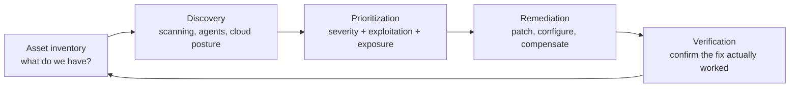

# Vulnerability and exposure management

> [!TIP]
> **In short:** scanning for vulnerabilities is the easy part; **prioritizing and actually fixing** them at the pace attackers exploit them is the program. You cannot patch everything immediately, so the whole discipline is deciding what matters most, right now, given what you have: an accurate **asset inventory**, a way to find vulnerabilities across it, a prioritization method that combines severity with real-world exploitation and your own exposure, and a patching process with enough authority and tracking to close the loop. The field has widened from "find CVEs and patch them" to **exposure management**: the same discipline applied to misconfigurations, excess permissions and attack paths, not only software flaws.

## Why this is a program, not a scan

A vulnerability scanner produces a list. A vulnerability management **program** turns that list into fixed systems, on a schedule the organization can actually sustain, with evidence that it happened. The gap between "we scanned" and "we fixed it" is where most real-world breaches that exploit known, patchable vulnerabilities actually happen: the vulnerability was known, a scanner likely even flagged it, and it stayed open long enough to be used. **●●●**

## The cycle

### Asset inventory

You cannot protect what you do not know you have. A usable inventory covers:

| Asset type | Why it is often missed |
|---|---|
| **Shadow IT** | Systems stood up without going through a formal process |
| **Cloud resources** | Spun up and torn down by developers, outside the traditional CMDB |
| **Third-party and SaaS** | Not "yours" in the traditional sense, but still part of your exposure |
| **End-of-life and unsupported software** | No longer receiving patches at all, which changes the remediation question from "when do we patch" to "when do we replace" |
| **Internet-facing assets specifically** | The highest-priority subset, and the one attackers find first regardless of whether you have inventoried it |

Automated discovery (network scanning, cloud API queries, external attack surface tools that see your organization the way an outsider would) should supplement, not replace, a deliberate inventory process, because automated discovery only finds what is reachable the way it looks for things.

### Discovery

| Method | Finds | Limitation |
|---|---|---|
| **Unauthenticated network scanning** | What is reachable and what it looks like from outside, similar to [reconnaissance](../06-offensive-security/02-reconnaissance-and-enumeration.md) | Cannot see inside a system; many false negatives for patch-level detail |
| **Authenticated / agent-based scanning** | Installed software, patch levels, configuration, in detail | Requires credentials or an agent on every asset |
| **Cloud security posture management (CSPM)** | Misconfigurations and policy violations across cloud accounts | Cloud-specific; does not cover on-premises systems |
| **Software composition analysis** | Vulnerable dependencies in your own code | Covered in [Secure development and supply chain](../05-application-security/06-secure-development-and-supply-chain.md) |
| **External attack surface management** | What an outsider sees, including forgotten and shadow assets | Breadth over depth |

Run discovery on a schedule that matches how fast your environment changes, not an arbitrary calendar date; a cloud environment that changes hourly needs continuous discovery, not a quarterly scan.

## Prioritization: more than a CVSS number

[Vulnerabilities and exploitation](../06-offensive-security/03-vulnerabilities-and-exploitation.md) introduced the scoring systems; here is how a program actually uses them together, because no single score answers "what do we fix first?" on its own.

| Input | What it adds |
|---|---|
| **CVSS** | How bad the flaw could be, technically, in the abstract |
| **EPSS** | The probability it will be exploited in the wild soon |
| **CISA KEV** (or an equivalent national list) | Confirmed, real-world exploitation, right now |
| **Exposure** | Is the asset internet-facing, internal, or isolated? Does it require authentication or user interaction to reach? |
| **Asset value** | What does this system hold or control? Compare a test server against a domain controller or a payment system |
| **Compensating controls** | Is there a WAF rule, network segmentation, or another control already reducing the practical risk? |

A workable priority order for most organizations: **start with anything in the KEV catalog that is exposed**, then high EPSS plus high exposure, then high CVSS on high-value assets, then everything else on a routine cadence. Organizations bound by CISA's Binding Operational Directive 22-01 (US federal civilian agencies) must remediate KEV-listed vulnerabilities by the due date the catalog assigns to each entry; everyone else is encouraged to treat that same catalog as their own floor, not their ceiling. **●●●**

### Service level objectives

Set explicit, written targets, and track them:

| Severity (combined score, not CVSS alone) | Target time to remediate | Notes |
|---|---|---|
| Critical, actively exploited, internet-facing | Hours to days | Emergency change process, not the normal cycle |
| High | Days to a couple of weeks | |
| Medium | Weeks to a month | |
| Low | Routine patch cycle | Still tracked, not forgotten |

Track **mean time to remediate** per severity tier, and treat a slipping trend as seriously as a single missed critical patch; a program that is quietly getting slower is a program heading toward the next preventable breach.

## Remediation

| Action | When |
|---|---|
| **Patch** | The default, when a fix exists and can be deployed safely |
| **Configuration change** | When the fix is a setting, not a new binary (disable a feature, tighten a permission) |
| **Compensating control** | A WAF rule, network ACL or detection that reduces risk while a real fix is scheduled; a stopgap, not a substitute, and tracked with its own expiry |
| **Replace or decommission** | For end-of-life systems with no patch forthcoming |
| **Accept the risk** | A documented, time-bound, re-reviewed decision when remediation genuinely costs more than the risk, approved by someone with the authority to accept it, never a default by inaction |

Patching production systems carries its own risk (an untested patch breaking something that was working), which is why a testing step and a rollback plan belong in the remediation process, not just in the deployment pipeline for your own software (see the testing discipline in [Secure development and supply chain](../05-application-security/06-secure-development-and-supply-chain.md)).

## Verification

A remediation that is not verified is a claim, not a fix. Re-scan or re-check after the change, and confirm the specific vulnerability or misconfiguration is actually gone, not just that "a patch was applied" according to a deployment tool's own report; deployment failures are common enough that this step catches real gaps.

## From vulnerabilities to exposure

Vulnerability management traditionally means "known CVEs in software." **Exposure management** broadens the same discipline to everything that gives an attacker a path, whether or not it has a CVE: a misconfigured permission, an exposed management interface, an attack path through Active Directory or cloud IAM, a weak credential. Gartner's **Continuous Threat Exposure Management (CTEM)** describes this as a five-stage cycle: **scoping** (what matters to the business), **discovery** (vulnerabilities and misconfigurations across that scope), **prioritization**, **validation** (confirming an exposure is actually exploitable, often through the same techniques covered in [Penetration testing methodology](../06-offensive-security/01-penetration-testing-methodology.md) and [Red teaming and adversary emulation](../06-offensive-security/06-red-teaming-and-adversary-emulation.md)), and **mobilization** (getting the fix actually done, which is the organizational, cross-team step most programs underinvest in). **●●○**

**Practical implication:** the graph-based attack-path tools introduced in [Active Directory attacks](../06-offensive-security/05-active-directory-attacks.md) and the cloud IAM analysis in [Cloud IAM and attack paths](../08-cloud-and-infrastructure/02-cloud-iam-and-attack-paths.md) are exposure management tools in the same sense as a CVE scanner: both answer "what is the realistic path to something that matters, and which single fix closes the most paths?"

## Reporting that drives action

| Audience | What to show |
|---|---|
| **Technical owners** | The specific list, with enough detail to act: asset, vulnerability, priority, owner, due date |
| **Management** | Trend over time (open critical count, mean time to remediate), not a raw vulnerability count, which mostly reflects scan coverage rather than risk |
| **Risk and compliance** | Mapping to required controls and frameworks (see [Frameworks and standards](../10-governance-risk-and-compliance/02-frameworks-and-standards.md)), accepted-risk register with review dates |

A raw count of open vulnerabilities, without severity and exposure context, tends to measure how hard you looked rather than how much risk exists, and reporting it that way invites the wrong conversation.

## Practice

1. Build a simple asset inventory for your home lab or network: every device, its role, and its current patch status, kept current as you add or remove devices.
2. Run a free vulnerability scanner (OpenVAS or Nessus Essentials) against your lab and produce a prioritized list using the combined severity, EPSS and exposure method above, not CVSS alone.
3. Pick your three highest-priority findings, remediate each, and verify the fix with a re-scan.
4. Write a one-page accepted-risk justification for one low-priority finding you choose not to fix immediately, with a review date.
5. Track your own mean time to remediate across a month of lab findings and see whether it is improving or slipping.

These support [Module 1.5](../../roadmap/phase-1-security-fundamentals/05-network-defense-monitoring.md) and the [GRC track](../../roadmap/phase-3-specialization/track-grc.md) of the roadmap.

## What to do with this

- [ ] Explain why CVSS alone is a poor prioritization method and what EPSS and KEV each add.
- [ ] Build and maintain an asset inventory for something you are responsible for.
- [ ] Set your own remediation service level objectives, by severity, and track whether you meet them.
- [ ] Explain the five CTEM stages and give a concrete example of each from your own lab.
- [ ] Write one properly justified, time-bound accepted-risk entry.

## Key references

CISA Known Exploited Vulnerabilities catalog and Binding Operational Directive 22-01 · FIRST CVSS v4.0 and EPSS · Gartner CTEM framework · NIST SP 800-40. Full list in [References](../15-references.md).

<!-- navigation -->
[← Threat intelligence and hunting](06-threat-intelligence-and-hunting.md) · [Index](../00-start-here.md) · [Hardening and resilience →](08-hardening-and-resilience.md)
