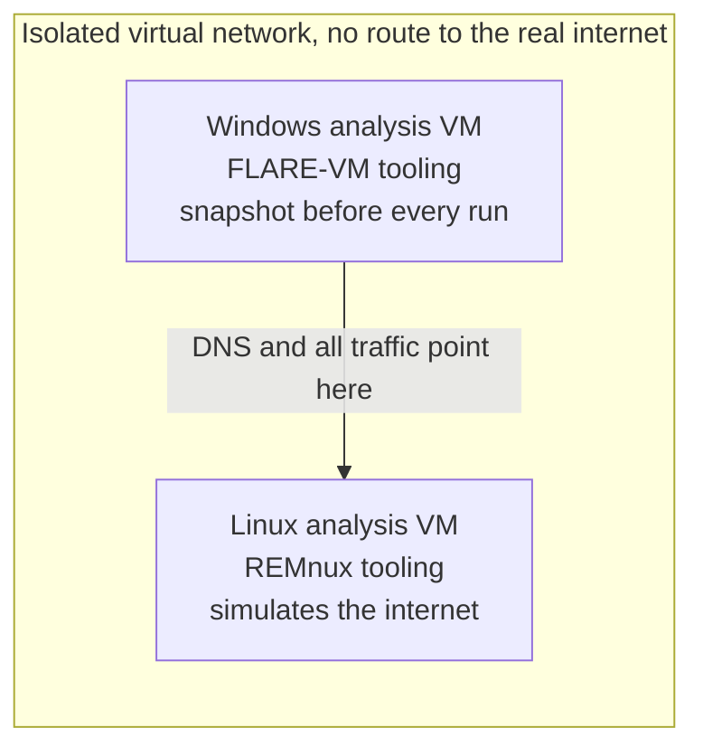

# Safe analysis lab setup

> [!TIP]
> **In short:** the single rule that makes malware analysis safe is **nothing a sample does can reach anything you care about**. That means no shared folders with the host, no real network path out (a simulated one instead), snapshots taken before every run and restored after, and a host machine you would not be devastated to lose if every containment layer somehow failed at once. Build this lab correctly, once, before opening a single real sample. Skipping this step is how a learning exercise becomes a real infection.

> [!CAUTION]
> Every exercise in this section of the knowledge base assumes this lab exists and is used. Never execute an unknown or malicious file on your daily computer, on a machine connected to a network with other devices you care about, or without a snapshot to revert to. Treat every sample as hostile until proven otherwise, including ones that look harmless.

## The containment layers

No single layer is assumed to be perfect; they exist together so that one failure is not catastrophic, the same defense-in-depth reasoning from [Security principles](../01-foundations/02-security-principles.md) applied to a lab instead of a production network.

| Layer | What it does | Why it alone is not enough |
|---|---|---|
| **Virtualization** | Runs the analysis environment as a VM, isolated from the host at the hypervisor level | Virtual machine escape vulnerabilities, while rare, exist; and some malware specifically checks for and behaves differently inside a VM |
| **Network isolation** | The VM has no route to your real network or the internet | A sample with no route out cannot exfiltrate data, call out for further instructions, or scan other real devices, regardless of what it tries |
| **Simulated services** | A dedicated analysis host answers the malware's network requests (DNS, HTTP, and others) without those requests ever reaching the real internet | Lets you observe what the sample *tries* to do over the network, safely, instead of either blocking it outright (which can stop interesting behavior from appearing) or routing it to the real internet (which is never acceptable) |
| **Snapshots** | A saved VM state taken before execution, reverted after | Guarantees a clean, known starting state every time, and removes any temptation to "clean up by hand," which is unreliable |
| **No shared folders or clipboard** between host and guest | Removes the most common accidental escape path: a file or command copied between host and guest | Shared folders are convenient and exactly why they are dangerous; disable them for the analysis VM entirely |
| **A host you could afford to lose** | The last line of defense if every layer above somehow fails together | Never run this lab on your only or daily machine; use a dedicated machine or accept that a full wipe and reinstall is the acceptable worst case |

## Building the lab

A standard, widely used architecture uses two purpose-built systems on an isolated virtual network:

| Component | Role | Notes |
|---|---|---|
| **Windows analysis VM** | Where Windows malware actually runs and is observed | Built from a clean Windows installation, then equipped with analysis tooling using **FLARE-VM**, an open-source installer that provisions a large, consistent set of free analysis tools in one pass |
| **Linux analysis VM** | Simulates the internet the Windows VM believes it is talking to | Built from **REMnux**, a Linux distribution purpose-built for malware analysis, which bundles network simulation and traffic analysis tools |
| **Virtual network** | Connects the two VMs to each other only | Configured as host-only or an isolated internal network in your hypervisor, with no bridge to your real network adapter |
| **DNS redirection** | The Windows VM's DNS server is set to the REMnux VM's address | So that every domain the malware tries to resolve resolves to the simulated environment instead of failing or, worse, reaching the real internet |
| **Network service simulation** | A tool such as **INetSim** running on the Linux VM answers common protocols (HTTP, HTTPS, FTP, SMTP and others) with generic responses | Lets malware "successfully" reach out, which is often necessary to observe its next-stage behavior, while every response actually comes from a machine you control |

### Minimum setup checklist

- [ ] Hypervisor virtual network set to host-only or isolated internal, verified with a connectivity test that confirms the VM cannot reach your real network or the internet.
- [ ] Windows analysis VM built, with FLARE-VM's tooling installed, and a clean snapshot taken immediately after setup, before any sample ever runs.
- [ ] REMnux VM built and configured to simulate common network services.
- [ ] Windows VM's DNS pointed at the REMnux VM, and this confirmed with a test lookup before any sample is introduced.
- [ ] Shared folders, clipboard sharing and drag-and-drop between host and guest disabled.
- [ ] A documented, repeatable process for transferring a sample **into** the isolated environment (typically via an isolated virtual drive mounted only briefly, or a controlled download step performed from inside the already-isolated VM) that does not require re-opening host-guest sharing.
- [ ] A snapshot taken immediately before every single sample run, and reverted to immediately after, with no exceptions.

## Handling samples

| Practice | Why |
|---|---|
| **Rename the file extension** (for example, append `.malware` or similar) before moving it anywhere | Prevents an accidental double-click from your file manager running it outside the intended controlled step |
| **Compute and record the hash** (SHA-256) before anything else | Establishes a stable identifier for the sample, used to check it against public reputation sources and to reference it consistently in your own notes |
| **Keep samples in a password-protected archive** when stored | Prevents antivirus on your own systems, or anyone else's, from automatically deleting or alerting on a file you intend to analyze deliberately |
| **Never execute a sample outside the isolated VM**, including "just to check" on a host tool | There is no justified exception to this rule in a learning context |
| **Document the source and acquisition date** of every sample | Matters for both your own records and, if the sample later needs to be reported or shared with others |

## Observability: what the lab needs to actually show you

Isolation alone only protects you; it does not teach you anything. The analysis VM also needs to be instrumented so that running a sample is observable:

| Tool | What it shows |
|---|---|
| **Process Monitor / Process Explorer** (Sysinternals) | File, registry, and process activity in real time |
| **Wireshark**, running on the capture path between the two VMs | Every network packet the sample actually sends, which can then be compared against what the simulated services answered |
| **A baseline snapshot of the clean system's processes, registry and file system** | Gives you something to diff against after execution, so you can see exactly what changed |
| **The simulated service logs** (INetSim and similar) | What domains and protocols the sample tried to reach, and what it was told in response |

The next three pages of this section (static analysis, dynamic analysis, and reverse engineering basics) all assume this lab exists and describe what to do once a sample is safely inside it.

## When you are done

- Revert the VM to its clean snapshot. Do not attempt to manually "clean" an analysis VM for reuse; reverting is faster and actually reliable.
- If a finding needs to be escalated (a sample turns out to be relevant to a real incident, or needs to be reported), follow your organization's or your own documented process for that, separate from the analysis itself.
- Securely delete or archive samples you no longer need, consistent with whatever retention practice you have decided on for your own lab notes.

## Practice

1. Build the two-VM lab exactly as described above, using FLARE-VM and REMnux, and verify network isolation concretely: confirm from inside the Windows VM that it cannot reach any real external address, and confirm that a DNS lookup resolves through REMnux instead.
2. Download one clearly harmless executable (not malware: a legitimate small utility) into the lab using your documented transfer process, and practice the full workflow end to end: hash it, snapshot, run it, observe it in Process Monitor and Wireshark, then revert.
3. Configure INetSim and confirm, by making a request from the Windows VM, that HTTP and DNS requests are answered by the simulated environment rather than failing outright.
4. Write your own one-page lab runbook, in your own words, covering setup verification and the per-sample procedure, to use as a checklist every time you analyze something new.

This lab is the required foundation for the exercises in [Static analysis](03-static-analysis.md), [Dynamic analysis](04-dynamic-analysis.md) and [Reverse engineering basics](05-reverse-engineering-basics.md), and supports [Module 2.4](../../roadmap/phase-2-guided-practice/04-blue-team-labs.md) of the roadmap.

## What to do with this

- [ ] Build the isolated two-VM lab and verify every item on the minimum setup checklist yourself, not by assumption.
- [ ] Explain why no single containment layer is treated as sufficient on its own.
- [ ] Practice the full snapshot-run-observe-revert cycle with a harmless file before ever introducing a real sample.
- [ ] Write your own sample-handling checklist and keep it where you will actually see it before every analysis session.
- [ ] Explain, specifically, why shared folders between host and guest are disabled rather than merely "used carefully."

## Key references

FLARE-VM documentation (Mandiant) · REMnux documentation · Sikorski and Honig (2012), *Practical Malware Analysis*. Full list in [References](../15-references.md).

<!-- navigation -->
[← The malware landscape](01-malware-landscape.md) · [Index](../00-start-here.md) · [Static analysis →](03-static-analysis.md)
