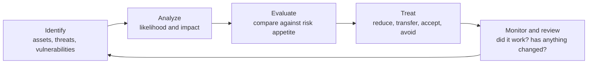

# Risk management

> [!TIP]
> **In short:** security work exists to manage risk, and risk is not the same thing as a vulnerability or a threat. **Risk is what happens when a threat meets a vulnerability and produces a consequence that matters to the organization**, and it can be reduced, transferred, accepted, or avoided, but never fully eliminated. Every other page in this knowledge base, every control, every detection, every hardening step, is ultimately a risk-reduction decision, and the discipline here is making those decisions explicitly and consistently instead of by gut feeling or whoever argued loudest in the meeting.

## The vocabulary, precisely

| Term | Meaning | Common confusion |
|---|---|---|
| **Asset** | Anything of value: data, a system, a process, reputation | Often under-scoped to just "servers," missing data and reputation |
| **Threat** | A potential cause of an unwanted incident (an actor, a natural event, an accident) | Often used interchangeably with "vulnerability," which it is not |
| **Vulnerability** | A weakness that a threat can exploit | Already covered technically in [Vulnerabilities and exploitation](../06-offensive-security/03-vulnerabilities-and-exploitation.md); here the concept is broader, including process and people weaknesses |
| **Risk** | The combination of likelihood and impact if a threat exploits a vulnerability against an asset | Not the same as "a bad thing that could happen"; risk is specifically that event's probability and consequence, together |
| **Control** | A measure that reduces likelihood, impact, or both | Confused with "requirement"; a control exists to change a risk's size, not to satisfy an auditor as an end in itself |
| **Residual risk** | What remains after controls are applied | Often forgotten entirely; no control reduces risk to zero |
| **Risk appetite** | How much risk an organization is willing to accept, in general, to pursue its objectives | A leadership decision, not a technical one |
| **Risk tolerance** | The acceptable variation around that appetite for a specific risk or category | More granular than appetite, and where most practical decisions actually get made |

**●●●** (ISO 31000, NIST SP 800-30 Revision 1.) Keeping these terms distinct is not pedantry: a report that says "we found vulnerabilities" where it means "we found risks" conflates a technical finding with a business decision, and the two need different owners and different language.

## Why this is a management discipline, not just a technical one

A security team can describe a vulnerability's technical severity (CVSS, as covered in [Vulnerabilities and exploitation](../06-offensive-security/03-vulnerabilities-and-exploitation.md)). Only the business can decide whether the resulting risk is acceptable, because that decision depends on information the security team does not own alone: how much would the consequence actually cost, what else competes for the same budget, and how much risk the organization has already decided it can tolerate. Risk management is the structured conversation that connects the two sides.

## The risk management process

This is a cycle, not a one-time project: new assets appear, new threats emerge, and treatments that worked last year can quietly stop working as the environment changes.

### Identification

List the assets that matter, the threats relevant to each, and the vulnerabilities that would let those threats succeed. This draws directly on earlier pages: [Adversaries and attack frameworks](../01-foundations/04-adversaries-and-attack-frameworks.md) for threat actor behavior, [Threat modeling](../01-foundations/03-threat-modeling.md) for a structured way to find vulnerabilities at the design level, and [Vulnerability and exposure management](../07-defensive-security/07-vulnerability-and-exposure-management.md) for the technical inventory.

### Analysis: qualitative and quantitative

| Approach | How it works | Strength | Weakness |
|---|---|---|---|
| **Qualitative** | Rates likelihood and impact on a scale (low, medium, high, or 1 to 5), often placed on a risk matrix | Fast, intuitive, needs little data, good for prioritizing a long list quickly | Ratings are subjective and hard to compare precisely; "high" means different things to different people |
| **Semi-quantitative** | Assigns numeric scores to qualitative categories to allow some math (multiplying likelihood and impact scores) | Slightly more comparable than pure qualitative | Still built on subjective inputs underneath the numbers |
| **Quantitative** | Expresses risk in real units, typically money and a time period, using calibrated estimation and statistical methods | Directly comparable to budget decisions; supports genuine cost-benefit analysis of a control | Requires more effort, more data, and the specific skill of calibrated estimation to avoid false precision |

**Open FAIR** (Factor Analysis of Information Risk), standardized by The Open Group, is the best-known quantitative model for information risk specifically: it decomposes risk into loss event frequency and loss magnitude, each broken into further factors, estimated as calibrated ranges and combined (often through simulation) into a distribution of probable annual loss, rather than a single misleadingly precise number. **●●●**

**Practical implication:** qualitative risk matrices are the right tool for a quick, broad prioritization pass across many risks; quantitative methods are the right tool when a specific, high-stakes decision (how much to spend on a specific control, whether to buy a specific insurance policy) needs a number the business can actually weigh against other spending.

### A simple qualitative matrix

| | Low impact | Medium impact | High impact |
|---|---|---|---|
| **High likelihood** | Medium | High | Critical |
| **Medium likelihood** | Low | Medium | High |
| **Low likelihood** | Low | Low | Medium |

Define, in writing, what "low," "medium" and "high" mean in your organization's own terms for both likelihood and impact (impact in money, downtime, regulatory exposure, or reputational terms) before using a matrix like this; an undefined scale just moves the subjectivity problem one level down without solving it.

## Treatment: four options, not one

| Option | What it means | When it fits |
|---|---|---|
| **Reduce (mitigate)** | Apply a control to lower likelihood or impact | The most common choice when a cost-effective control exists |
| **Transfer** | Shift some of the financial consequence to another party | Cyber insurance, contractual indemnification; transfers the financial impact, not the operational or reputational one, and not the obligation to still try to prevent the incident |
| **Accept** | Formally decide to bear the risk as it stands | When the cost of further treatment exceeds the risk's likely cost, or the risk is already within appetite; must be a documented, owned, time-bound decision, never silence |
| **Avoid** | Eliminate the risk by not doing the activity that creates it | Discontinuing a feature, a vendor relationship, or a data collection practice that is not worth the risk it creates |

A risk that is simply never discussed is not "accepted"; it is unmanaged. The distinction matters because an unmanaged risk has no owner and no review date, while an accepted one does.

## The risk register

A **risk register** is the operational tool that makes this process real rather than theoretical: a living, owned list, not a document written once for an audit and never opened again.

| Field | Content |
|---|---|
| Risk description | Specific enough to be actionable, not "cybersecurity risk" |
| Asset(s) affected | |
| Threat and vulnerability | What specifically could happen, and through what weakness |
| Likelihood and impact | Using your organization's defined scale |
| Current controls | What already reduces this risk |
| Residual risk rating | After existing controls, not before |
| Treatment decision | Reduce, transfer, accept, or avoid, with the specific action if reducing |
| Owner | A named person, not a department |
| Review date | When this entry gets reassessed, not "ongoing" |

Review the register on a schedule, and especially after any significant change: a new system, a new regulation, an incident, or a finding from [Vulnerability and exposure management](../07-defensive-security/07-vulnerability-and-exposure-management.md) or a penetration test. An accepted risk that is never revisited tends to quietly outlive the reasoning that justified accepting it.

## Third-party and supply chain risk, briefly

Risk does not stop at your own systems. A vendor, contractor or supplier with access to your data or systems carries risk you are still responsible for managing, through due diligence before the relationship starts and monitoring throughout it; this is developed further in [Policies, audits and third-party risk](03-policies-audit-and-third-party-risk.md).

## Connecting risk management to the rest of this knowledge base

| This page's concept | Where it becomes concrete elsewhere |
|---|---|
| Threats and vulnerabilities | [Adversaries and attack frameworks](../01-foundations/04-adversaries-and-attack-frameworks.md), [Threat modeling](../01-foundations/03-threat-modeling.md) |
| Technical vulnerability likelihood | CVSS, EPSS and KEV in [Vulnerabilities and exploitation](../06-offensive-security/03-vulnerabilities-and-exploitation.md) |
| Controls as risk treatment | Nearly every page in sections 2 through 9 describes a specific control |
| Formal frameworks for structuring this work | [Frameworks and standards](02-frameworks-and-standards.md), next |
| Risk that crystallizes into an actual event | [Incident response](../07-defensive-security/04-incident-response.md) |

## Practice

1. Build a risk register, using the fields above, for a system you actually run (a home lab, a personal project, a small organization you volunteer for), with at least eight distinct risks covering technical, people and process sources.
2. Rate each risk on a qualitative matrix you define yourself first, writing out explicitly what each likelihood and impact level means in concrete terms for that system.
3. For your three highest-rated risks, decide and justify a treatment (reduce, transfer, accept or avoid) and, for "reduce," name the specific control.
4. Pick one risk and attempt an Open FAIR-style quantitative estimate: a calibrated range for loss event frequency and loss magnitude, and a rough resulting annualized loss range, then compare how that changes (or does not change) your treatment decision versus the qualitative rating alone.
5. Set a review date for every entry in your register, and actually review it on that date.

These support the [GRC track](../../roadmap/phase-3-specialization/track-grc.md) of the roadmap.

## What to do with this

- [ ] Explain the difference between a threat, a vulnerability and a risk clearly enough to correct someone who conflates them.
- [ ] Build and maintain a risk register for something you are actually responsible for.
- [ ] Explain the four risk treatment options and give a real example of each.
- [ ] Explain why "accepted" and "ignored" risk are different, and what makes a risk acceptance legitimate.
- [ ] Attempt one quantitative risk estimate and explain what it added over a qualitative rating alone.

## Key references

ISO 31000 · NIST SP 800-30 Revision 1 · Open FAIR (The Open Group) · NIST SP 800-39. Full list in [References](../15-references.md).

<!-- navigation -->
[← Reverse engineering basics](../09-malware-and-reverse-engineering/05-reverse-engineering-basics.md) · [Index](../00-start-here.md) · [Frameworks and standards →](02-frameworks-and-standards.md)
