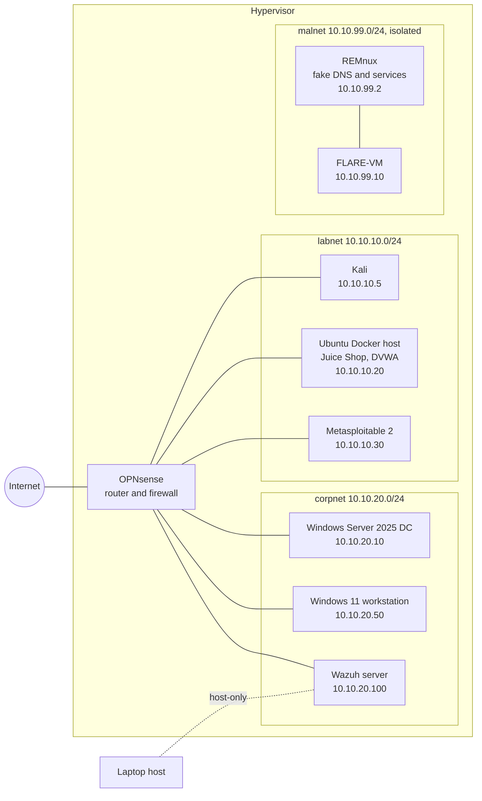

# Home lab

A home lab is where you practice attacks and defenses legally, break things without consequences, and build the projects that go into this portfolio. Everything here uses free software and free evaluation licenses. It is built in four stages so it can start on a modest laptop and grow.

## Hardware

| Resource | Minimum (stages 1-2) | Comfortable (all stages) |
|---|---|---|
| RAM | 8 GB | 16 GB or more; 32 GB if you want Security Onion |
| Free disk | 120 GB SSD | 300 GB SSD or more |
| CPU | 4 cores with virtualization enabled in BIOS/UEFI (Intel VT-x or AMD-V) | 6 or more cores |

Security Onion and most Windows images are x86-64 only, so an Apple Silicon Mac cannot run the full lab. On a laptop with 8 GB, run only two or three VMs at a time.

## Software

| Component | Cost | Notes |
|---|---|---|
| [VirtualBox 7.2](https://www.virtualbox.org/wiki/Downloads) | Free | The 7.2 line is current (7.2.22 was released October 2026); 7.1 has been unsupported since March 2026 |
| [VMware Workstation Pro](https://www.vmware.com/products/desktop-hypervisor/workstation-and-fusion) | Free for all users since November 2024 | Alternative to VirtualBox; download from the Broadcom support portal. Pick one hypervisor and stay with it. |
| [Kali Linux](https://www.kali.org/get-kali/#kali-virtual-machines) | Free | Prebuilt VirtualBox and VMware images; 2026.2 is the latest quarterly release |
| [Ubuntu Server LTS](https://ubuntu.com/download/server) | Free | Hosts Docker targets and the Wazuh server |
| [OPNsense](https://opnsense.org/download/) | Free and open source | Router and firewall between lab segments |
| [Wazuh](https://documentation.wazuh.com/current/quickstart.html) | Free and open source | SIEM and XDR. The 4.x all-in-one install needs at least 4 GB RAM and 2 cores for the server VM |
| [Splunk Free](https://help.splunk.com/en/splunk-enterprise/administer/admin-manual/10.4/configure-splunk-licenses/about-splunk-free) | Free | Alternative SIEM: 500 MB of indexing per day, no expiry; search is disabled after 3 license warnings in a rolling 30 days |
| [Windows Server 2025 evaluation](https://www.microsoft.com/en-us/evalcenter/evaluate-windows-server-2025) | Free for 180 days | Domain controller. Activate online within the first 10 days |
| [Windows 11 Enterprise evaluation](https://www.microsoft.com/en-us/evalcenter/evaluate-windows-11-enterprise) | Free for 90 days | Domain workstation |
| [OWASP Juice Shop](https://owasp.org/www-project-juice-shop/) and [DVWA](https://github.com/digininja/DVWA) | Free | Vulnerable web apps, run as Docker containers |
| [Metasploitable 2](https://docs.rapid7.com/metasploit/metasploitable-2/) | Free | Deliberately vulnerable Linux VM; old but still useful for practice |
| [REMnux](https://docs.remnux.org/) and [FLARE-VM](https://github.com/mandiant/flare-vm) | Free | Linux and Windows malware analysis environments |
| [GOAD](https://github.com/Orange-Cyberdefense/GOAD) | Free | Scripted vulnerable Active Directory. GOAD-Light is 3 VMs, 1 forest and 2 domains |
| [Security Onion](https://docs.securityonion.net/en/3/main/hardware/) | Free | Optional. Standalone needs at least 4 cores, 24 GB RAM and 200 GB of disk |

Evaluation licenses expire. Take a snapshot right after installing Windows so you can rebuild quickly, and note the expiry dates in your lab notes.

## Network design

The lab uses three kinds of virtual networks:

| Network | Hypervisor mode | Purpose |
|---|---|---|
| `NAT` | NAT | Internet access for updates. Only OPNsense and, temporarily, VMs being updated connect here |
| `labnet` | Internal network (VirtualBox) or LAN segment (VMware) | Attacker and targets. No direct internet access |
| `corpnet` | Internal network | Simulated company: domain controller, workstation, Wazuh |
| `malnet` | Internal network, not connected to OPNsense | Malware analysis only. Fully isolated |
| `host-only` | Host-only | Optional management access from your laptop to the Wazuh dashboard |



If the diagram does not render, the same layout in text:

```
Internet
   |
[OPNsense] ---- WAN: NAT (updates only)
   |-- labnet  10.10.10.0/24: Kali .5 | Docker host .20 | Metasploitable 2 .30
   |-- corpnet 10.10.20.0/24: DC .10 | Win 11 .50 | Wazuh .100
   x
malnet 10.10.99.0/24 (no router, no host access): REMnux .2 | FLARE-VM .10
```

**Firewall rules on OPNsense (starting point)**

1. `labnet` to internet: blocked by default. Open temporarily for updates, then close.
2. `labnet` to `corpnet`: allowed from Kali only, so you can attack the domain once that stage is ready.
3. `corpnet` to internet: blocked, except Windows activation during the first days and updates when needed.
4. Wazuh agents on `corpnet` and `labnet` to Wazuh server on TCP 1514 and 1515: allowed.
5. Log all blocked traffic. Reading those logs is part of the practice.

## Build stages

### Stage 1: Attacker and web targets (8 GB is enough)

1. Install the hypervisor and import the Kali VM image.
2. Create an Ubuntu Server VM with Docker and run Juice Shop bound to the lab interface:

   ```bash
   docker run -d --name juice-shop -p 10.10.10.20:3000:3000 bkimminich/juice-shop
   ```

   Run DVWA with the Docker instructions in its README.
3. Put both VMs on `labnet` with static addresses. To check isolation, run [`scripts/check-isolation.sh`](scripts/check-isolation.sh) inside each VM.
4. Snapshot both VMs ("clean install").

### Stage 2: Router and detection

1. Add OPNsense with one NIC on `NAT` and one on each lab network. Move routing and DHCP to it.
2. Install Wazuh on a new Ubuntu VM in `corpnet` following the quickstart, and enroll agents on the Docker host and Kali.
3. Generate activity from Kali against the Docker host (failed SSH logins, a web scan of Juice Shop) and find it in Wazuh.

### Stage 3: Active Directory

1. Install Windows Server 2025 from the evaluation ISO, promote it to a domain controller for `lab.local`, and create users and groups.
2. Join the Windows 11 evaluation VM to the domain. Install the Wazuh agent and Sysmon on both.
3. Later, replace or extend this with GOAD-Light for a ready-made vulnerable forest. Plan for roughly 115 GB of disk for GOAD, plus snapshots.

### Stage 4: Malware analysis enclave

1. Create REMnux and FLARE-VM on `malnet` only. Install FLARE-VM while it still has temporary internet access, then disconnect that adapter permanently.
2. Configure REMnux as the DNS server and fake internet services for FLARE-VM so samples that try to reach the internet talk to REMnux instead.
3. Disable shared folders, shared clipboard and drag and drop on both VMs.
4. Snapshot both before every analysis and revert after.

## Safety rules

- Never bridge a vulnerable VM to your home or university network. Vulnerable services must not be reachable from anything except the lab.
- Never expose lab ports on the host's public interfaces. Bind containers to lab addresses, as in the Juice Shop example.
- Keep malware only inside `malnet`, stored in password-protected archives (the common convention is the password `infected`), and never on the host.
- Update the hypervisor regularly; VM escape vulnerabilities do exist.
- Take snapshots before any risky change. Use [`scripts/snapshot-all.sh`](scripts/snapshot-all.sh) with VirtualBox.
- Attack only your own lab, or platforms and programs that authorize it. See [legal-and-ethics.md](../legal-and-ethics.md).
