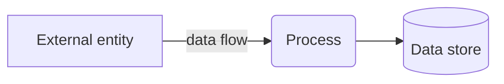

# Threat model: <system or feature>

Author: <name>  ·  Date: <date>  ·  See [Threat modeling](../docs/01-foundations/03-threat-modeling.md) for the method.

## 1. What are we building?

A data-flow diagram: external entities, processes, data stores, trust boundaries.

## 2. What can go wrong?

STRIDE per element that crosses a trust boundary.

| Element | S | T | R | I | D | E | Notes |
|---|---|---|---|---|---|---|---|
| | | | | | | | |

## 3. What are we going to do about it?

| Threat | Severity | Mitigation | Status |
|---|---|---|---|
| | | | |

## 4. Did we do a good job?

- [ ] Every trust boundary in the diagram was reviewed.
- [ ] Every high-severity threat has a mitigation or an accepted-risk decision.
- [ ] This model is scheduled to be revisited (date: <date>) or on the next significant design change.
